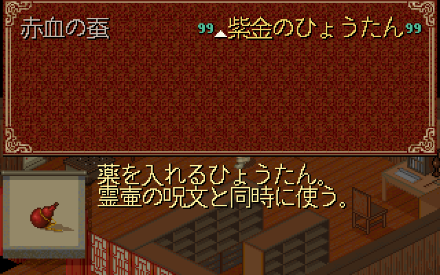
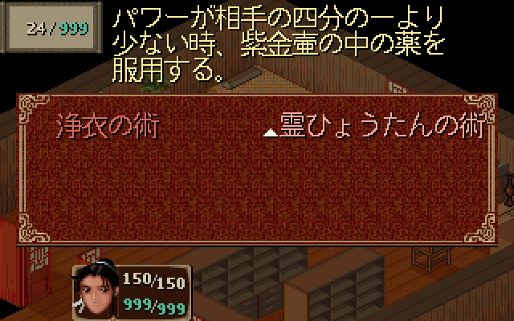

# Issue #2：日文转换工具与可复现基线

2026-10-20，关联 [#2](https://github.com/othercat/sdlpal-jp/issues/2)、[总管 #1](https://github.com/othercat/sdlpal-jp/issues/1)。

**三个 Release 脚本已原样纳管，Win SLF 已完整复现；GUI 的工作目录、复制路径、子进程编码和失败中止问题已修正。** 没有改变日文映射、文本内容或 Steam 转换算法。

以上是 #2 合入时的记录。随后 [#3 恢复遗漏映射](japanese-missing-dialogues.md)修改了当前转换器：默认输出新增 119 组，`--upstream-baseline` 保留逐字节相同的上游输出。`verify_baseline.py` 使用该审计模式并记录当前脚本指纹；本页原始导入 SHA 和历史测试结果继续保留。

用户已将验收调整为：全部子 Issue 的实现及专项验证完成后，再统一进行实机验收。实现完成的 Issue 保持开放，等待统一验收，不阻塞下一项实现。本轮没有进行实机游戏流程验收。

## 来源与未修订起点

来源是 [PalMusicFan/sdlpal v2026.08 Release](https://github.com/PalMusicFan/sdlpal/releases/tag/v2026.08)，2026-10-20 重新下载附件，逐项核对 GitHub 提供的 digest、旧审计文件和初始 Git blob；三者相同。

| 附件 | 字节数 | SHA256 |
| --- | ---: | --- |
| `makemessage_j.py` | 27100 | `c6957be6eb3081c111509353e89d8559e5744e07d828bd0c9afb1ae415cdc149` |
| `rungui.py` | 12233 | `93148d91d24219a66036f4d3fcbf21920318f9f972ce9fdd92ecd6dad35a4e99` |
| `steam_to_legacy.py` | 15456 | `6e80a2c965a39fc8ce405ec3459bb9486fdf377fc03591466793f12ed87ab542` |

未修订导入提交：[2e0b004d8253140ae762735c2a0e061f2e984a7e](https://github.com/othercat/sdlpal-jp/commit/2e0b004d8253140ae762735c2a0e061f2e984a7e)。`.gitattributes` 对三个附件关闭文本换行转换，保留原 LF/CRLF 和上游尾随空白；原样导入时的空白提示单独归档，没有为了消除提示修改源文件。

来源、asset ID、时间、许可说明、原始指纹及基线输入见 [`tools/japanese/upstream.json`](../tools/japanese/upstream.json)。GUI 原声明保留，两个 CLI 没有独立许可证版本头，未虚构作者或重新许可。后续 GUI 修改单独提交，两个 CLI 字节保持原样。

## 可复现转换

环境为官方 CPython 3.11.9、`C:\Users\other\CodexTools\python`，基础解释器为官方 Python311，Tcl/Tk 8.6 可导入。工具仅依赖标准库；检查入口不需要 Tk 窗口。

[`verify_baseline.py`](../tools/japanese/verify_baseline.py)要求下列固定资源，先核对 SHA256 再运行转换器。输出必须使用输入目录以外的全新目录；复核结束后再次确认这 **7 个输入文件**未改变。

| 输入 | 格式与用途 |
| --- | --- |
| Win `SSS.MKF` / `M.MSG` / `WORD.DAT` | 指定 `PAL98_v1.72_20261014`，GBK，原 Win 消息编号 |
| 土星 `JM.SEC` / `JM.NOR` | 大端脚本，按上游顺序拼接 |
| 土星 `JM.MSG` | Shift-JIS 消息，沿用上游去零字节处理 |
| 土星 `PROG.BIN` | 固定位置的消息索引和 16 字节名称记录 |

实际运行：

```powershell
& (Join-Path $env:USERPROFILE 'CodexTools\python\Scripts\python.exe') -B -X utf8 tools\japanese\verify_baseline.py 'D:\PAL\完整包\PAL98_v1.72_20261014' 'D:\Workspace\KnowledgeRoots\PAL\PalMusicFan\sdlpal\artifacts\saturn-japanese-audit-20261020\saturn-extracted' 'D:\Workspace\PALWork\artifacts\sdlpal-jp-issue-2\tool-baseline-r1-20261020\baseline-run'
```

该输出目录现在已有证据，复现时需改用新的目录。运行参数、解释器、输入和输出指纹写入 `verification.json`，标准输出/错误保存在 `converter.log`。脚本也检查退出状态、新文件和完成标记，避免上游部分读取失败分支返回 0 时误报成功。

| 结果 | 值 |
| --- | --- |
| 原始 SLF 字节数 | 1,230,303 |
| 消息块 / 唯一区间键 | 4,654 / 4,647 |
| Windows 原始 SHA256 | `f15a22cb2e999680119e08bae021cb61f366d6f45655ef4e33019472e9388c54` |
| 统一 LF 后 SHA256 | `55694eb786d2a8458324ecc40062a2cc912ed0538f830a68185085a37e90f7b4` |
| 与旧审计关系 | Windows 文件逐字节一致；7 个输入指纹未变 |

原始输出保留已知的 119 组遗漏、10 组错配、重复键和译文问题。复现成功说明起点可靠，不代表这些问题已修复。Win 编号不能当成 DOS 编号；实际把现有 PAL_DOS 资源交给核对入口时，返回明确的 `PAL_DOS` 错误且不创建输出目录。错误编码、输入版本改变、缺失土星资源同样被拒绝。

## GUI 与 Steam 入口验证

GUI 原先依赖进程工作目录查找子脚本，且 Steam 转换成功后从错误目录复制生成文件；异常被吞掉后仍可能启动主转换器。本轮只修改 `rungui.py` 的入口处理：

- 三处子脚本路径相对于 `__file__`，两处复制源使用 PC 资源目录。
- 消息或词表转换失败、复制或启动异常上抛到已有 `generate()` 错误处理，停止后续生成。
- 真实日文路径测试发现 Windows 代码页与父进程 UTF-8 不一致；三个子进程统一 `-X utf8` 和 UTF-8 管道解码，读完后关闭 stdout。

[`test_japanese_conversion_tools.py`](../tests/test_japanese_conversion_tools.py)的 **9/9 项测试通过**。它提取源码中的真实回调函数，以测试对象代替 Tk 控件，实际执行 Steam 子进程；没有直接 import 顶层创建窗口的 GUI 文件。覆盖不同工作目录、日文路径、GBK/BIG5、MSG/WORD 字节输出、超长输入拒绝、缺少路径、准备失败后停止及基线保护。

Steam 成功样例是可审查的小夹具：36 字节 SSS、无 BOM UTF-16LE 的 `0:A / 1:xy / 2:` 消息和 `0:甲 / 1:A:B` 词表。消息结果为 `41 20 78 79 20`，词表为两个各 10 字节记录。没有用合成夹具冒充真实 Steam 整包。

另在独立的 `gui Win 日本語` 工作副本中，通过真实 `generate()` 回调和真实 `makemessage_j.py` 子进程完整生成 Win SLF。工作目录不在工具目录，输出 SHA256 与上表一致，原始 7 个输入及 3 个 Win 副本均未改变。此项证明完整生成回调可用，Tk 窗口控件与交互留待统一验收。

上游 Steam 算法仍有输入限制：BOM、缺失/稀疏/负编号、空消息没有完整拒绝机制，重复编号最后一条生效；准备过程不具备事务性。完整说明和命令见 [工具用法](../tools/japanese/README.md#steam-文本入口)，必须使用版本匹配、编号完整的输入，不能只看退出 0。此次保留算法以固定基线；没有把它声明为任意 Steam 文件的修复器。

## 生成文件的源码加载

新生成的原始 SLF 经过现有 [赤血蚕适配器](../tools/adapt_red_silkworm_description.py)后，得到与 #5 相同的指纹：

`f4ffb5753a1a168a23a27426aa6163cd35c35a85d3fd5a8d5f69c0ef2e7f595e`

复用 #5 R7 的 Test x64 程序；C/C++ 和 Test 出图文件的 Git 内容与该构建一致，本轮未重新构建引擎。实际加载新 SLF 后，`jp-cursor-grid` 的 8 个状态、2 张密排图、30 张缩放图全部通过，26 个名称位置／208 字符／11,080 个正文墨点完整，游标遮字为 0。

| 新生成 SLF：物品源码图 | 新生成 SLF：法术源码图 |
| --- | --- |
|  |  |

源码加载第一次使用含中文的绝对资源路径时，旧 Test 引擎报 `File open error(2): fbp.mkf`，该任务进程已终止；改用既有 ASCII 路径副本后通过，副本中 17 个实际使用文件与原包逐项 SHA256 相同。转换器与 GUI 回调本身已通过中文／日文路径；本轮未修复引擎的绝对路径兼容性。图来自隐藏渲染目标，不代表游戏交互验收。

## 追溯与剩余验收

实施基线为 `feature @ ed6374f2a0507974d9db02736696a39ee4e04712`，分支 `richardli/feat/2-version-japanese-conversion-tools` 从原建单起点快进到该最新基线后实施。原始导入与后续修订分别提交，最终实现/合并 SHA、普通合并方式、远端祖先检查及清理记录保存在 [Issue #2](https://github.com/othercat/sdlpal-jp/issues/2)。

完整证据见 [manifest](evidence/issue-2-conversion-baseline.json)。本机归档：`D:\Workspace\PALWork\artifacts\sdlpal-jp-issue-2\tool-baseline-r1-20261020`，包含下载原件、基线/GUI 输出、正负例日志、源码图和输入指纹；没有将原游戏资源或生成的完整译文打包入库。

#2 保持开放，待所有子 Issue 实现完成后由用户统一验收。剩余实际验收包括 Tk 窗口操作、真实 Steam 文本整包转换及游戏加载/流程；本轮工具与源码验证不提前代替这些结果。
