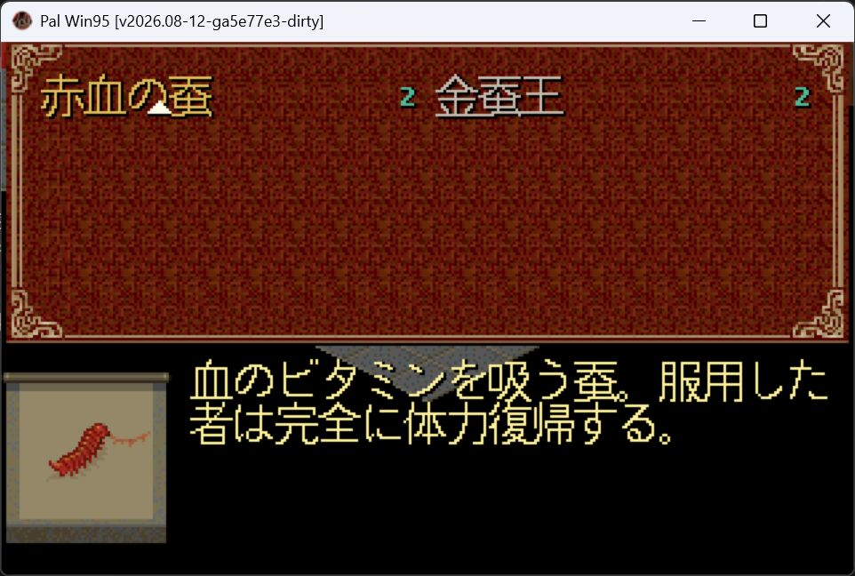
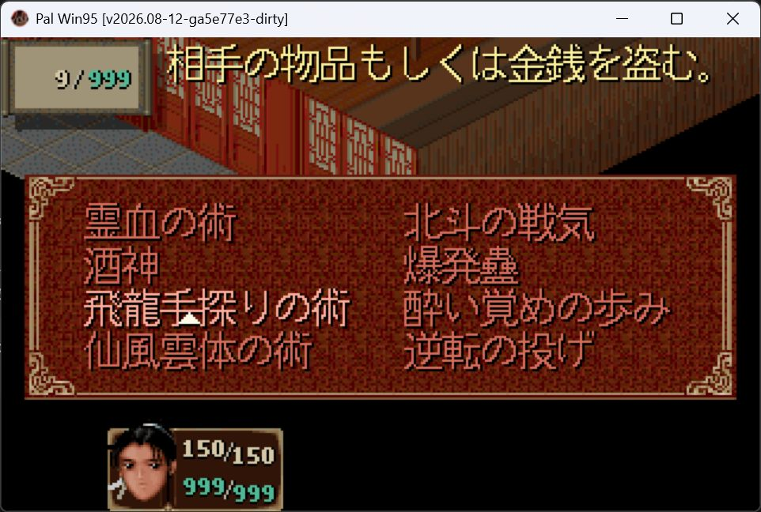

# Issue #5：日文说明的实际游戏验收

2026-10-20，关联 [#5](https://github.com/othercat/sdlpal-jp/issues/5)、[总管 #1](https://github.com/othercat/sdlpal-jp/issues/1)。这是 Issue 的 R5 记录；本机产物目录名 `gameplay-r3-20261020` 沿用工作目录编号。

**赤血蚕在实际 SDLPAL 游戏中完整显示两行；用户逐项确认 10 个受影响法术的说明右端、底部及 MP 框均完整。** Codex 保存并检查了赤血蚕与「飛龍手探りの術」两张代表性实机图。其余九个法术的实际操作结论明确来自用户确认，不冒称逐项都有 Codex 截图。

本轮没有新改绘制或文本代码。被测构建包含既有 [83–87 布局实现](japanese-description-layout-verification.md)，加载[赤血蚕适配后的 SLF](japanese-red-silkworm-layout.md)。日文菜单专项结果推进验收；8 全角长名称的实际菜单样本和完整游戏流程仍未覆盖，#5 保持开放。

## 被测构建与资源

| 项目 | 记录 |
| --- | --- |
| 引擎 | 本仓 Release x64，VS 2026 / v145；真实游戏主循环，不是 Test 出图入口 |
| 产品源码基线 | `a5e77e3b8aea26399c1b2de1b777479eace7fd9a`，已包含 #5 的布局合并及 SLF 适配工具 |
| exe SHA256 | `a3aebcc48ff0b688ecded5f7ffd47956c1818633c0ad0098775f681dc74806ea` |
| 窗口版本文字 | `v2026.08-12-ga5e77e3-dirty`；构建时仅有 #10 的 Test 渲染器未提交改动，该文件在非 Test 配置排除。`dirty` 不表示本轮改了产品绘制逻辑 |
| 操作系统 | Windows 11 Pro 10.0.26200，DPI 144 |
| 游戏资源 | `D:\PAL\完整包\PAL98_v1.72_20261014` 根资源，实际副本 17/17 文件 SHA256 一致；未复制未被引擎读取的备份 `ABC-ori.MKF` |
| 日文 SLF | `paljpn-win-adapted.slf`，SHA256 `f4ffb5753a1a168a23a27426aa6163cd35c35a85d3fd5a8d5f69c0ef2e7f595e` |
| 字形 | SLF 指定 `FontFlavor=Japanese`、`UseISOFont=0`，内置 16px，无外部 FontFile |
| 布局 | `81=2,0`、`82=1,0`、`83=3,0`、`84=30,14`、`85=5,14`、`86=31,14`、`87=70,0` |
| 测试存档 | R2 的离线测试夹具，第一槽；SHA256 `9d19a620534b7108fdb77b641456fdf362c3764f9f6ae7cf8b816243c4ae4318` |

使用独立目录 `D:\Workspace\PALWork\artifacts\sdlpal-jp-issue-5\gameplay-r3-20261020\runtime`。测试存档只预置 MP、背包和目标法术；11 个目标对象的 7 WORD 对象记录与根 SSS.MKF 对照全部相同，避免旧存档覆盖说明脚本入口。实际加载后存档 SHA 未变。它不是自然剧情获得全部物品/技能的证据。

启动必须以 runtime 为工作目录，让程序读取该处 `sdlpal.cfg`。最初直接按路径启动显示默认启动器，退出后改用明确工作目录启动，才进行以下验收。配置完整副本及哈希见 [manifest](evidence/issue-5-runtime-verification.json)。

```ini
LaunchSetting=0
WindowWidth=640
WindowHeight=400
TextureWidth=320
TextureHeight=200
FullScreen=0
KeepAspectRatio=1
ScaleQuality=0
EnableGLSL=0
EnableAviPlay=0
UseTouchOverlay=0
MusicVolume=0
SoundVolume=0
```

`GamePath`、`SavePath` 指向该隔离 runtime，`MessageFileName` 指向其中适配 SLF。截图保留原始 JPEG、窗口边框和标题；在本机 DPI 下实际游戏区为 960×600，不能把配置 640×400 当作采集像素尺寸。

## 实际操作与结果

用户手动进入「続きの物語」并载入第一槽。SDLPAL 的状态轮询未捕获工具的短按，因此实际菜单导航由用户完成，Codex 负责核对窗口进程路径、保存截图和检查可见内容。

1. 按 E 打开物品菜单，选中对象 149「赤血の蚕」。
2. 退出物品菜单，按 F、确认角色，逐项检查下表十个法术。
3. 最后停在「飛龍手探りの術」，采集法术说明、MP 框、双列列表及角色状态。

| 对象 ID | 当前日文名 | 验收依据与结果 |
| ---: | --- | --- |
| 149 | 赤血の蚕 | 用户操作 + Codex 实机图：两行完整，两列菜单正常 |
| 306 | 浄衣の術 | 用户逐项确认说明右端、底部及 MP 框完整 |
| 307 | 冷心の術 | 同上 |
| 308 | 霊血の術 | 同上，原基线的两条裁切行均在此次检查范围 |
| 311 | 北斗の戦気 | 同上 |
| 370 | 酒神 | 同上 |
| 374 | 爆発蠱 | 同上 |
| 377 | 飛龍手探りの術 | 用户确认 + Codex 实机图：说明句末「盗む。」及 MP `9 / 999` 完整 |
| 390 | 酔い覚めの歩み | 用户逐项确认说明右端、底部及 MP 框完整 |
| 393 | 仙風雲体の術 | 同上 |
| 394 | 逆転の投げ | 同上 |

赤血蚕的第一行结束于「した」，第二行从「者」开始；与源码前后验证中保留全文、移动一个换行的结果一致。



法术说明整体使用日文布局的左移起点，左侧 MP 框与说明分开。当前为非战斗菜单，部分法术名为不可使用颜色；它们仍显示说明，不将灰显误判为字形问题。



## 验证和剩余边界

- Release x64 构建成功，0 错误，日志记录 26 条现有构建警告；未把警告写成零。运行文件与构建产物 SHA 相同。
- 实际副本 17 个根资源、SLF、存档和配置指纹归档；原目录连同 `ABC-ori.MKF` 的 18 个指纹仍与 R2 一致。11 个对象的存档/根资源记录一致；未更改原安装或 PALDLL 仓库。
- 既有 R4 的 296 对象 / 793 行静态结论保留：正文和纯阴影越界均为 0。本轮没有重跑该全量审计，也没有把它改标为 296 对象逐项实机检查。
- [#10 R3](pal98-dialogue-pagination-scaling.md)补齐指定中文/日文普通对白分页、控制符、缩放源码验证及 PAL98 + PALDLL 对照；不能作为 SDLPAL 全路线实机通过。
- 本轮可见名称最长为 7 个全角字符。8 全角名称「紫金のひょうたん」（270）和「霊ひょうたんの術」（384）不在当前测试存档中，仍需实际菜单验证。
- 完整路线、战斗施法、其他字体/FontFile、DOS、土星原生画面和 SDLPAL OS 层窗口 resize/DPI 未测试，不标为通过。

人工操作时 Esc 会同时停止窗口控制工具；这导致两次采集轮次中断，不是游戏崩溃。工具恢复后通过进程完整路径重新选中 SDLPAL，置前确认画面才保存。后续配合采集时可用游戏已有的 Insert 菜单键退出，减少这种冲突。

全部构建、runtime、两张原始截图、配置及对象核对结果保留在 `D:\Workspace\PALWork\artifacts\sdlpal-jp-issue-5\gameplay-r3-20261020`。引擎日志日期月份使用 `tm_mon`（0 起点）直接格式化，显示月份少一；本次验收日期按客户端 **2026-10-20** 记录，没有修改日志或顺带修复该独立问题。

独立分支 `richardli/fix/5-runtime-description-acceptance-r3` 从 #10 R3 合入后的最新 feature 创建，只提交本单文档、实机图片及 manifest。实现与普通合并 SHA、清理和剩余验收回写 #5 / #1；原布局与 SLF 修复 SHA 保留供重开定位。
