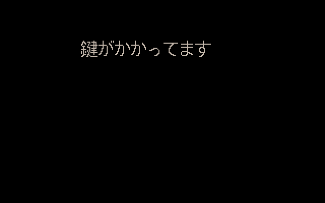
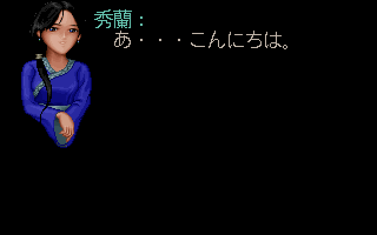
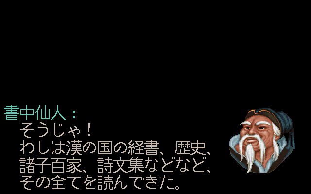
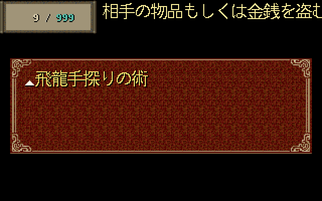
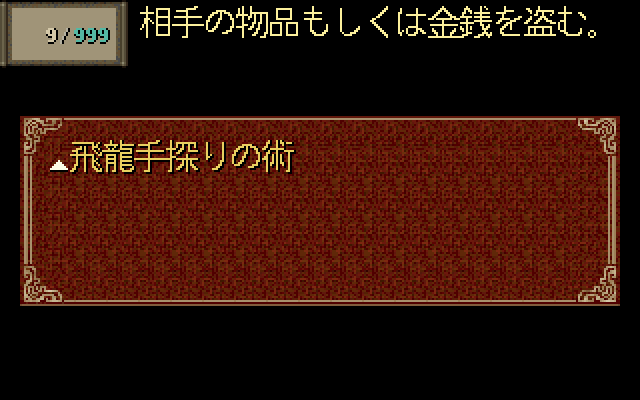
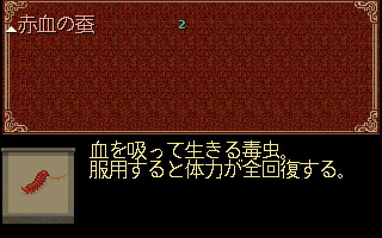
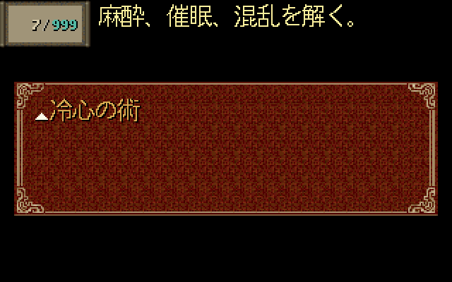
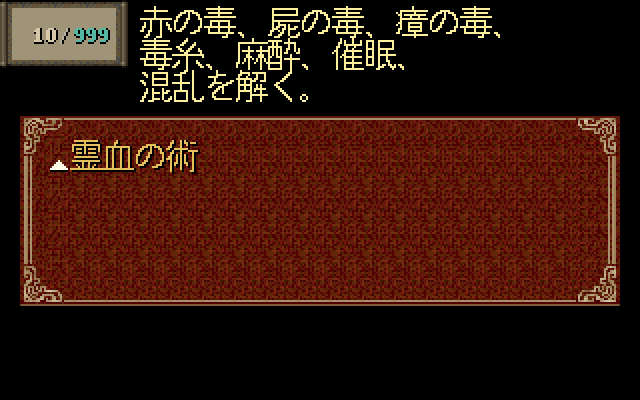

# Issue #7：PAL_DOS 独立日文映射与版本保护

2026-10-21，关联 [#7](https://github.com/othercat/sdlpal-jp/issues/7)、[总管 #1](https://github.com/othercat/sdlpal-jp/issues/1)。

**DOS 的 4,476 个运行时消息键已有独立处置，源码引擎全部命中。** 其中 4,471 组使用对应日文，5 组保留原资源中的 ASCII 占位／标记。另提供 296 条对象说明，修正 DOS 有说明法术菜单的布局。原游戏资源及战斗脚本未修改；实机路线验收仍由用户在所有 Issue 实现后统一进行。

## 来源与处置

生成入口是 [`makemessage_dos.py`](../tools/japanese/makemessage_dos.py)，逐组清单是 [`dos-map.json`](../tools/japanese/dos-map.json)。它读取固定 Steam PAL_DOS（CP950）、PAL98 v1.72_20261014（GBK）和土星提取资源，先验证整文件 SHA256，再校验 DOS／Win／土星的具体脚本跨度、消息首尾与原文指纹。DOS/Win 的 DATA.MKF 也纳入版本检查，防止将已核对的机制说明套给其他资源。

Win 资源用来复现已有 #3、#4、#6、#8 的审订译文；转换过程生成临时 Win SLF，并检查其去除版本标签后的整体指纹。DOS 逐组映射使用自己的消息 ID，生成时不运行模糊搜索、不按全局偏移换算。修改资源、清单锚点或共享译文后，应重新校读清单，不能取消保护强行生成。

| 处置 | 组数 | 依据 |
| --- | ---: | --- |
| 简繁、空白、标点及文字控制码规范化后正文对应 | 3,419 | 原文身份及具体脚本锚点；控制码仅用于比较，不据此改写输出 |
| 额外正异体对应 | 799 | 如麽／么、後／后、屍／尸，原文字节仍保留在来源指纹中 |
| 阅读 DOS、Win、日文后确认的版本措辞／讹字差异 | 252 | 完整差异见[来源复核](evidence/issue-7-source-review.json)；确认对应关系，不等于全剧本译文审校 |
| DOS 说话者专属修订 | 1 | DOS 1741–1742 是「秀蘭」，Win 1160–1161 是「香兰」；只把日文姓名改为「秀蘭」 |
| 原样保留的无对应标记 | 5 | DOS 1、2、3、4 为 `?(2)`、`?(4)`、`?(2)`、`?(3)`；5965 为 `EGIN` |

五条标记没有确认的土星对应，不能用相邻的空箱、钱币或乘船对白代替。`EGIN` 后真正的乘船提示是 DOS 5966，现已单独映射。它们被明确列入覆盖统计，不能称为五条已译日文。

原审计的旧 Win SLF 在 DOS 上只有 320 个键偶合。以 #6 完成后的 Win SLF 重测时是 **331 个键偶合／4,145 个缺失**；偶合依旧不代表语义正确。DOS 键 0 的「此門已上鎖」应对应 Win 12221 和日文「鍵がかかってます」，不能显示 Win 开场呼唤。

十组 NPC 使用 #4 的中文补译，不把当时错误套用的土星段称为正确译文来源。土星脚本 8657–8663 沿用既有转换器跨两个消息组的特殊拼接：核对 8660 的 `0037(40,46,8)`，使用后续原始 `008E` 作为 CLEAR；没有执行该移动指令或修改脚本。

## 名称、说明与 DOS 差异

[独立对象复核](evidence/issue-7-description-review.json)核对了全部 565 个 WORD 槽。两版对象身份一致，DOS 对象是 6 WORD，Win 是 7 WORD；DOS 原始记录没有 Win 描述指针。日文名称可按已审对象身份复用，描述必须写入 SLF 的 `[DESCRIPTIONS]`，用**十六进制对象 ID**作为键、`*` 分行，不能复制 Win 说明消息 ID。

296 条说明包括 233 个物品、63 个法术，其中 294 条沿用共享译文，以下两条根据 DOS 实际脚本调整：

| 对象 | DOS 原始指令依据 | DOS 说明 |
| --- | --- | --- |
| 307 冰心诀 | 39362–39365 清除状态 `0,1,2,0`；Win 对应为 `0,1,2,3` | `麻酔、催眠、混乱を解く。` |
| 308 灵血咒 | 42098 解毒，42099 跳至上述 39362 | `赤の毒、屍の毒、瘴の毒、`<br>`毒糸、麻酔、催眠、`<br>`混乱を解く。` |

因此 DOS 说明不写「術封じ」，也不为统一文本修改原资源的状态效果。酒神在第九次使用后的移除操作数也有版本差异；现有说明未承诺该行为，故保留并记录边界。

296 个描述 ID 中，281–283 在 DOS 是零对象记录，保留其身份说明不代表可以正常取得。另有 36 个非零对象没有现成 Win 说明，包括 277 青龍碧血玉及 35 个法术，清单逐项记录，不补造内容。

DOS 有说明的法术分支原来硬编码 `x=102` 和 MP 框坐标。本轮让它读取已有 83–87 参数；日文使用 `x=70` 及较窄 MP 框，中文默认值仍等于旧坐标。无说明分支、物品说明 `x=75`、Win 绘制分支不变。

## 输入与加载保护

新 Win CLI／GUI 输出带 `ResourceVersion=WIN95`，DOS 输出带 `ResourceVersion=DOS`。`PAL_InitText` 在分配文字／应用布局前预检标签；资源与标签不匹配时返回错误。**历史未标记 SLF 继续兼容，也因此没有版本误配保护**，不要把历史审计产物用于 DOS。

Win CLI 的固定映射现也先验证已审 Win／土星输入和 GBK 编码。原 `big5` 参数仍由参数解析器识别，但不再允许给当前固定 Win 映射静默套用；DOS 使用独立入口和固定 CP950。四种历史审计模式的字节输出均保持原样、未添加标签。

## 使用与复现

以下路径均需替换为本机资源／产物位置。输出目录必须尚不存在且位于输入目录之外；输入资源只读。DOS 入口需要 Win 资源作为共享审订译文的可验证桥接，不接收任意外部 SLF。

```powershell
$jpPython = Join-Path $env:USERPROFILE 'CodexTools\python\Scripts\python.exe'
& $jpPython -B -X utf8 tools\japanese\makemessage_dos.py 'DOS资源目录' 'Win资源目录' '土星提取目录' '新的生成目录'
& $jpPython -B -X utf8 tools\japanese\verify_dos_rendering.py 'Test版sdlpal.exe' '生成目录' 'DOS运行资源目录' 'Win运行资源目录' '新的源码渲染目录'
```

加载 DOS 产物时，在工作副本的配置中选择 `MessageFileName=生成目录/paljpn-dos.slf`。默认 Japanese 16px、`UseISOFont=0` 和布局均来自该 SLF。GUI 当前只提供 Win 转换，DOS 使用上述 CLI。

生成目录另含 `paljpn-win.slf`、来源报告、完整预期文本及渲染夹具。`audit-wrong-win.slf` 是**专门复现旧版误用的未标记审计输入**，不是游戏用 DOS 译文。

本次构建使用 VS 2026、v145、x64 Test；源码验证不创建可见窗口、不输入游戏按键、不写存档。对白采用真实消息查表、分页／CLEAR、字体和 SDL Direct3D 缩放路径；菜单通过生产绘制函数显示。中性背景及内存物品／法术列表不是自然流程或实际存档。

## 源码图与验证结果

所有图为重新打开校验过的不透明 RGB PNG，文字来自上述引擎绘制。左列为**误用 Win 映射**或**同一 DOS 文本使用旧硬编码坐标**的夹具，右列为本轮结果。

| 样例 | 原错误映射／坐标 | 独立 DOS 映射／日版布局 |
| --- | --- | --- |
| 锁门提示，DOS 0 |  |  |
| 秀蘭，DOS 1741–1742 |  |  |
| 比武 NPC，DOS 3296–3297 |  |  |
| 书中仙，DOS 9449–9458 第一页 |  |  |
| 飞龙探云手 377，同一 DOS 说明 |  |  |

赤血蚕完整说明及 DOS 专用冰心诀、灵血咒：





[完整验证清单](evidence/issue-7-verification.json)保存输入／输出／二进制指纹、命令、读回结果、图片索引与边界。38 张 PNG 全部纳入[图片目录](images/dos-mapping/)。

| 检查 | 结果 |
| --- | --- |
| DOS 源码实际查表 | 4,476 键、16,932 个正文／CLEAR 条目全部匹配预期；无缺键 |
| 对象描述查表 | 296 个十六进制 ID／完整文本全部匹配 |
| 描述横向及底部越界探针 | 旧坐标 5 对象、163 个正文墨点；新布局 0 |
| 生产菜单文字保留 | 10 个代表菜单逐墨点检查通过，说明未被菜单／MP 框遮盖 |
| 源码图 | 8 组对白、10 个菜单，38 张不透明 PNG；2×／3×像素一致，2.5×检查输出尺寸 |
| 资源版本反向加载 | Win 标签＋DOS 资源、DOS 标签＋Win 资源均在文字加载前拒绝 |
| Win 回归 | 全部 4,766 有效键一致；100 张各尺寸源码 BMP 与 #6 结果逐像素一致 |
| 转换工具回归 | 四种历史产物逐字节一致；真实 GUI 回调与当前 CLI Win 结果逐字节一致 |
| 错误输入／验证保护 | 错编码、互换资源目录、原文件保护、非标签位置换行变化拒绝通过 |
| 自动化测试 | 17 个 Python 测试、5 个 C++ 测试通过 |
| 原始资源 | 生成及渲染前后指纹一致 |
| 实机路线 | 未执行；统一验收待用户进行，Issue 保持开放 |

## 仍需区分的边界

本轮确认 DOS 与共享译文的对应，不是重新翻译全部土星对白。复核中发现的「阿青／若い頃の霊児」「十赌九输」「不要离开七步以外」「陌生人／村の人」四项原译候选已由 [#6 R2](japanese-translation-followup.md)核实并同步修正 Win／DOS；仅桥接指纹和四组译文来源标签更新，锚点及所有说明不变。本页及其验证清单保留 #7 首轮结果，新译文和 28 张前后图见 R2 记录。

统一实机验收时，仍应使用明确构建／SLF 指纹覆盖 DOS 开场、主要剧情转折、物品／法术、对白分页和长名称，并记录路线、设备、资源、配置和结果。当前固定版本以外的 DOS/Win 资源、其他字体、全流程、战斗效果和头像重配色未在本轮验收。
