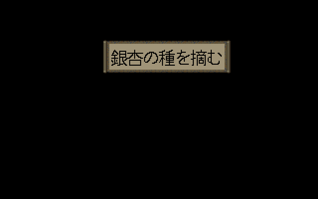
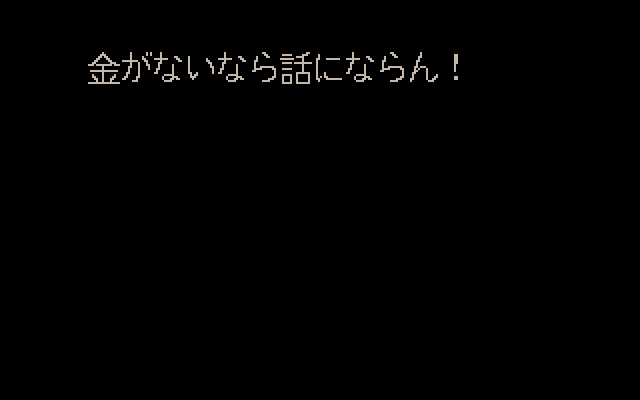
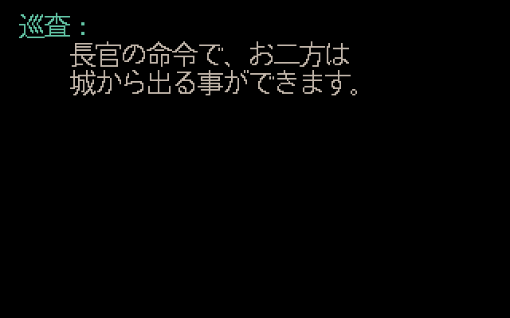

# Issue #8：重复消息键冲突

2026-10-20，关联 [#8](https://github.com/othercat/sdlpal-jp/issues/8)、[总管 #1](https://github.com/othercat/sdlpal-jp/issues/1)。

**仅修改两条后出现的 MESSAGE 正文，语义冲突从 2 个降为 0。** 4,773 个消息块、4,766 个唯一键、六个复用键及原来源注释全部保留；四个正常同文键不改。采用已有土星原文的中性“獲得”，没有新增补译。实机验收由用户在所有 Issue 实现后统一进行。

## 原版与土星来源

原 Win 中，开箱和地图采集分别复用“获得灵山仙芝”“获得银杏子”。土星分成“獲得”和“摘む”，但此 SLF 映射键只有 Win 消息区间，不包含场景或事件，所以采集用语会覆盖开箱用语。“獲得”只描述共同取得结果，适合两种路径。

| Win 键 | 出现次数 | 全部 Win 消息组入口 | 原土星来源 | 处置 |
| --- | ---: | --- | --- | --- |
| 4931–4931 | 2 | 14579, 43542 | JP6455–6455 / 脚本15813 | 保留各块及相同正文 |
| 4932–4933 | 2 | 14581, 43544 | JP6456–6458 / 脚本15815 | 保留各块及相同正文 |
| 4934–4935 | 2 | 14586, 43549 | JP6459–6460 / 脚本15821 | 保留各块及相同正文 |
| 5107–5108 | 3 | 14990, 43514, 43524 | JP6666–6668 / 脚本16264 | 保留各块及相同正文 |
| 12352–12352 | 2 | 37511, 38193 | JP15746–15746 / 脚本40409；JP15861–15861 / 脚本41095 | 仅后块的 `摘む` 改用前块已有 `獲得` 句 |
| 12368–12368 | 2 | 37607, 38123 | JP15762–15762 / 脚本40505；JP15851–15851 / 脚本41025 | 仅后块的 `摘む` 改用前块已有 `獲得` 句 |

| 消息 | Win 原文 | 修前最终有效正文 | 修后所有出现的正文 / 来源 |
| --- | --- | --- | --- |
| 12352 | 获得灵山仙芝 | 霊山の仙芝を摘む | 霊山の仙芝を獲得（JP15746，脚本40409） |
| 12368 | 获得银杏子 | 銀杏の種を摘む | 銀杏の種を獲得（JP15762，脚本40505） |

两句分别 8、7 个全角字，不改现有物品名，不含新增控制符。原脚本的前置 `003e` 和后置 `001f` 保持不变；六个键均无 CLEAR。四个同文键属于守卫的拒绝、收钱、准入与放行，正文逐字节不变。

## 全部调用点

独立调查扫描 43,557 条 Win 脚本，六键共有 13 个原始消息组、20 条 FFFF 引用。逐项核对原消息字节、脚本、事件及场景字段，完整数据见 [原版/土星来源与静态调用链](evidence/issue-8-source-review.json)。

| 消息 / 路径 | 事件入口 → 消息脚本 | 事件 ID（scene/map） |
| --- | --- | --- |
| 12352 / 开箱 | 37509 → 37511 | 2365（140/129）、2456（149/146）、5044（293/191） |
| 12352 / 采集 | 38189 → 38193 | 2925（177/201）、2926（177/201）、2927（177/201）、3148（187/150）、3158（189/153）、3160（189/153）、3314（193/151）、3318（193/151） |
| 12368 / 开箱 | 37605 → 37607 | 2734（166/142）、2766（167/143）、4418（251/188） |
| 12368 / 采集 | 38119 → 38123 | 1872（102/98）、3316（193/151） |

共 16 个拾取事件：仙芝 3 个开箱、8 个采集；银杏 3 个开箱、2 个采集。开箱调用 36505 改变对象帧，领取后切换到 36509“一个空箱子．．”；采集使用 0049 隐藏当前事件。两种路径分别用 001f 取得相同物品 107、74。

正常复用的五名守卫在 scene85 / map80：

- 1584、1585：scene82 / map84 入场链经 14541、14542 设置触发脚本 14581、43544。拒付/钱不足跳 14578、43541 显示 4931；付款后显示 4934–4935。
- 1600、1601、1602：14971–14973 设置 14990、43514、43524，复用 5107–5108。上游是 scene93 / map85 事件1693 → 14669，成功路径设置 scene82 入场为 14707，再分派三名巡捕的入口。

这是固定资源的静态调用链覆盖，不代表已在存档中走过所有剧情条件。没有修改原脚本、事件、奖励或存档。

## 实际覆盖规则与最小修复

`text.c::PAL_ReadMessageFile` 按文件顺序把 MESSAGE 追加到链表，再按同一顺序建立 `lpIndexBuf[sid][eid-sid]`。重复槽先释放旧索引，再保存新正文，因此**相同 sid 且相同跨度时最后一块生效**。`script.c::MESSAGE_GetSpan` 依连续 Win ID 划分区间，FFFF 执行时用 `PAL_GetMsgNum(sid, span, order)` 查正文，没有场景参数。同 sid 不同 eid 是不同键。

本单不改引擎读取兼容规则。转换器只将四个经核对的来源统一到已有中性原文，其中前两条本来就是獲得，仅后两条正文实际改变；检查 Win 区间、Win/土星脚本、JP ID、原正文和完整四源集合。对所有生成组比较同键完整正文（包含 CLEAR），遇到未处理的异文立即报出键与脚本并停止写文件。

独立验证器从固定 #4 后文件重建仅两处正文变化的预期输出，再比较完整字节，保护正文以外的注释、设置、说明、顺序与块数量。历史审计参数分别保留原上游、#3 后和 #4 后结果，默认 CLI/GUI 输出包含修复。

## 源码渲染与顺序验证

内置 Japanese 16px、UseISOFont=0，17 个运行资源与指定 `PAL98_v1.72_20261014` 原包指纹一致。图像使用实际 Test 引擎文字绘制、UI 框及 SDL Direct3D 目标纹理，黑色为中性背景，未重放地图/剧情。

两种取得提示使用原脚本 `003e(0,0,0)`，在真正的 `PAL_DialogWaitForKeyWithMaximumSeconds` 等待中保存文字与框，随后由测试输入结束等待。未测试完整 1.4 秒超时路径。另四个守卫组的入口没有显式对话命令，采用引擎默认上方、无头像；夹具 `003c(0,0,0)` 明确是默认布局表达，不冒称原前置指令。

**将临时 SLF 中全部 MESSAGE 块倒序后，修前只有这两个键切换为另一种正文；修后 4,766 个键的实际加载全文完全一致，六张图也逐像素一致。** 每次引擎运行通过 `effective-text.csv` 导出实际 `PAL_GetMsg` 字符，逐键逐行比较最后一次文件出现，而非仅看转换器输出或依赖源码注释。

| Win 键 | 修前 | 修后 |
| --- | --- | --- |
| 12352 |  |  |
| 12368 |  |  |
| 4931 |  |  |
| 4932 |  |  |
| 4934 |  |  |
| 5107 |  |  |

四个守卫组前后图完全相同，作为正常复用回归。两种取得框的差异仅是原有词句中的“摘む”→“獲得”。

## 验证结果

| 检查 | 结果 |
| --- | --- |
| 最小输出变化 | 仅两个后出现正文；其余 4,771 块、4,764 有效键及文件其他字节不变 |
| 重复/冲突 | 六键、七个额外出现均保留；异文冲突 2→0；没有删除调用消息 |
| 历史保护 | 原上游、#3 后、#4 后输出复现；#3 的119组与 #4 的10组保持一致 |
| 工具 | 12项测试通过，含正反冲突顺序、不同跨度、CLEAR差异；实际GUI回调与CLI文件相同，未打开Tk窗口 |
| 负例 | 6种SLF腐坏、已知来源变更、意外异文重复、新审计参数的两种非法组合均拒绝；无错误输出文件/验证目录 |
| 引擎 | Test/x64构建通过，既有警告保留；前后与倒序四轮均4766键、6组/2个实际等待框；截短及重复夹具拒绝 |
| 字形/缩放 | 前后156个字形实例、8868个墨点完整；黑字提示框还核对精确黑色字形掩码，避免空黑图假通过；36张缩放图均保留64000源像素，整数倍率精确一致 |
| PNG | 12张640×400不透明RGB，共22,492字节；重新打开检查alpha=255，白/深色背景合成一致 |
| 旧渲染模式 | #4 的40张BMP的RGB及CSV与先前版本一致 |
| 独立复核 | 来源调查及静态代码/记录复核，无阻塞发现；未冒称重复执行构建或实机 |

当前 SLF SHA256：`b8657971f4962b25e8a8f9a15c4b9d26ddf52e1d18408ab259b2f932b59f2f87`。再应用 #5 赤血蚕换行适配后：`9fa24bc68726539a59e25d117178cb791c2e55c7242b2881bd663553b7971cc5`。更新 exe 不会替换旧 SLF，实际使用需重新生成并配置文本。

## 复现与追溯

PC、SAT 使用 [upstream.json](../tools/japanese/upstream.json) 的固定输入；先核对映射，再执行现有 #5 适配。

```powershell
$jpPython = Join-Path $env:USERPROFILE 'CodexTools\python\Scripts\python.exe'
& $jpPython -B -X utf8 tools\japanese\makemessage_j.py 'PC' 'SAT' 'OUT\before.slf' gbk --before-duplicate-fix
& $jpPython -B -X utf8 tools\japanese\makemessage_j.py 'PC' 'SAT' 'OUT\after.slf' gbk
& $jpPython -B -X utf8 tools\japanese\verify_duplicate_messages.py 'PC' 'SAT' 'OUT\before.slf' 'OUT\after.slf' 'OUT\verify'
& $jpPython -B -X utf8 tests\test_japanese_conversion_tools.py -v
& $jpPython -B -X utf8 tools\adapt_red_silkworm_description.py 'OUT\after.slf' 'OUT\after-adapted.slf'
```

构建 Test/x64（本机 VS2026 / v145，`CL=/utf-8 /DGTEST_HAS_TR1_TUPLE=0`）。分别创建渲染目录并放入 `OUT/verify/recovery-fixtures.csv`：

```powershell
& 'BUILD\sdlpal.exe' --render-evidence 'ASCII_PC\' 'OUT\before.slf' 'OUT\render-before' jp-duplicates-before
& 'BUILD\sdlpal.exe' --render-evidence 'ASCII_PC\' 'OUT\after.slf' 'OUT\render-after' jp-duplicates
```

旧引擎 GamePath 的非ASCII限制沿用 #2 记录；渲染使用指纹相同的ASCII资源副本。Python转换可直接读取原中文路径。PNG逐图调用既有 `export_recovery_previews.export_preview`，不使用固定8组的 #3 批量CLI。

完整 [验证记录、实际命令、图片及二进制指纹](evidence/issue-8-duplicate-verification.json) 随仓库保存。Test exe SHA256：`26c72f31780ed7561dfd57837cce0ec8929827a908757fb3c443be7a044128ec`。源数据核对、SLF、全部BMP、倒序探针、源码出图脚本、构建与负例日志保存在 `D:\Workspace\PALWork\artifacts\sdlpal-jp-issue-8\duplicate-keys-r1-20261020`，不依赖待删除分支。

专用分支 `richardli/fix/8-resolve-conflicting-message-keys` 从最新 `feature @ 7bf7fcb54233fe6d3207b1f5110a9b64dc3d997c` 开始实施。实现/普通合并完整SHA、远端核对和清理记录见 #8、#1；本轮不修改Release引擎逻辑。

统一实机验收再覆盖16个取得事件、五名动态守卫、空箱/消失状态及奖励结果，记录实际构建/SLF、资源、配置、存档、设备、测试人与日期。当前Issue保持开放，不填写实机通过。
