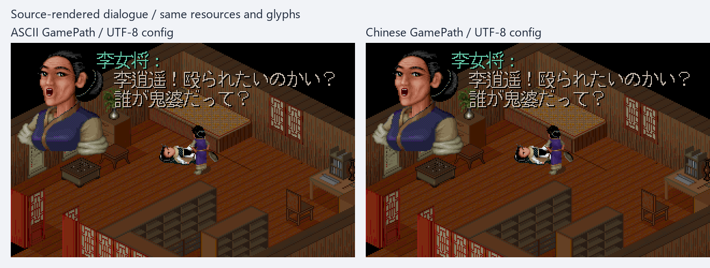
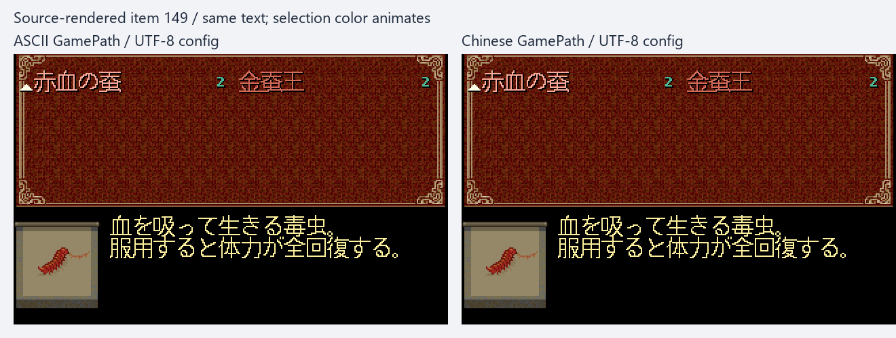
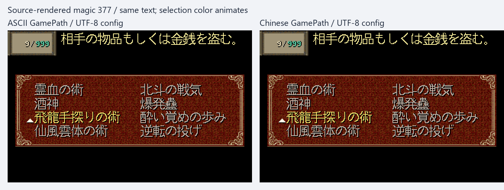

# Issue #2 R4：Windows 中文绝对 GamePath

2026-10-21，关联 [#2](https://github.com/othercat/sdlpal-jp/issues/2)、[总管 #1](https://github.com/othercat/sdlpal-jp/issues/1)。
基线 `feature @ 581fe0cdf7873b4ec5be7aac15d846299cffc0c2`，分支 `richardli/fix/2-chinese-absolute-gamepath`。

**最新基线仍可复现中文路径打不开 `fbp.mkf`；本轮修复后，中文与 ASCII 路径均能加载相同 PAL98 资源。**
已验证命令行、UTF-8 配置、旧 CP936 配置、设置窗口 GamePath 往返和 RIX 文件入口。
源码图和自动化验证已完成，实机由用户最后统一验收，Issue 保持开放。

## 先复现，再核对文件打开链路

修前先从最新 `feature` 构建 x64 Test，不沿用旧失败结论。将
`D:\PAL\完整包\PAL98_v1.72_20261014` 的 17 个输入按既有 SHA256 清单复制到
`runtime-ascii` 和 `中文资源-仙剑98`，两份资源逐文件相同。使用相同当前 Win SLF、日文 16px 字体和 `jp` 渲染模式：

| 构建／入口 | 结果 |
| --- | --- |
| 修前，ASCII 绝对路径 | 退出 0，生成 12 张 320×200 BMP |
| 修前，中文绝对路径 | `FATAL ERROR: File open error(2): fbp.mkf!`，未生成画面；记录 fatal 后仅终止本次 Test 子进程，未等待错误对话框。退出 1 是此终止结果 |
| 修后，命令行 ASCII／中文路径 | 各退出 0，各 12 张图 |
| 修后，sdlpal.cfg 中 ASCII UTF-8／中文 UTF-8／中文 CP936 | 各退出 0，各 12 张图；配置字节未被渲染器改写 |
| 修后，UTF-8 配置直接指向原始 PAL98 中文目录 | 退出 0，12 张图；17 个原资源指纹仍相同 |

链路不是单一 `fopen`：SDL2main 将 Windows 宽字符命令行转成 UTF-8，Test 入口直接传给 GamePath；
生产入口则由 `PAL_LoadConfig(TRUE)` 读取配置。`UTIL_OpenFile`／`UTIL_OpenRequiredFile`
先经过 `UTIL_GetFullPathName` 的存在性检查，再打开资源；两处原来都使用窄字符 CRT API。
Windows 设置窗口还混用了宽字符长度与 `GetDlgItemTextA` 的字节长度，中文可能被截断。
RIX 的 `rixplay.cpp → CProvider_Filesystem → binifstream` 有独立的 `fopen`，也需要接通。

微软文档说明：[fopen 的文件名字节按 ANSI 代码页解释，_wfopen 接受宽字符文件名](https://learn.microsoft.com/en-us/cpp/c-runtime-library/reference/fopen-wfopen?view=msvc-170)；
[MultiByteToWideChar 的严格转换与长度单位](https://learn.microsoft.com/en-us/windows/win32/api/stringapiset/nf-stringapiset-multibytetowidechar)
以及 [GetWindowTextLengthW 的字符数](https://learn.microsoft.com/en-us/windows/win32/api/winuser/nf-winuser-getwindowtextlengthw)
支持上述链路判断。这些 API 转换只作用于路径，不改变读取的游戏文本或流编码。

## 最小修改与兼容规则

- [util.c](../util.c) 增加路径转换及流打开包装，Windows 的存在性检查和打开使用 `_waccess`／`_wfopen`；required 的当前目录回退、写入／追加／更新也复用。非 Windows 继续使用原 `access`／`fopen`。
- 有效 UTF-8 优先；只有无效 UTF-8 才回退到当前系统 ACP。本机 ACP=936，旧配置加载／保存后保持原字节，未修改全局 CRT 代码页。两种编码都有效时不能推断原意，本实现明确选择 UTF-8。
- [win32.cpp](../win32/win32.cpp) 的 GamePath 控件改为 W API 与 UTF-8 往返，先测 UTF-8 字节数再分配；盘符绝对路径判定只看前缀，避免 `_splitpath_s` 固定字节缓冲拒绝合法中文路径。
- [palcfg.c](../palcfg.c) 的配置读行扩到已有 1024 字节全局缓冲规格，字符分类使用 unsigned char；字符串保存直接 `fprintf`，避免超过 512 字节的 UTF-8 路径溢出。GamePath 默认复制给 ShaderPath，随后更换 GamePath 再保存这一触发链也已覆盖。
- [binfile.cpp](../adplug/binfile.cpp) 的 RIX 流入口复用同一包装。测试验证真实 provider 和 SDL_RWFromFile 能读到相同字节，不将文件打开测试当作音乐播放验收。
- Test 渲染器新增 `RESOURCE_DIR=@config`，使用真实 `PAL_LoadConfig(TRUE)`；正式游戏参数和绘图逻辑未改。其他设置窗口路径字段仍使用 A API；本轮不声明支持 UNC 或突破 Windows 传统字符长度限制。

## 源码画面对比

以下左侧为 ASCII 路径，右侧为中文路径，均由修后引擎通过独立 UTF-8 `sdlpal.cfg` 加载。
同一资源、SLF、调色板 0、字体 flavor 4／16px／词宽 16；图中内容来自真实对白和菜单绘制函数。
这是源码重建场景，未重放游戏路线、音乐或输入循环。修前中文路径根本没有出图，不能把空白图当成修前画面。







三张展示图的对应原始帧逐像素相同。PNG 为不透明 RGB，2×最近邻放大；未重画文字或修整游戏像素。
三张合计 144,009 字节，已重新打开并目视核对，GitHub 与本地均保留可打开的文件。

全部六组共 72 张图另作严格核对，不只比较这三个样例：

- ASCII 命令行与 ASCII 配置的 12 张图完全相同。
- 四组中文路径与 ASCII 配置相比，各只有 `magic-393.bmp` 的 460 个选中名称墨点从索引 FA 变为 F9；调色板不变。
- 修前 ASCII 与修后 ASCII 配置相比，仅 `magic-390.bmp` 的 469 个选中名称墨点有相同换色。
- 原因是 [ui.h](../ui.h) 的 `MENUITEM_COLOR_SELECTED` 每 100ms 在 F9–FE 六色循环。
  校验只允许已知选中名称矩形内的完整、统一换色：包括未变化墨点在内，所有亮色位置必须共用同一 `(旧索引, 新索引)` 对。
  字形位置集合、阴影、其他文字、背景、全调色板和裁切报告仍须一致；未解释差异为 0。
  原图和原始差异数量都保存，不修改图片来制造零差异结论。

## 自动化验证与复现

最终 Test 构建：VS 2026 18 Community／v145／Windows SDK 10.0／x64，
`CL=/utf-8 /DGTEST_HAS_TR1_TUPLE=0`。构建期间的 `generated.h` 有备份并恢复。

| 验证 | 实际结果 |
| --- | --- |
| 完整 C++ Test 套件 | 21/21 通过；其中 6 项新增路径用例 |
| 中文、非 BMP 字符、绝对文件名、斜杠／末尾分隔符 | 打开成功；缺文件返回空值 |
| 写入／追加／更新／required 当前目录回退 | 内容与预期相同，临时文件清理完成 |
| UTF-8 与旧 CP936 配置 | 实际加载、打开、保存、再加载；字节保持，ACP 可表示性由独立 Win32 转换判定 |
| 超 512 字节、仍在传统字符长度内的中文路径 | 保存／重载／绝对打开通过；更换 GamePath 后旧 ShaderPath 完整保留 |
| 设置窗口 GamePath | 实际 SaveSettings／ResetControls 与隐藏原生 EDIT 控件往返通过；不需要用户按键 |
| RIX provider 与 SDL 文件入口 | 同一个中文／非 BMP 文件读到相同内容 |
| 图片比较器正负例 | 8/8 通过；拒绝移位、说明墨点变化、矩形外换色、部分墨点换色、非均匀换色、调色板变化 |
| 实际资源源码渲染 | 六组各 12 张，共 72 张；另复核 12 张修前 ASCII 图；裁切报告不变 |

测试夹具和比较器完善过程中出现的失败日志也保留；最终结论只使用 `after-r4` 构建及最终比较规则。
最后一次只收紧比较器的完整名称换色检查，重新核对已有原始 BMP 和指纹，没有为此重复运行游戏渲染。

```powershell
$jpPython = Join-Path $env:USERPROFILE 'CodexTools\python\Scripts\python.exe'
$jpEvidence = 'D:\Workspace\PALWork\artifacts\sdlpal-jp-issue-2\gamepath-r4-20261021'
$jpExe = Join-Path $jpEvidence 'after-r4\build\sdlpal.exe'
$env:SDLPAL_PATH_TEST_ROOT = Join-Path $jpEvidence 'test-data'
# C++ 套件从仓库根目录执行；test-data 须存在。
& $jpExe --gtest_output=xml:新的测试报告.xml
& $jpPython -B -X utf8 tests\test_gamepath_verifier.py -v
# 复用留存的修前复现目录；输出目录须尚不存在。
& $jpPython -B -X utf8 tools\japanese\verify_gamepath.py $jpExe $jpEvidence '新的核对目录' --caption-font 'C:\Windows\Fonts\segoeui.ttf'
```

不使用已归档目录时，按[完整证据](evidence/issue-2-gamepath-verification.json)的资源清单准备两个只读副本与相同 SLF，
从基线构建 Test，按记录的 argv 生成 ASCII 图和中文 fatal 日志／`reproduction.json`，再运行当前校验器。
配置文件无 BOM，只有 `GamePath=绝对路径` 一行；旧编码测试使用系统 CP936。
命令行路径使用正斜杠和末尾分隔符，配置路径使用反斜杠且无末尾分隔符。

修前 exe SHA256：`8122b10f5e6d8ea336e57928f36690af675c05378c15cbb605c4d9a5f0d4d31a`。
最终 exe SHA256：`e697feb6044617a6ea473938d96cc38d996b8429928c0294ad58c8eee477db30`。
精确源码、SLF／资源／配置指纹、构建、测试 XML、日志、全部 BMP 和对比 PNG 保存在上述 artifacts；
仓库只提交源码、证据和三张小图，不提交原游戏资源或完整转换文本。

实现、源分支最终 SHA、普通合并 SHA、远端核对及清理结果记录在 #2／#1，目标为 `feature`。
Windows x64 SDL2 Test 验证不能代替其他平台构建、Tk 交互、音乐和实际游戏流程；
本轮没有实机通过记录，全部 Issue 继续开放，等待最后统一验收。
