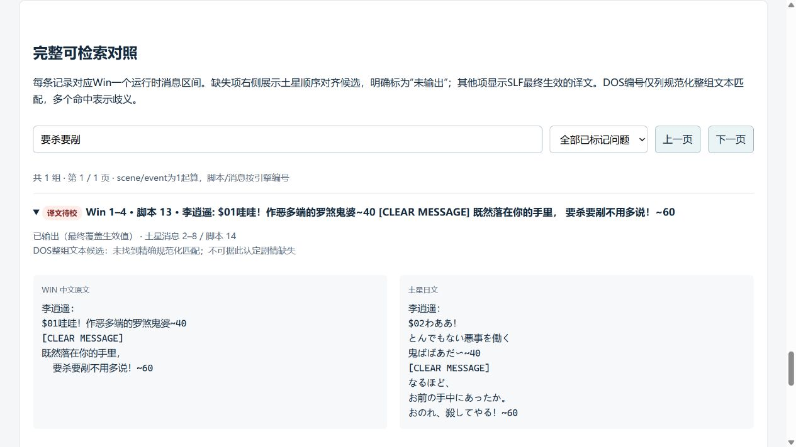
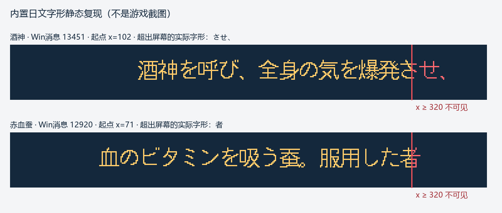

# 日文化静态审计与 Issue 依据

审计日期：2026-10-20。本文是本仓库日文化 Issue 的版本化依据，收录输入指纹、消息与脚本编号、静态结论及验证边界。Issue 的实施进度、提交和实机结果在各 Issue 中按轮次维护；本文记录的是修复前基线。

代码基线：[`6dafc9c79718058f3a1a4ab8a3d3e30a102ab207`](https://github.com/othercat/sdlpal-jp/commit/6dafc9c79718058f3a1a4ab8a3d3e30a102ab207)。

后续 [Issue #3 恢复记录](japanese-missing-dialogues.md)已逐组核对并补回 119 组 / 290 个 Win ID；包含逐组中日正文、脚本与场景依据、源码渲染前后图。下文的缺失数量仍是修复前基线，统一实机验收待全部实现完成后进行。

| Issue | 文档章节 | 范围 |
| --- | --- | --- |
| [#1](https://github.com/othercat/sdlpal-jp/issues/1) | [总管与追溯](#issue-1) | 分支、依赖、合入和验收 |
| [#2](https://github.com/othercat/sdlpal-jp/issues/2) | [工具与基线](#issue-2) | 三个 Release 附件纳管 |
| [#3](https://github.com/othercat/sdlpal-jp/issues/3) | [遗漏映射](#issue-3) | 119 组 / 290 个 Win 消息 ID |
| [#4](https://github.com/othercat/sdlpal-jp/issues/4) | [场景错配](#issue-4) | 比武招亲 10 组 NPC 对白 |
| [#5](https://github.com/othercat/sdlpal-jp/issues/5) | [说明布局兼容](#issue-5) | SLF 布局参数；当前基线 11 个对象 / 12 行裁字 |
| [#6](https://github.com/othercat/sdlpal-jp/issues/6) | [译文校对](#issue-6) | 语义、语法与术语 |
| [#7](https://github.com/othercat/sdlpal-jp/issues/7) | [DOS 映射](#issue-7) | DOS / Win 编号兼容性 |
| [#8](https://github.com/othercat/sdlpal-jp/issues/8) | [重复键冲突](#issue-8) | 6 个重复键中的 2 个语义冲突 |
| [#9](https://github.com/othercat/sdlpal-jp/issues/9) | [头像与调色板](#issue-9) | 86 头像已适配，SDL2 日夜源色合成及回归完成；待统一验收 |
| [#10](https://github.com/othercat/sdlpal-jp/issues/10) | [字体与跨引擎对照](pal98-font-rendering-comparison.md) | PAL98 实机基线、SDLPAL 源码出图及布局前后证据 |

2026-10-20 后续：[83–87 实现复核](japanese-description-layout-verification.md) 将正文裁切从基线 12 行减少为赤血蚕 1 行；[#10 源码渲染](pal98-font-rendering-comparison.md) 提供实际绘制证据。随后[赤血蚕换行适配](japanese-red-silkworm-layout.md)核对土星原始消息，仅在生成的 Win SLF 移动一个换行；加载适配后 SLF 时，剩余正文与阴影越界均为 0。完整游戏验收待完成。下文保留原审计基线。

## Audit baseline

输入为 PAL98 v1.72_20261014 的 Win 版根资源（GBK）、Steam PAL_DOS 根资源（CP950），以及 Sega Saturn 日文版提取资源。这里只列资源类型与指纹，不依赖某台主机的绝对路径。

| 统计项 | 基线值 |
| --- | ---: |
| Win 运行时消息区间 / 唯一区间键 | 4773 / 4766 |
| 生成的 SLF 映射块 / 唯一键 | 4654 / 4647 |
| Win 未映射区间 / 涉及消息 ID | 119 / 290 |
| 遗漏区间的土星候选消息数 | 362 |
| 全部未选土星区间 / 消息数 | 130 / 397 |
| 其中其他未选区间 | 11 |
| 生成文件日文正文行数 | 16834 |
| 土星源消息总数 | 17171 |
| 解析的物品与法术说明对象 | 296 |
| 说明名义字框越界：行 / 对象 | 20 / 19 |
| 当前布局下说明真实字形裁切：行 / 对象 | 12 / 11 |
| 普通对白实字越界行数（本次设置） | 0 |
| 错误控制码 / 不支持的 Unicode 字符 | 0 / 0 |

原始 `summary.json` 的 `nmsgs=16835` 是索引相关值，不能当作正文行数。130 组未选源文本也不能全算 PC 漏译：119 组有恢复候选，其余 11 组需要另作判断。

说明裁字数量限定于当前代码与生成 SLF 的组合：物品起点 `x=71`、法术起点 `x=102`，并已计入额外说明行。2026-10-20 根据用户转述的 PalMusicFan 布局反馈补查，确认本仓已有两列菜单及更多说明行支持，但未接入转换器输出的法术布局参数 83–87。详见 [Issue 5](#issue-5)；不能将原版日文换行直接判为错误，也不能把上述数量推广到完整适配后的布局。

已完成的原审计包括：实际运行 `makemessage_j.py` 生成 Win SLF；独立核对全部 4654 块的起止编号和正文；静态消息键统计；部分场景与控制流追溯；296 个说明入口的内置字体像素计算。生成的 SLF SHA256 为 `f15a22cb2e999680119e08bae021cb61f366d6f45655ef4e33019472e9388c54`。

尚未完成：游戏全路线运行、所有存档状态、全部战斗对象脚本、mod 覆盖、全 17171 条人工日语校读。内置字体的结论不直接适用于自定义 `FontFile`、其他二进制或 PAL98 原生 exe。本次将证据整理为 Markdown 未重新运行转换器或游戏。

### 输入文件 SHA256

| 资源 | 文件 | SHA256 |
| --- | --- | --- |
| Win | `sss.mkf` | `a14ca6d9ab20767ae97a211cba85496879cb5d04f04ef8db453ef1c72a2cae3c` |
| Win | `m.msg` | `d07344645bf0c65d58d13bdb5916e28222f8ce4d506821085ddfd44ba5533d9c` |
| Win | `word.dat` | `be56e77c7ecd61306133913a1987b1dddf656528ae870c2de1ee8ccda7ff3ebf` |
| DOS | `sss.mkf` | `8ebbbcfa5bdae5fe6b73752e3a6e6d3fd28d6fa857ffefcb6c8c0242eaf0252c` |
| DOS | `m.msg` | `f6480a5095e8cc358ecb3e8329ca80996c6068c34327f2f86ec03375ad40b654` |
| DOS | `word.dat` | `856fd6649a3e5bf143af30281eb33b2c67b1f6776290ce9650b065b1f78f49bb` |
| Saturn | `JM.MSG` | `9fe510d44812c245e844692a368f2e5dfbe9c47c06673ac1e18f179e8c85aa90` |
| Saturn | `JM.NOR` | `9ba1b1897ad3812a3b5111da41511a09f3a369d23ce17fc12a8074552d1713ac` |
| Saturn | `JM.SEC` | `4956999afe7bb1cf023269675bc6360c61e98e604c4a1414c7f8e038807bce95` |
| Saturn | `PROG.BIN` | `4ff1d34c0345a1e0ba2959ef5d1d437338f9370f6eaaa68e6d3bbe3e07d6e33c` |

## Selected dialogue screenshots

以下三张图截自原始审计报告 `report.html` 的“完整可检索对照”，用于阅读经典台词、核对消息与脚本编号，**不是游戏运行截图，也不代表实机验收通过**。左侧为 Win 中文，右侧为当前映射生效的土星日文；保留原换行和控制码，没有改写成修订译文。`$01`、`~60` 等是源文本控制码，`[CLEAR MESSAGE]` 是审计报告的清屏分隔标记。

### 开场梦境：“要杀要剐不用多说”

Win 消息 **1–4** / 脚本 **13**；土星消息 **2–8** / 脚本 **14**。原译末句 `おのれ、殺してやる！` 把任凭对方处置变成主动杀对方，是 [#6](#issue-6) 的语义校对例子。



### 灵儿吟诗：“既不回头，何必不忘”

Win 消息 **1759–1763** / 脚本 **4689**；土星消息 **2366–2374** / 脚本 **5297**。作为经典台词与日文行数的对照样例；中文和日文的行数不同，本身不构成漏映射证据。此处收录不等于已经完成该段译文审校。


### 月如：“吃到老！玩到老！”

Win 消息 **6744–6745** / 脚本 **18615**；土星消息 **8709–8711** / 脚本 **20297**。采用不含速度控制码的这一处对白；截图下方折叠行是另一处 Win **10209–10210**，不能把两处消息编号混用。本图用于经典台词展示，不作为新增缺陷认定。


## Issue 1

**总管、分支和永久追溯。** #1 汇总所有子 Issue，采用以下独立分支；实施基线和合入目标为 `feature`。

| Issue | 专用分支 |
| --- | --- |
| #1 | `richardli/feat/1-japanese-localization-tracker` |
| #2 | `richardli/feat/2-version-japanese-conversion-tools` |
| #3 | `richardli/fix/3-restore-missing-japanese-dialogue` |
| #4 | `richardli/fix/4-correct-tournament-npc-mappings` |
| #5 | `richardli/fix/5-fix-japanese-description-clipping` |
| #6 | `richardli/fix/6-correct-saturn-japanese-translation` |
| #7 | `richardli/feat/7-add-dos-japanese-message-mapping` |
| #8 | `richardli/fix/8-resolve-conflicting-message-keys` |
| #9 | `richardli/feat/9-adapt-saturn-portrait-palettes` |

先完成 #2 工具基线，再推进 #3、#4、#5、#8；#6 与各项修复联合校读；#7 单独验证 DOS 编号体系。#9 是新增的头像资源调查与适配项，不影响已核实的文本问题数量。分支命名规则为 `richardli/<feat|fix>/<issue-id>-<issue-title>`。

实现与合并提交须有主题、说明改动和验证的非空正文，以及 `Refs #<issue-id>`。默认普通 merge，保留原始实现提交和合并节点。允许在具体 PR 完成适当验证并满足检查后启用自动合并；仓库选项本身不等于已配置强制检查或自动记录程序。

合入后在对应 Issue 追加完整实现 SHA、源分支最终 SHA、目标分支、完整合并 SHA、合并方式、PR、验证、实机证据及清理结果。文档管理提交与游戏修复提交分别记录。实机通过前不得通过关键词或 Development 关闭关联自动关闭 Issue。

重开时保留旧轮次，先查旧实现与合并提交，再从最新 `feature` 建立 `richardli/fix/<同一编号>-<标题>-r2` 等分支。清理前确认远端目标包含原提交、实际内容与验证已复核，且证据已妥善保存。

## Issue 2

**日文转换工具与可复现基线。** 三个脚本来自 [PalMusicFan/sdlpal v2026.08 Release](https://github.com/PalMusicFan/sdlpal/releases/tag/v2026.08) 附件。普通 Git 历史同步不包含 Release 附件，需在本仓库纳管。

2026-10-20 后续：三个附件已原样纳管，Win SLF 完整复现，GUI 入口问题已修复；详见[转换工具基线与源码加载记录](japanese-conversion-baseline.md)。下表仍记录未修订附件指纹。用户已将实机验收统一安排在全部子 Issue 的实现与专项验证完成之后。

| 文件 | 字节数 | SHA256 |
| --- | ---: | --- |
| `makemessage_j.py` | 27100 | `c6957be6eb3081c111509353e89d8559e5744e07d828bd0c9afb1ae415cdc149` |
| `rungui.py` | 12233 | `93148d91d24219a66036f4d3fcbf21920318f9f972ce9fdd92ecd6dad35a4e99` |
| `steam_to_legacy.py` | 15456 | `6e80a2c965a39fc8ce405ec3459bb9486fdf377fc03591466793f12ed87ab542` |

原审计实际运行的是 `makemessage_j.py`，不能据此声明 GUI 和 Steam 转换入口已运行通过。后续先保留未修订源码及来源，再逐项实现修复。Agent 使用项目规定的官方 CPython 3.11、`~/CodexTools/python` 环境。

验收应覆盖：附件指纹与差异追溯、Win SLF 复现与输入输出指纹、三个入口的实际执行结果、版本/编码错误提示和游戏加载结果。游戏资源保持为本地输入。

## Issue 3

**Win 日文对白遗漏映射。** 未生成的 119 个区间包含 290 个 Win 消息 ID；已找到 362 条土星候选消息。候选依据包括源顺序与关键前后文，尚未逐句人工确认全部条目，不能直接视作已修复译文。

| Win 消息 ID | 组数 | 土星候选消息 ID | 主要内容 |
| --- | ---: | --- | --- |
| 2686–2713 | 13 | 3602–3635 | 苏州街头、卖艺、观众、比武开始 |
| 9110–9339 | 93 | 11759–12050 | 锁妖塔、剑圣、神木林、阿奴 |
| 9902 | 1 | 12849 | 月如死讯 |
| 9976 | 1 | 14968 | 数月后 |
| 10888–10895 | 4 | 13801–13809 | 阿奴阻止逍遥、守卫问候 |
| 11164–11168 | 2 | 15348–15353 | 灵儿面对命运、巫后石像 |
| 12053–12069 | 5 | 14853–14871 | 十年前来福伯、丁大伯、船商 |

93 组长缺段的定位：

| 内容 | 组数 | Win 脚本 | 场景锚点 |
| --- | ---: | --- | --- |
| 锁妖塔底破柱与化妖水 | 19 | 24461–24613 | scene154 / map74，入场 24148 |
| 塔内回忆 | 4 | 24702–24743 | — |
| 七星盘龙柱 | 2 | 24781、24816 | — |
| 群妖逃出 | 6 | 24931–24971 | — |
| 剑圣、酒剑仙 | 4 | 25006–25026 | — |
| 塔内拾取 | 7 | 25040–25070 | — |
| 蟠果、香蕉 | 2 | 25976、25983 | — |
| 猴子 | 10 | 25989–26091 | — |
| 凤凰蛋、阿奴追逐 | 12 | 26205–26309 | scene186 / map152，event3116 |
| 阿奴救醒、认错灵儿、约定取宝 | 27 | 26426–26584 | scene189 / map153，入场 26368 |

[附录](#omitted-mapping-index)列出全部 119 组的消息与脚本区间，可直接定位，不依赖本地 JSON 文件链接。逐组核实说话者、事件和剧情状态后补映射；相邻比武招亲的 10 组现有错配归 #4。

验收应覆盖全部缺段的处置清单、修前/修后覆盖率与冲突检查，以及上述七段在游戏中的复现和相邻正常对白回归。未确认候选保留为待核实，不以机械编号平移取代语义确认。

## Issue 4

**比武招亲的 10 组 NPC 场景错配。** 转换段 `section=1` 和 `section=5` 均从土星脚本 `8253` 连取 5 组，重复套用书生、刘楚香、拳师、护院、小僧的对白。

| Win 脚本 | Win 消息 ID | 当前错用的土星消息 ID |
| ---: | --- | --- |
| 7685 | 2714–2715 | 3443–3447 |
| 7688 | 2716–2717 | 3448–3454 |
| 7691 | 2718–2719 | 3455–3457 |
| 7694 | 2720–2722 | 3458–3462 |
| 7698 | 2723–2726 | 3463–3466 |
| 8128 | 2860–2861 | 3443–3447 |
| 8131 | 2862–2863 | 3448–3454 |
| 8134 | 2864–2867 | 3455–3457 |
| 8139 | 2868–2871 | 3458–3462 |
| 8144 | 2872–2874 | 3463–3466 |

家仆称赞小姐、观众要求别挤的文本，会被变为书生自述不会武术。相关 NPC 有事件引用，不能视为无用文本删除。原审计没有在土星对应段找到这 10 组的直接日文等价文本，不能仅整体平移脚本起点。

逐组确定 NPC、事件和剧情阶段，记录新来源或补译依据，保留原来正确的书生等 NPC 文本；实机覆盖比武前后对话与状态切换，并与 #3 的苏州缺段联合回归。

2026-10-20 后续：[Issue #4 实现与源码对比](japanese-tournament-npc-dialogues.md)核对了 10 组原文、土星近似段及 17 个事件引用。未找到可靠对应原段的 10 组采用明确标注的 Win 原文补译，原正确的五组 NPC 台词和 #3 恢复保持不变。上表保留修前定位；统一实机验收待全部实现完成后进行。

## Issue 5

**先核对土星日文布局兼容，再处理剩余说明裁字。** 2026-10-20 用户转述 PalMusicFan：土星日版给文字的空间更多，说明换行沿用日版设计；名称最长 8 个全角字，道具栏为两列，说明需要更多行。这是布局适配线索，不能直接据此认定所有裁字都无解，或要求改写原版日文换行。

本仓代码与现有生成文件的补查结果如下，代码链接固定到上述审计基线：

| 项目 | 已核实的行为 | 依据 |
| --- | --- | --- |
| 名称与列数 | 读取 SLF 后按 WORDS 实际字宽重算 `dwWordLength`；当前文件最大为 16 个半角单位，即 8 全角 / 128px，道具和法术均按 `32 / dwWordLength` 得到两列 | [text.c:688](https://github.com/othercat/sdlpal-jp/blob/6dafc9c79718058f3a1a4ab8a3d3e30a102ab207/text.c#L688)、[itemmenu.c:53](https://github.com/othercat/sdlpal-jp/blob/6dafc9c79718058f3a1a4ab8a3d3e30a102ab207/itemmenu.c#L53)、[magicmenu.c:58](https://github.com/othercat/sdlpal-jp/blob/6dafc9c79718058f3a1a4ab8a3d3e30a102ab207/magicmenu.c#L58) |
| 自定义布局入口 | `[BEGIN LAYOUT]` 在 WORDS 之前出现时启用自定义布局；`FontFlavor=Japanese` 只负责日文字形 | [text.c:245](https://github.com/othercat/sdlpal-jp/blob/6dafc9c79718058f3a1a4ab8a3d3e30a102ab207/text.c#L245)、[text.c:435](https://github.com/othercat/sdlpal-jp/blob/6dafc9c79718058f3a1a4ab8a3d3e30a102ab207/text.c#L435) |
| 更多说明行 | SLF 已写 `81=2,0`、`82=1,0`；物品列表为 5 行、说明起点 `y=119`，法术列表为 4 行、菜单框起点 `y=58`。原静态审计已经采用这些纵向参数 | [itemmenu.c:55](https://github.com/othercat/sdlpal-jp/blob/6dafc9c79718058f3a1a4ab8a3d3e30a102ab207/itemmenu.c#L55)、[magicmenu.c:122](https://github.com/othercat/sdlpal-jp/blob/6dafc9c79718058f3a1a4ab8a3d3e30a102ab207/magicmenu.c#L122)、[script.c:3568](https://github.com/othercat/sdlpal-jp/blob/6dafc9c79718058f3a1a4ab8a3d3e30a102ab207/script.c#L3568) |
| 布局协议缺口 | 转换器还输出 83–87，当前 `SCREENLAYOUT` 只有 82 项；解析器忽略超出结构大小的索引 | [palcfg.h:126](https://github.com/othercat/sdlpal-jp/blob/6dafc9c79718058f3a1a4ab8a3d3e30a102ab207/palcfg.h#L126)、[text.c:534](https://github.com/othercat/sdlpal-jp/blob/6dafc9c79718058f3a1a4ab8a3d3e30a102ab207/text.c#L534) |
| 法术说明与 MP 框 | 说明起点仍为 `x=102`，MP 框宽度与坐标也仍固定；目前不能只靠现成配置使 `87=70,0` 生效 | [script.c:3567](https://github.com/othercat/sdlpal-jp/blob/6dafc9c79718058f3a1a4ab8a3d3e30a102ab207/script.c#L3567)、[magicmenu.c:211](https://github.com/othercat/sdlpal-jp/blob/6dafc9c79718058f3a1a4ab8a3d3e30a102ab207/magicmenu.c#L211) |

已固定指纹的 `makemessage_j.py` 第 375–383 行及其生成 SLF 声明：

```text
83=3,0    # 法术 MP 栏宽度
84=30,14  # 斜线坐标
85=5,14   # 所需 MP 坐标
86=31,14  # 当前 MP 坐标
87=70,0   # 法术说明 X 起点
```

上面的行尾注释为本文说明，实际文件的说明位于独立注释行。优先确认转换器与引擎版本/协议是否匹配，并接入或选择已支持这些参数的对应实现。支持日文字体、两列和更多说明行，并不等于已经支持全部日版布局参数。

### 当前基线的静态裁字清单

内置日文字形逐像素检查确认：在当前生效布局下，11 个对象、12 行丢失右侧笔画。物品起点 `x=71`、可用 249px；法术起点 `x=102`、可用 218px。这是该代码与 SLF 组合下的结果，不是完整日版布局的实测结论。

| 对象 ID | 对象 | Win 消息起点 | Win 脚本 | 被裁字形 |
| ---: | --- | ---: | ---: | --- |
| 149 | 赤血蚕 | 12920 | 40482 | 者 |
| 306 | 净衣咒 | 13437 | 43302 | く。 |
| 307 | 冰心诀 | 13436 | 43299 | く。 |
| 308 | 灵血咒 | 13466 | 43365 | 糸 / く。（两行） |
| 311 | 天罡战气 | 13444 | 43317 | 力が |
| 370 | 酒神 | 13451 | 43332 | させ、 |
| 374 | 爆炸蛊 | 13094 | 40846 | 発 |
| 377 | 飞龙探云手 | 13458 | 43347 | む。 |
| 390 | 醉仙望月步 | 13455 | 43340 | 数が |
| 393 | 仙风云体术 | 13457 | 43344 | る。 |
| 394 | 乾坤一掷 | 13464 | 43361 | る。 |

名义字框越界的 20 行/19 对象不是实际裁字数。下图原样引用原审计的 `display-clipping-evidence.png`，采用当前生效的法术 `x=102`、物品 `x=71`，使用真实内置日文字形。红线表示逻辑屏幕 `x=320`，红色为越界笔画；**这是静态字形复现，不是游戏截图，也不是接入 `87=70` 后的效果**。



从已有像素坐标推断，若 11 条法术说明裁字行整体左移 32px，最大字形右端会从 `x=345` 移到 `x=313`，提示接入 `87=70` 可能消除这些行的横向裁字。此为坐标推断，尚未重新渲染或实机确认；仍须检查 MP 框遮挡、纵向范围及全部说明。赤血蚕属于物品说明，须独立处理。普通剧情对白的正常分页不算遗漏。

验收顺序：先核对 83–87 的解析与实际使用、旧布局默认值和中文兼容；再按生效后的布局重新计算全部 296 个说明对象的像素边界；最后只对剩余问题决定换行、校译或绘制调整，保留语义、数值和控制码。检查行数与底部边界，避免改为纵向截断。实际游戏中回归两列菜单、8 全角名称、MP 框、普通对白分页及受影响说明，并记录构建、字体、显示配置与截图。自定义字体或其他引擎未测时须明确保留边界。本次仅补充调查记录，尚未实施引擎修复或游戏验收。

### 2026-10-20 后续实现与复核

已找到并移植上游 `let_us_dub` 的独立布局提交 `d82e20f9fc38126602bebdd60f2aca3c4e552b09`，补齐 83–87。对全部 296 对象 / 793 行重算后，原 12 行中 11 行法术说明已无正文裁切；残留赤血蚕 1 行 / 31 个正文像素。原表与图片继续作为移植前证据。构建、测试、完整像素结果与验收边界见 [Issue #5 实现复核](japanese-description-layout-verification.md)；跨引擎字体和真实截图另由 [Issue #10](https://github.com/othercat/sdlpal-jp/issues/10) 跟踪。

## Issue 6

后续实现：[R1 十八组](japanese-translation-review.md)及 [R2 四组共享 Win／DOS 日译](japanese-translation-followup.md)已分别记录来源、最小修订、源码前后图和验证；下文保留最初审计发现，实机验收仍最后统一进行。

2026-10-20 后续：[18 组日译最小修正、联合校读和源码图](japanese-translation-review.md) 已完成源码专项。确定错误、保留原译的可选补全项、战斗机制与验证边界分别记录；仍待全部 Issue 完成后统一实机验收。

**土星原译的语义、语法和术语问题。** 下列内容即使映射正确仍可能错误，须与 #3、#4 的映射问题以及 #5 的裁字分别记录。

| Win 消息 ID | 土星消息 ID / 对象 | 校读发现 |
| --- | --- | --- |
| 1–4 | 2–8 | “要杀要剐”的语义被反转为“我要杀了你” |
| 9207–9208 | 11888–11889 | “为何没阻止”的责问变成“阻止他们”的命令 |
| 9211–9212 | 11893–11894 | 愤怒反驳变成询问确认 |
| 12920–12921 | 赤血蚕 | “吸血维生”被理解为“血的维生素” |
| 12660–12661 | 圣灵披风 | `神聖な力な持つ` 的格助词错误 |
| 12866–12868 | 雪蛤蟆 | 原译省略产地与大小，数值仍在；是否补足需判断 |
| 13442、13444、13455、13457 等 | 战斗说明 | 回合、攻击次数与效果须按真实机制统一 |

阿奴 `お鈴`、彩依 `お彩`、姬三娘 `三姫` 是土星本地化命名，仅中文名不同不能判为错配。雪蛤蟆的省略也不能标成转换器丢字。

每项应保留中文语义、原译、修订日译、说话者/场景、理由和审核结果。抽查清单完成不代表全 17171 条人工审校完成；扩展范围应另行明确。修订须回归映射、控制码、显示及实际场景和战斗说明。

## Issue 7

**PAL_DOS 独立映射。** DOS 的 4476 个区间中，现有 Win SLF 仅有 320 个键偶合，4156 组无键；偶合也不证明语义正确。DOS 消息 `0` 的锁门提示会命中 Win 消息 `0` 的开场呼唤。

应显式识别资源版本与编码，建立 DOS 消息区间—脚本—土星来源映射，并记录剧情差异与缺失。输出要标识适用版本，不能复制 Win SLF 或统一偏移消息 ID 代替适配。

验收须提供全部 4476 组的处置与覆盖清单、已知偶合错配回归，以及 DOS 开场、主要剧情、物品/法术说明和分页的实机记录；Win 现有结果同时回归。当前只有静态兼容性证据，未完成 DOS 全路线运行。

2026-10-21 后续：[DOS 独立映射与源码验证](japanese-dos-mapping.md)已提供 4,476 键的逐组处置（4,471 组日文、5 组原样标记）、296 条对象说明及双向资源版本保护。源码查表全部命中，DOS 说明旧坐标的 5 个裁切对象修为 0；Win 的 4,766 键和 100 张源码图未回退。实机统一验收仍待用户完成。上面的 320／4,156 保留为原审计版本的历史统计。

## Issue 8

**重复消息键覆盖。** 6 个重复键中只有 2 个语义冲突。下表的映射行号为原始 `mapping-rows.json` 的零基索引。

| Win 区间键 | 映射行号 | 原审计是否发现语义冲突 |
| --- | --- | --- |
| 4931–4931 | 1686、4651 | 否 |
| 4932–4933 | 1687、4652 | 否 |
| 4934–4935 | 1688、4653 | 否 |
| 5107–5108 | 1742、4649、4650 | 否 |
| 12352–12352 | 4007、4118 | 是 |
| 12368–12368 | 4023、4108 | 是 |

| Win 消息键 | 用途 | 先前映射 | 后写入映射 |
| --- | --- | --- | --- |
| 12352 | 获得灵山仙芝 | Win 脚本 37511 / JP 15746：取得仙芝 | Win 脚本 38193 / JP 15861：采摘仙芝 |
| 12368 | 获得银杏子 | Win 脚本 37607 / JP 15762：取得银杏种子 | Win 脚本 38123 / JP 15851：采摘银杏种子 |

同键后写入译文会覆盖先前内容。应核实所有调用场景，采用适用的中性措辞或有依据的场景区分方案，并对全部 6 个键说明处置。不能仅删重复行，或依赖写入顺序隐式选择译文。

验收须检查最终有效映射、所有拾取/采集调用点、正常同文重复键及游戏中的相关获取场景。

2026-10-20 后续：[Issue #8 来源、实际覆盖规则与源码对比](japanese-duplicate-message-keys.md)确认引擎按文件顺序后者覆盖。两个取得键的所有出现现统一为已有土星 `獲得` 句，仅修改两条正文；四个正常同文键原样保留，六个重复键不再含异文，默认转换器拒绝其他异文重复。表中冲突和行号保留为修前定位，统一实机验收仍待进行。

## Issue 9

2026-10-21 R1：[原版证据、适配方案与源码对比](japanese-portrait-palettes.md)已核实 `RGM.JOE`、`ALLDAT.NEW` 的零基 bank 3 及 NBG1 绑定。Win／DOS 分别建立 86 个已审编号；空槽 38 等保留 PC 原图。可选头像包与按场景重新配色保留默认 PC 行为及现有 8 位绘制。

2026-10-21 R2：[夜景源色合成、原版复核与前后图](japanese-portrait-night-colors.md)处理 R1 的夜景量化色差。原盘已审路径没有头像夜景色表；SDL2 正常日夜显示采用适配后的源 RGB，保留索引兼容路径。8,356 帧、150 个对白／菜单视图和 16 项单元测试通过。

2026-10-21 R3：[特殊渐变、索引特效、源码前后图与验证](japanese-portrait-effects.md)继续处理已知渐变函数、波浪、擦屏／溶解、震屏、FBP 与战斗切换下的颜色和覆盖。SDL1 和未识别的直接调色板改写继续回退；动态土星硬件效果及完整游戏流程仍留待统一验收。下面保留建单时尚未提取资源的调查基线。

**核实并适配土星人物头像与调色板。** 2026-10-20 用户转述 PalMusicFan：“我记得土星版支持同屏多调色板，人物头像是独立调色板的，得重新配色。”此项作为待核实的资源兼容线索；当前审计没有提取或解码土星头像，不能把回忆性描述写成已验证的资源格式，也不能据此判定现有日文化版本所有头像都错色。

当前代码能确认的是“日文文本配 PC 头像”的链路：

- [global.c:182](https://github.com/othercat/sdlpal-jp/blob/6dafc9c79718058f3a1a4ab8a3d3e30a102ab207/global.c#L182) 打开 PC 的 `RGM.MKF`；[text.c:1268](https://github.com/othercat/sdlpal-jp/blob/6dafc9c79718058f3a1a4ab8a3d3e30a102ab207/text.c#L1268) 与 [text.c:1313](https://github.com/othercat/sdlpal-jp/blob/6dafc9c79718058f3a1a4ab8a3d3e30a102ab207/text.c#L1313) 按脚本头像编号读取并绘制到 `gpScreen`，没有日文头像替换或头像独立调色板参数。
- [palcommon.c:164](https://github.com/othercat/sdlpal-jp/blob/6dafc9c79718058f3a1a4ab8a3d3e30a102ab207/palcommon.c#L164) 直接写入颜色索引；[video.c:210](https://github.com/othercat/sdlpal-jp/blob/6dafc9c79718058f3a1a4ab8a3d3e30a102ab207/video.c#L210) 的逻辑屏幕为 320×200、8bpp。[palette.c:52](https://github.com/othercat/sdlpal-jp/blob/6dafc9c79718058f3a1a4ab8a3d3e30a102ab207/palette.c#L52) 从 `PAT.MKF` 读取场景/日夜调色板，[video.c:605](https://github.com/othercat/sdlpal-jp/blob/6dafc9c79718058f3a1a4ab8a3d3e30a102ab207/video.c#L605) 把同一套颜色应用到屏幕与备份。最终输出存在 32 位表面，不代表当前头像链路已支持独立调色板。
- 三个发布工具处理文字、SLF 与布局，不转换 `RGM` 或 `PAT`。光盘目录清单列有候选文件 `RGM.JOE`（1,013,760 字节），但尚未提取、解码或确定其调色板来源；不能凭 `RNG.PAL` 等文件名认定用途。

实施前先确认土星头像文件、编号、尺寸、透明规则、调色板位置及绑定关系，记录样本指纹，并与可追溯的土星实际画面对照。建立 PC 编号—土星人物/表情对应后，再决定颜色重映射或独立颜色合成方案，不能直接把头像索引套到场景调色板，或盲目替换全局调色板。

验收应覆盖上/下方对话头像、日夜场景、场景切换、渐变、RNG 背景和对话等待色轮，确认头像、背景、文字及其他角色颜色均正确，保留默认 PC 资源行为。记录被测提交/构建、资源、配置、前后截图与测试日期。本项独立于文本映射和说明布局，当前为待调查，尚无头像移植或实机验收结果。

## Omitted mapping index

以下 119 行从原始 `omitted-source-pairs.json` 提取，只记录定位数据。所有行均为**待逐组确认的恢复候选**；消息与脚本范围为十进制、两端包含，不表示跨版本编号可直接互用。

| 序号 | Win 消息区间 | Win 脚本区间 | 土星候选消息区间 | 土星脚本区间 |
| ---: | --- | --- | --- | --- |
| 1 | 2686–2687 | 7583–7584 | 3602–3604 | 8508–8510 |
| 2 | 2688–2690 | 7586–7588 | 3605–3607 | 8512–8514 |
| 3 | 2691–2692 | 7590–7591 | 3608–3609 | 8516–8517 |
| 4 | 2693–2694 | 7593–7594 | 3610–3612 | 8519–8521 |
| 5 | 2695–2697 | 7596–7598 | 3613–3616 | 8523–8526 |
| 6 | 2698–2698 | 7600–7600 | 3617–3617 | 8528–8528 |
| 7 | 2699–2700 | 7602–7603 | 3618–3619 | 8530–8531 |
| 8 | 2701–2702 | 7605–7606 | 3620–3622 | 8533–8535 |
| 9 | 2703–2704 | 7609–7610 | 3623–3625 | 8538–8540 |
| 10 | 2705–2706 | 7612–7613 | 3626–3627 | 8542–8543 |
| 11 | 2707–2708 | 7615–7616 | 3628–3629 | 8545–8546 |
| 12 | 2709–2711 | 7618–7620 | 3630–3633 | 8548–8551 |
| 13 | 2712–2713 | 7622–7623 | 3634–3635 | 8553–8554 |
| 14 | 9110–9115 | 24461–24467 | 11759–11765 | 26845–26852 |
| 15 | 9116–9120 | 24470–24474 | 11766–11771 | 26855–26860 |
| 16 | 9121–9128 | 24477–24484 | 11772–11782 | 26863–26874 |
| 17 | 9129–9130 | 24486–24487 | 11783–11785 | 26876–26878 |
| 18 | 9131–9133 | 24490–24492 | 11786–11789 | 26881–26884 |
| 19 | 9134–9135 | 24499–24500 | 11790–11793 | 26891–26894 |
| 20 | 9136–9143 | 24503–24511 | 11794–11803 | 26897–26906 |
| 21 | 9144–9145 | 24515–24516 | 11804–11806 | 26910–26912 |
| 22 | 9146–9152 | 24519–24526 | 11807–11815 | 26915–26923 |
| 23 | 9153–9154 | 24534–24535 | 11816–11817 | 26931–26932 |
| 24 | 9155–9159 | 24542–24546 | 11818–11822 | 26939–26944 |
| 25 | 9160–9161 | 24548–24549 | 11823–11825 | 26946–26948 |
| 26 | 9162–9166 | 24553–24557 | 11826–11832 | 26952–26959 |
| 27 | 9167–9168 | 24578–24579 | 11833–11835 | 26980–26982 |
| 28 | 9169–9170 | 24586–24587 | 11836–11837 | 26989–26990 |
| 29 | 9171–9172 | 24591–24592 | 11838–11839 | 26994–26995 |
| 30 | 9173–9174 | 24597–24598 | 11840–11841 | 27000–27001 |
| 31 | 9175–9180 | 24602–24608 | 11842–11849 | 27005–27014 |
| 32 | 9181–9183 | 24611–24613 | 11850–11852 | 27017–27019 |
| 33 | 9184–9186 | 24702–24704 | 11853–11855 | 27108–27110 |
| 34 | 9187–9188 | 24716–24717 | 11856–11859 | 27123–27126 |
| 35 | 9189–9189 | 24729–24729 | 11860–11861 | 27139–27140 |
| 36 | 9190–9190 | 24743–24743 | 11862–11862 | 27154–27154 |
| 37 | 9191–9191 | 24781–24781 | 11863–11863 | 27193–27193 |
| 38 | 9192–9192 | 24816–24816 | 11864–11864 | 27228–27228 |
| 39 | 9193–9194 | 24931–24932 | 11865–11868 | 27344–27347 |
| 40 | 9195–9196 | 24937–24938 | 11869–11871 | 27352–27354 |
| 41 | 9197–9199 | 24941–24943 | 11872–11876 | 27357–27361 |
| 42 | 9200–9201 | 24955–24956 | 11877–11879 | 27373–27375 |
| 43 | 9202–9203 | 24964–24965 | 11880–11882 | 27383–27385 |
| 44 | 9204–9206 | 24969–24971 | 11883–11887 | 27389–27393 |
| 45 | 9207–9208 | 25006–25007 | 11888–11889 | 27428–27429 |
| 46 | 9209–9210 | 25012–25013 | 11890–11892 | 27434–27436 |
| 47 | 9211–9212 | 25016–25017 | 11893–11894 | 27439–27440 |
| 48 | 9213–9213 | 25026–25026 | 11895–11895 | 27449–27449 |
| 49 | 9214–9214 | 25040–25040 | 11896–11896 | 27463–27463 |
| 50 | 9215–9215 | 25045–25045 | 11897–11898 | 27468–27469 |
| 51 | 9216–9216 | 25050–25050 | 11899–11899 | 27474–27474 |
| 52 | 9217–9217 | 25055–25055 | 11900–11900 | 27479–27479 |
| 53 | 9218–9218 | 25060–25060 | 11901–11901 | 27484–27484 |
| 54 | 9219–9219 | 25065–25065 | 11902–11902 | 27489–27489 |
| 55 | 9220–9220 | 25070–25070 | 11903–11903 | 27494–27494 |
| 56 | 9221–9221 | 25976–25976 | 11904–11904 | 28400–28400 |
| 57 | 9222–9222 | 25983–25983 | 11905–11905 | 28407–28407 |
| 58 | 9223–9224 | 25989–25990 | 11906–11908 | 28413–28415 |
| 59 | 9225–9226 | 26005–26006 | 11909–11910 | 28430–28431 |
| 60 | 9227–9228 | 26011–26012 | 11911–11912 | 28436–28437 |
| 61 | 9229–9229 | 26015–26015 | 11913–11913 | 28440–28440 |
| 62 | 9230–9231 | 26020–26021 | 11914–11916 | 28445–28447 |
| 63 | 9232–9232 | 26025–26025 | 11917–11917 | 28451–28451 |
| 64 | 9233–9233 | 26059–26059 | 11918–11918 | 28485–28485 |
| 65 | 9234–9235 | 26067–26068 | 11919–11920 | 28493–28494 |
| 66 | 9236–9238 | 26083–26086 | 11921–11923 | 28509–28512 |
| 67 | 9239–9239 | 26091–26091 | 11924–11924 | 28517–28517 |
| 68 | 9240–9240 | 26205–26205 | 11925–11925 | 28561–28561 |
| 69 | 9241–9243 | 26216–26218 | 11926–11928 | 28567–28569 |
| 70 | 9244–9245 | 26229–26230 | 11929–11932 | 28573–28576 |
| 71 | 9246–9249 | 26234–26238 | 11933–11938 | 28580–28586 |
| 72 | 9250–9251 | 26241–26242 | 11939–11942 | 28590–28593 |
| 73 | 9252–9253 | 26245–26246 | 11943–11944 | 28596–28597 |
| 74 | 9254–9256 | 26269–26271 | 11945–11947 | 28601–28603 |
| 75 | 9257–9258 | 26274–26275 | 11948–11950 | 28607–28609 |
| 76 | 9259–9260 | 26279–26280 | 11951–11952 | 28613–28614 |
| 77 | 9261–9262 | 26286–26287 | 11953–11955 | 28617–28619 |
| 78 | 9263–9263 | 26297–26297 | 11956–11956 | 28623–28623 |
| 79 | 9264–9265 | 26308–26309 | 11957–11958 | 28634–28635 |
| 80 | 9266–9267 | 26426–26427 | 11959–11960 | 28645–28646 |
| 81 | 9268–9269 | 26430–26431 | 11961–11962 | 28650–28651 |
| 82 | 9270–9272 | 26436–26438 | 11963–11965 | 28654–28656 |
| 83 | 9273–9273 | 26457–26457 | 11966–11966 | 28661–28661 |
| 84 | 9274–9275 | 26463–26464 | 11967–11968 | 28665–28666 |
| 85 | 9276–9277 | 26468–26469 | 11969–11970 | 28669–28670 |
| 86 | 9278–9280 | 26472–26474 | 11971–11973 | 28673–28675 |
| 87 | 9281–9283 | 26477–26479 | 11974–11977 | 28678–28681 |
| 88 | 9284–9287 | 26487–26490 | 11978–11983 | 28691–28697 |
| 89 | 9288–9291 | 26493–26496 | 11984–11987 | 28700–28703 |
| 90 | 9292–9294 | 26500–26502 | 11988–11990 | 28707–28709 |
| 91 | 9295–9298 | 26505–26508 | 11991–11995 | 28712–28716 |
| 92 | 9299–9300 | 26511–26512 | 11996–11998 | 28719–28721 |
| 93 | 9301–9303 | 26515–26517 | 11999–12001 | 28724–28726 |
| 94 | 9304–9306 | 26520–26522 | 12002–12005 | 28729–28732 |
| 95 | 9307–9311 | 26525–26529 | 12006–12012 | 28735–28742 |
| 96 | 9312–9313 | 26532–26533 | 12013–12015 | 28745–28747 |
| 97 | 9314–9315 | 26535–26536 | 12016–12017 | 28749–28750 |
| 98 | 9316–9317 | 26539–26540 | 12018–12021 | 28753–28756 |
| 99 | 9318–9319 | 26543–26544 | 12022–12024 | 28759–28761 |
| 100 | 9320–9323 | 26547–26550 | 12025–12029 | 28764–28768 |
| 101 | 9324–9325 | 26553–26554 | 12030–12031 | 28771–28772 |
| 102 | 9326–9329 | 26557–26561 | 12032–12037 | 28775–28781 |
| 103 | 9330–9331 | 26564–26565 | 12038–12039 | 28784–28785 |
| 104 | 9332–9333 | 26567–26568 | 12040–12041 | 28787–28788 |
| 105 | 9334–9335 | 26576–26577 | 12042–12043 | 28796–28797 |
| 106 | 9336–9339 | 26581–26584 | 12044–12050 | 28801–28807 |
| 107 | 9902–9902 | 27933–27933 | 12849–12849 | 30429–30429 |
| 108 | 9976–9976 | 28097–28097 | 14968–14968 | 35596–35596 |
| 109 | 10888–10890 | 30408–30410 | 13801–13803 | 32559–32561 |
| 110 | 10891–10892 | 30413–30414 | 13804–13806 | 32564–32566 |
| 111 | 10893–10894 | 30419–30420 | 13807–13808 | 32571–32572 |
| 112 | 10895–10895 | 30432–30432 | 13809–13809 | 32584–32584 |
| 113 | 11164–11167 | 32201–32206 | 15348–15352 | 37664–37668 |
| 114 | 11168–11168 | 32306–32306 | 15353–15353 | 37768–37768 |
| 115 | 12053–12056 | 35006–35009 | 14853–14856 | 35380–35383 |
| 116 | 12057–12059 | 35011–35013 | 14857–14859 | 35385–35387 |
| 117 | 12060–12062 | 35015–35017 | 14860–14863 | 35389–35392 |
| 118 | 12063–12065 | 35020–35022 | 14864–14867 | 35395–35398 |
| 119 | 12066–12069 | 35024–35027 | 14868–14871 | 35400–35403 |

## Source manifest

本文依据 2026-10-20 的 `saturn-japanese-audit-20261020` 审计产物整理，已将当前 Issue 所需的统计、编号、定位表和边界写入上文。三张经典台词图截取自下列原始 `report.html`，消息编号与 `comparison-corpus.json` 一致；说明裁字图原样复制到 [`images/japanese-audit/`](images/japanese-audit/)，图片随本文纳入仓库。原始 JSON 和完整 HTML 保留在审计归档；下表文件名是溯源标识，不是可点击的仓库文件链接。截图没有重新运行转换器、修改源文本或运行游戏。

| 原始产物 | 对应信息 | SHA256 |
| --- | --- | --- |
| provenance.json | 代码、输入、输出指纹与验证边界 | a06deb90d03ded0a2bc2a3115940904c8aa1b7f28413be7456dfe499f403a680 |
| release-metadata.json | Release 附件元数据 | 4849368899c6441f11d40c834f57d230a878e861070de964dcb445794ea19ade |
| summary.json | 消息键、遗漏与重复统计 | ed5f29faedaf8092692ba94f67b3f44e50098a76c565c431bc25014b7d3f09b4 |
| crosscheck-summary.json | DOS 对照与候选统计 | 40f1810d37b8fa5bc830cff09958645c8766338db0bd43a8f556cf72c748f65c |
| display-summary.json | 字体和说明区统计 | ab1421ddd7f95d713d4f7e4e18c03a9d95f2585ea299daa015c5f3498b04c5a6 |
| omitted-source-pairs.json | 119 组恢复候选与脚本编号 | 666c367654a604bb57afc7e5729721918746f4823aae2b91652c571923fa282b |
| scene-evidence.json | 场景、事件与脚本锚点 | 389f05a2718ce5ab67812f3adc83f86eb3f956a77ff911d86b7e9312bc90a3b1 |
| mapping-rows.json | 转换器映射与源区间 | 15f3eacd74fe4ced4ec8b6ac166c6d36692e120c1d68578d62d656a93c7cc5b9 |
| comparison-corpus.json | 4773 组 Win 对照 | 6eb12d388c6a5d821757f61f1ed2823e1e00d6c57af679b3f6f6bef54e9c4a13 |
| duplicate-keys.json | 6 个重复键与冲突标记 | aad07f49201474bbccc7838162d26ee1ef0421aa96c7c6758fb9b41fe82b84c2 |
| description-display-issues.json | 对象、说明、脚本与裁字 | 8746ab5c67d123646b5156b2eb80cc21f677aa0bee80d604cff7a31ba90cb437 |
| translation-review.json | 译文抽查定位 | 04fec76f9e353814c8e242e8423f4a565d0665da002337ae853420d54935a299 |
| report.html | 原始完整审计报告 | 256b7a9a4e62c97226b6019dc97f7584b96cd056db90ff69172a8bb937f00a16 |
| display-clipping-evidence.png | 当前布局静态裁字图，原样纳入仓库 | e04ed07a2dead843a4b0e0ffb33681f10675d3be17b995a688166fee849db4fd |
