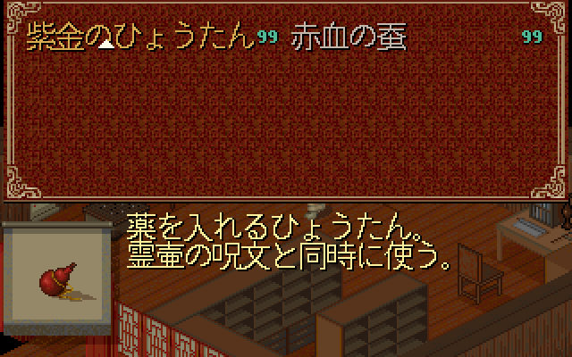
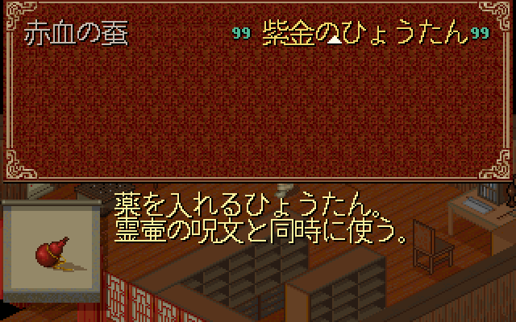
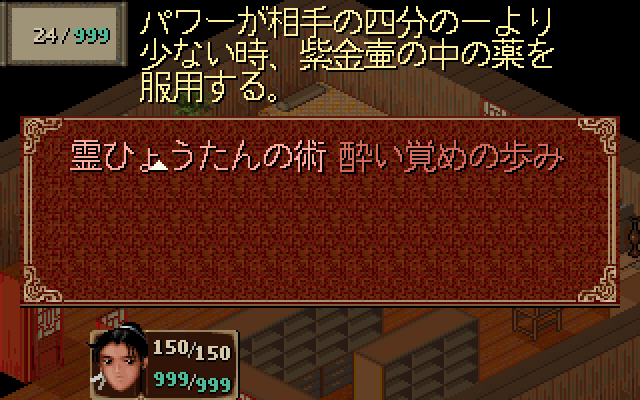
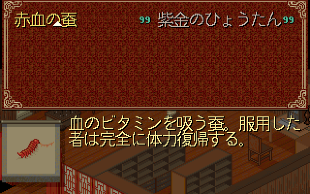
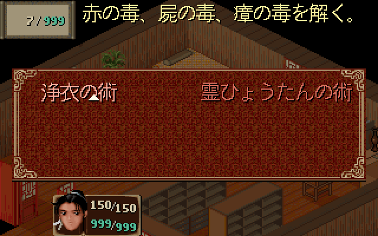

# Issue #5 R6：8 全角名称的游戏渲染图

2026-10-20，关联 [#5](https://github.com/othercat/sdlpal-jp/issues/5)、[字体对照 #10](https://github.com/othercat/sdlpal-jp/issues/10)、[总管 #1](https://github.com/othercat/sdlpal-jp/issues/1)。

> 本页保留 R6 历史图与当时的游标覆盖结果。后续 [R7 游标修复与前后对比](japanese-menu-cursor-layout.md)已将选中名称覆盖的 7／4 个正文墨点降为 0。当前校验器验证本页旧图时须加 `--legacy-cursor`。

**两个 8 全角名称在左右两列均完整容纳，物品数量与名称不重叠，法术 MP 与说明完整。** 本轮直接调用游戏源码绘制，新增 Test 出图模式；没有修改产品布局、字形、说明文本或原始资源。

用户已明确：“我自己验收就行，你只要游戏渲染图即可，不需要实机。”后续实际操作验收由用户完成。本轮交付源码游戏渲染图及检查结果，#5/#10 保持开放，等待用户验收反馈；不再要求用户配合窗口操作或采集。

## 物品和法术

物品 270「紫金のひょうたん」分别置于左右列，数量设为 99，以覆盖完整两位数字边界。场景使用客栈资源重建，所有菜单、物品图标、说明和数字均来自游戏绘制函数。

| 物品在左列，选中 | 物品在右列，选中 |
| --- | --- |
|  |  |

法术 384「霊ひょうたんの術」的资源 MP 成本为 24；夹具角色 MP 为 999。原对象 flags 为 10，场外不可用，所以名称采用现有灰显颜色。没有为了出图修改可用状态。三行说明和底部角色信息使用现有绘制路径。

| 法术在左列，选中 | 法术在右列，选中 |
| --- | --- |
|  |  |

现有选中游标在名称后绘制，会覆盖物品名称的 **7 个**正文墨点、法术名称的 **4 个**正文墨点。这是菜单当前的选中标记，不能算作右侧裁切，也不能声称选中时所有笔画都无遮挡。本轮保留该行为，另外输出未选中画面核对完整字形；此时说明和 MP 属于另一列被选中的对象。

| 右列物品未选中，全部笔画可查 | 右列法术未选中，全部笔画可查 |
| --- | --- |
|  |  |

左列未选中图：[物品](images/long-names/item-270-left-unselected-640.png)、[法术](images/long-names/magic-384-left-unselected-640.png)。全部八种状态的 320×200 原图及三档引擎输出保留在本机产物目录。

## 布局与像素检查

使用同一套 `PAL98_v1.72_20261014` 根资源和赤血蚕适配 SLF。内置 Japanese 字形、`UseISOFont=0`、16px、无外部 FontFile；`dwWordLength=16`，两个名称均为八个 JIS 字形，总推进宽度 128px。以下坐标均为内部 320×200 的首行。

| 检查项 | 物品 270 | 法术 384 |
| --- | --- | --- |
| 名称起点，左／右列 | `(15,12)`／`(163,12)` | `(35,70)`／`(170,70)` |
| 列间距 | 148px | 135px |
| 右列正文最右 x | 289 | 297 |
| 右列含阴影最右 x | 290 | 298 |
| 单个名称正文墨点 | 422 | 431 |
| 其他内容边界 | 数量 99 在 `x=292..303`，名称阴影止于 290 | MP `24 / 999` 在框内；框及阴影止于 `x=69`，说明从 `x=70` 开始 |

[`verify_long_name_rendering.py`](../tools/verify_long_name_rendering.py)独立读取源码 JIS 点阵和 DATA.MKF 的 UI 精灵，逐点核对名称正文、阴影、游标、数量及 MP；透明 RLE 的调色板索引 0 按不透明像素处理。四张未选中图合计 **1,706 个正文墨点**完整；四张选中图按实际游标覆写顺序检查，分别明确记录 7/4 个被覆盖点。预期像素缺失、错色或越界为 0，不把检查范围扩大为所有背景像素。

四张物品图均检查两位数量 99；两张目标法术选中图检查 `24 / 999` 的数字和斜线。菜单输出前后没有改变对象记录，法术排序仍由实际初始化函数完成。八个状态对应的说明右侧越界正文均为 0；图片复核中两项目标说明的行尾、底部与 MP 均完整。

三档放大调用生产 `VIDEO_Resize`、`VIDEO_UpdateScreen` / `VIDEO_RenderCopy`，由隐藏窗口的 Direct3D 目标纹理读回；没有用图片编辑器模拟引擎缩放。

| 尺寸 | 全部八种状态的结果 | 右列选中示例 |
| --- | --- | --- |
| 640×400，2 倍 | 与基础图最近邻逐像素相同 | 上方嵌图 |
| 960×600，3 倍 | 与基础图最近邻逐像素相同 | [物品](images/long-names/item-270-right-selected-960.png) / [法术](images/long-names/magic-384-right-selected-960.png) |
| 800×500，2.5 倍 | 每图 64,000 个源像素中心均保留，无新增混色 | [物品](images/long-names/item-270-right-selected-800.png) / [法术](images/long-names/magic-384-right-selected-800.png) |

非整数缩放会形成交替的 2/3 像素块，不声称与 Pillow 的半像素取样规则完全一致。这里验证的是引擎目标纹理，不是操作系统窗口 resize/DPI。

## 配置、复现与追溯

| 项目 | 记录 |
| --- | --- |
| 源码基线 | `feature @ 8ebd96e3e31e8210992588339823d2a1b1303c2a`，加本轮 Test 出图改动 |
| 独立分支 | `richardli/fix/5-render-eight-character-names-r6` |
| 构建 | Windows 11 Pro 10.0.26200，VS 2026 / v145，Test x64 |
| 字体与渲染 | Japanese 16px，UseISOFont=0，ScaleQuality=0；Direct3D flags=14，GLSL/触控覆盖关闭 |
| 布局 81–87 | `2,0` / `1,0` / `3,0` / `30,14` / `5,14` / `31,14` / `70,0` |
| SLF SHA256 | `f4ffb5753a1a168a23a27426aa6163cd35c35a85d3fd5a8d5f69c0ef2e7f595e` |
| 资源 | 17 个实际使用的 MKF/MSG/DAT 与 `D:\PAL\完整包\PAL98_v1.72_20261014` 逐项 SHA256 一致 |
| 本机产物 | `D:\Workspace\PALWork\artifacts\sdlpal-jp-issue-5\long-names-r6-20261020` |

夹具仅在内存中设定场景、HP/MP、两件物品或两个法术，清空装备以免菜单附加装备项；未写入存档或资源，也没有执行完整游戏路线。物品邻项为 149；法术左列测试以 390 为邻项，右列测试以 306 为邻项，保留实际菜单排序。Test 文件仍排除在 Release/Debug 游戏构建之外。

从仓库根目录运行；先按 [Test 构建命令](pal98-dialogue-pagination-scaling.md#验证与复现)生成程序，输出目录需存在。资源和 SLF 路径可替换为本机副本，资源目录保留末尾分隔符：

```powershell
$exe='D:\Workspace\PALWork\artifacts\sdlpal-jp-issue-5\long-names-r6-20261020\build\sdlpal.exe'
$out='D:\Workspace\PALWork\artifacts\sdlpal-jp-issue-5\long-names-r6-20261020'
$resources='D:\Workspace\PALWork\artifacts\sdlpal-jp-issue-5\gameplay-r3-20261020\runtime\'
$slf=Join-Path $resources 'paljpn-win-adapted.slf'
& $exe --render-evidence $resources $slf "$out\source" jp-long-names
& (Join-Path $env:USERPROFILE 'CodexTools\python\Scripts\python.exe') -B -X utf8 tools\verify_long_name_rendering.py $resources "$out\source" "$out\verification.json" --legacy-cursor
& $exe "--gtest_output=xml:$out\tests.xml"
```

实际验证结果：

- Test x64 构建成功，0 错误，3 条既有 SDL 警告；GTest 4/4 通过。
- 8 张基础菜单图、24 张缩放图通过；精选 12 张 PNG 无损转码，413,827 字节，RGB 像素往返一致。
- 将右列未选中物品末字「ん」的一个正文像素改黑，校验器按预期拒绝，负例不混入正式图片。
- 旧 `jp-pages` 模式重跑，44 张 BMP 及分页 CSV 与 #10 R3 逐字节相同；7 次真实翻页等待、69 字符 / 3,885 墨点、33 张缩放图再次通过。

[完整 manifest](evidence/issue-5-long-name-rendering.json)记录 exe、源码、资源、SLF、全部图片和验证哈希。实现提交、普通合并提交、远端祖先确认和分支清理回写 #5，#1/#10 同步当前交付与用户验收分工。此前 [11 对象实机记录](japanese-description-runtime-verification.md)、[同源字体对照](pal98-same-source-font-comparison.md)和[对白分页图](pal98-dialogue-pagination-scaling.md)继续作为各轮独立证据保存。

本轮没有增加实机结论。完整路线、战斗施法、OS 窗口/DPI、其他字体、DOS 与土星原生画面不在本次源码出图通过范围；实际验收由用户自行完成。
