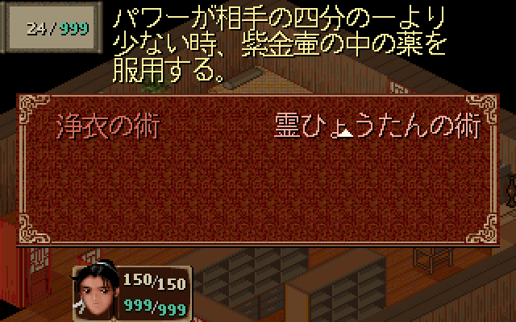
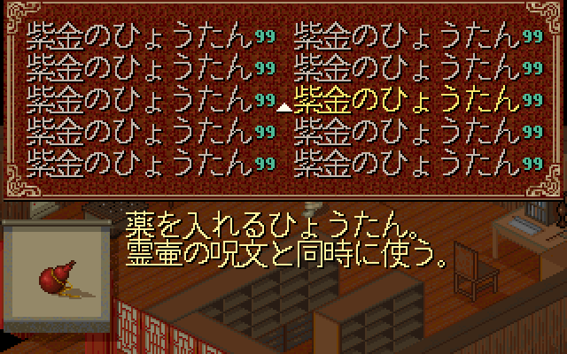
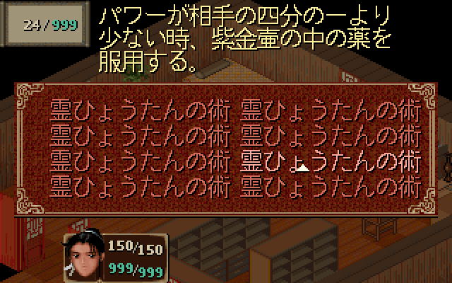
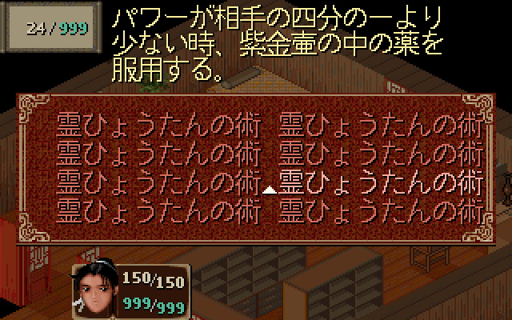

# Issue #5 R7：日文双列菜单的游标遮字修复

2026-10-20，关联 [#5](https://github.com/othercat/sdlpal-jp/issues/5)、[总管 #1](https://github.com/othercat/sdlpal-jp/issues/1)；字体对照背景见 [#10](https://github.com/othercat/sdlpal-jp/issues/10)。

**选中游标移至名称左侧，物品／法术的列间距分别增加 3／4px。**「紫金のひょうたん」「霊ひょうたんの術」被游标覆盖的正文墨点分别由 7／4 降为 0；右列名称、数量、MP 和说明均完整。产品代码只修改两种菜单的列间距与游标横向偏移公式。

本轮按用户要求交付源码生成的游戏渲染图。实际操作验收由用户自行完成，#5 保持开放；下图来自游戏绘制函数和隐藏窗口目标纹理读回。

## 日版布局核对与最小改动

已刷新 `PalMusicFan/sdlpal` 上游，`master` 为 `6dafc9c79718058f3a1a4ab8a3d3e30a102ab207`，检查 23 条远端分支的可达历史：

- 日文名称按 `dwWordLength=16` 处理，`32 / dwWordLength` 得到两列，最长 8 全角字推进 128px。原游标公式来自 [2015 年日文菜单提交](https://github.com/PalMusicFan/sdlpal/commit/4ba4cf325cb14f06d416c13da0952685086b373c)，横向偏移为 `dwWordLength * 5 / 2`，日文因此为 `+40`，落在名称内部。
- 已有 [83–87 布局实现](japanese-description-layout-verification.md)继续使用。`SCREENLAYOUT` 的 1–87 项没有物品／法术选中游标的位置配置；[上游说明布局提交](https://github.com/PalMusicFan/sdlpal/commit/d82e20f9fc38126602bebdd60f2aca3c4e552b09)调节的是法术 MP 框和说明区域。本轮未找到可直接沿用的游标避让修正。
- 指定资源中 UI 精灵 69 为 9×6px。原双列间隙在扣除前列数量或名称阴影后仅有物品 7px／法术 6px，直接将游标移到左侧会碰到前列内容。两种菜单仅需各增加 3／4px 列间距，就能给 9px 游标留下 1px 分隔。
- 这里核对的是日版 SDLPAL 源码及 SLF 布局。没有土星原机帧缓冲对照，不声称游标位置逐像素复刻土星。

下表均为内部 320×200 画布的首行坐标；游标 y 始终为名称 y+10，行距始终为 18px。

| 参数 | 物品：修复前 → 后 | 法术：修复前 → 后 |
| --- | --- | --- |
| 列间距 | 148 → 151 | 135 → 139 |
| 左／右名称 x | 15／163 → 15／166 | 35／170 → 35／174 |
| 名称 y | 12 → 12 | 70 → 70 |
| 左／右游标 x | 55／203 → 5／156 | 75／210 → 25／164 |
| 右列名称含阴影最右 x | 290 → 293 | 298 → 302 |
| 左／右数量 99 的范围 | 144..155／292..303 → 144..155／295..306 | 不适用 |

`itemmenu.c`、`magicmenu.c` 各改两个公式，仅在 `iItemsPerLine == 2` 时生效。中文 `dwWordLength=10` 的三列布局保留原列间距 100／87 和游标偏移 +25。使用原游标精灵及绘制顺序，字形、字号、行距、SLF、物品属性和游戏输入逻辑均沿用现有实现。

## 前后游戏渲染图

相同资源、相同 Japanese 16px 字形、相同 Test 夹具。图为引擎输出的 640×400，无损转码成 PNG；左为基线产品代码，右为修复后。物品选中色沿用引擎脉动，独立运行的色阶可能略有差异。

| 物品 270：修复前，游标覆盖 7 个正文墨点 | 修复后，覆盖 0 |
| --- | --- |
|  |  |

| 法术 384：修复前，游标覆盖 4 个正文墨点 | 修复后，覆盖 0 |
| --- | --- |
|  |  |

左列修复后：[物品](images/menu-cursor/item-270-left-selected-640-after.png)、[法术](images/menu-cursor/magic-384-left-selected-640-after.png)。2.5 倍引擎输出：[物品](images/menu-cursor/item-270-right-selected-800-after.png)、[法术](images/menu-cursor/magic-384-right-selected-800-after.png)。

另外用**内存中的重复对象夹具**填满物品五行、法术四行，选中第三行右列，专门检查前一列数量、相邻上下行和右边界。这是边界测试，未声称正常游玩会获得重复的法术列表。

| 满页物品：修复前 | 修复后 |
| --- | --- |
|  |  |

| 满页法术：修复前 | 修复后 |
| --- | --- |
|  |  |

夹具通过实际菜单初始化和更新函数绘制；法术密排的选中位置通过五次真实菜单右移更新到达。物品数量为 99，法术资源 MP 成本为 24，角色 MP 为 999；法术场外不可用的原属性保留，采用现有灰显色。对象属性表没有修改，未写存档。

## 验证结果

独立校验器 [`verify_long_name_rendering.py`](../tools/verify_long_name_rendering.py)读取源码 JIS 点阵和资源 UI 精灵。修复后的默认检查要求正文、阴影与游标完全不相交，不能再用旧版的游标覆盖规则放行遮字。

| 检查 | 实际结果 |
| --- | --- |
| 前后源码出图 | 各 8 个左右列选中／未选中状态、2 张密排图，以及 30 张缩放图，共各 40 张 BMP |
| 名称正文 | 每组 26 个名称位置、208 个字符、11,080 个正文墨点；修复后缺失、裁切、错色、游标覆盖均为 0 |
| 旧问题复现 | 单项选中图覆盖 7／4 个墨点；包含两张密排图后合计 33 → 0 |
| 阴影、数量、游标 | 游标不碰名称阴影或前列数量；全部物品 99、普通选中法术的 MP 24/999 精灵逐点通过 |
| 菜单外区域 | 10 对基础图中，名称／游标／数量网格外所有 RGB 像素逐点相同，包含说明、MP 框、角色信息和场景 |
| 缩放 | 2×、3×与基础图整数最近邻逐像素相同；2.5×每图 64,000 个源像素中心保留，无新增混色 |
| 中文兼容 | `cn-jp-font-field` 的 12 张 BMP 及 CSV 与 #10 R3 存档逐字节相同，保留中文三列 |
| 日文对白回归 | `jp-pages` 的 44 张 BMP 及分页 CSV 与 #10 R3 逐字节相同；7 次翻页、69 字符／3,885 墨点及 33 张缩放图通过 |
| 负向检查 | 在独立副本中将一个名称正文点恢复成旧游标色；校验器正确拒绝，未污染正式图片 |
| 构建与测试 | VS 2026 / v145，修复前后 Test x64 和修复后 Release x64 均成功，分别 0 错误／3 条既有 SDL 警告；GTest 4/4 通过 |
| 输入完整性 | 本次实际读取的 17 个 MKF/MSG/DAT 与指定 PAL98 根包逐项 SHA256 相同；适配 SLF 指纹不变 |
| 发布图片 | 精选 12 张无损 PNG，共 434,524 字节，RGB 像素往返一致 |

校验覆盖上述预期像素及前后差异范围。其他字体、DOS、战斗施法、完整游戏流程、OS 窗口 resize/DPI 由后续验收覆盖；源码图不代表这些项目已通过。

## 配置、复现与追溯

| 项目 | 记录 |
| --- | --- |
| 源码基线 | `feature @ 7600f63da72dbd9a0b09a6840142b1ea08b7a333` |
| 独立分支 | `richardli/fix/5-japanese-menu-cursor-r7` |
| 前后构建关系 | 同一份新增 Test 密排夹具；修复前两个产品文件的 Git blob 与基线相同，修复后仅上述四个公式变化 |
| 字体／渲染 | Japanese 16px，UseISOFont=0，无外部 FontFile，ScaleQuality=0；Direct3D flags=14，关闭 GLSL 和触控覆盖 |
| 布局 81–87 | `2,0` / `1,0` / `3,0` / `30,14` / `5,14` / `31,14` / `70,0` |
| SLF SHA256 | `f4ffb5753a1a168a23a27426aa6163cd35c35a85d3fd5a8d5f69c0ef2e7f595e` |
| 资源来源 | `D:\PAL\完整包\PAL98_v1.72_20261014` |
| 环境／执行者 | Windows 11 Pro 10.0.26200；VS 2026；官方 CPython 3.11.9；Codex，2026-10-20 |
| 本机产物 | `D:\Workspace\PALWork\artifacts\sdlpal-jp-issue-5\cursor-layout-r7-20261020` |
| Release 文件 | 产物目录下 `build-release\sdlpal.exe`，供用户后续验收；本轮未交互启动 |
| Release SHA256 | `a8ecb87e0a02a89ff737c1cfb118eb19da6b830774e042b8db7bd7a0738a7aa0` |

构建沿用 [Test 构建方法](pal98-dialogue-pagination-scaling.md#验证与复现)，Release 使用相同 VS 2026 / v145、x64 参数，将配置改为 Release，并去掉 Test 专用的 `GTEST_HAS_TR1_TUPLE=0`。Test 出图代码不进入 Release/Debug。

从仓库根目录运行；输出目录需已存在，资源目录保留末尾分隔符：

```powershell
$out='D:\Workspace\PALWork\artifacts\sdlpal-jp-issue-5\cursor-layout-r7-20261020'
$resources='D:\Workspace\PALWork\artifacts\sdlpal-jp-issue-5\gameplay-r3-20261020\runtime\'
$slf=Join-Path $resources 'paljpn-win-adapted.slf'
& "$out\build-before\sdlpal.exe" --render-evidence $resources $slf "$out\before" jp-cursor-grid
& "$out\build-after\sdlpal.exe" --render-evidence $resources $slf "$out\after" jp-cursor-grid
& (Join-Path $env:USERPROFILE 'CodexTools\python\Scripts\python.exe') -B -X utf8 tools\verify_long_name_rendering.py $resources "$out\before" "$out\before-verification.json" --legacy-cursor --dense-grid
& (Join-Path $env:USERPROFILE 'CodexTools\python\Scripts\python.exe') -B -X utf8 tools\verify_long_name_rendering.py $resources "$out\after" "$out\after-verification.json" --dense-grid
& "$out\build-after\sdlpal.exe" "--gtest_output=xml:$out\tests.xml"
```

完整哈希、像素检查、前后差异、回归及图片清单见 [manifest](evidence/issue-5-menu-cursor.json)。实现提交、普通合并提交、分支最终 SHA 与清理记录保存在 [Issue #5](https://github.com/othercat/sdlpal-jp/issues/5)，合入目标为 `feature`。如需回滚，通过 Issue 中的实现 SHA 撤销本轮改动；若用户验收发现问题，从最新 `feature` 新建修复分支继续追溯同一 Issue。
