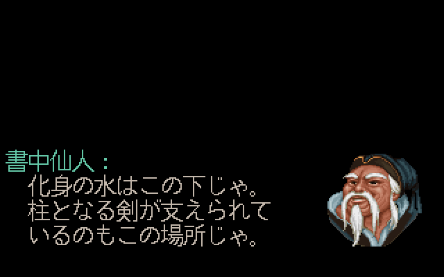
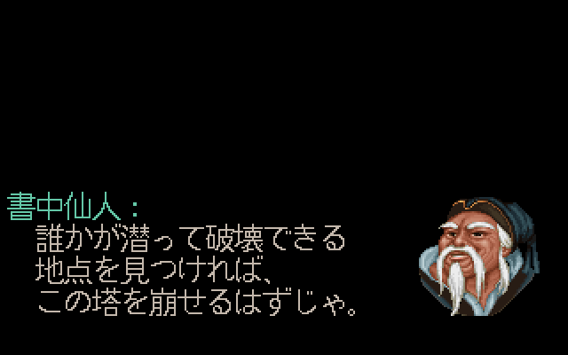
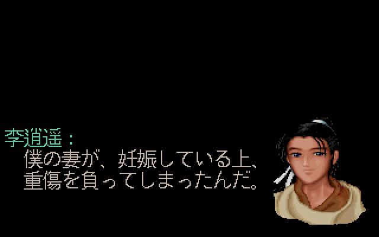
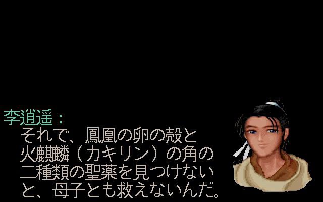
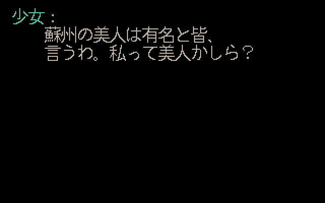
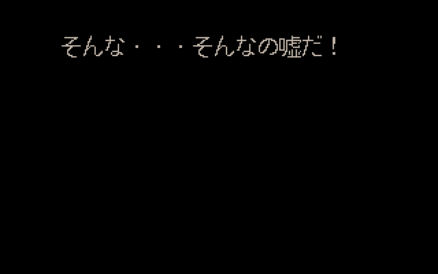
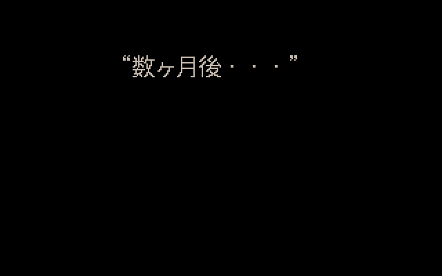
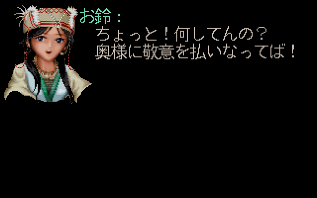
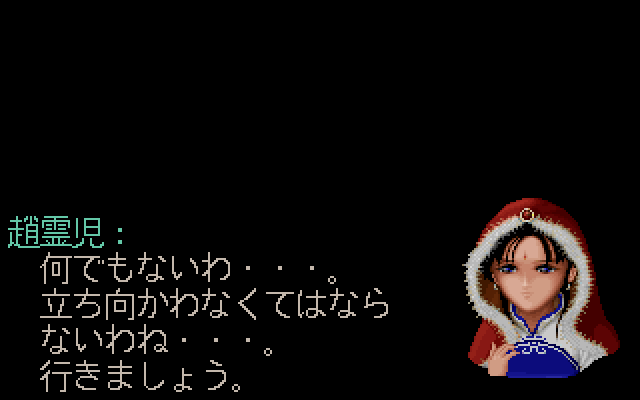

# Issue #3：恢复 Win 日文对白遗漏映射

2026-10-20，关联 [#3](https://github.com/othercat/sdlpal-jp/issues/3)、[总管 #1](https://github.com/othercat/sdlpal-jp/issues/1)。

**119 组全部核对并补回，覆盖 290 个 Win 消息 ID，采用土星原文 362 条和 11 个 CLEAR 标记。** 原有 4,654 个块连同注释逐字节保留。全部子 Issue 实现与专项验证完成后，再由用户统一实机验收；本次没有进行游戏流程验收。

## R2：修正预览图完全透明（2026-10-20）

R1 的 18 张 PNG 虽有正确的颜色像素，却全部带有值为 0 的 alpha 通道，因此在聊天和 Markdown 中显示为空白。此前只比对 RGB 和文件指纹，遗漏了透明度检查；问题来自导出程序。R1 的图片指纹保留在历史验证 JSON 中，不代表本页当前图片。

Test 证据入口改用 RGB888 读回不透明的游戏帧，不再导出目标纹理无效的 alpha；新增导出工具要求输入完全不透明、输出 RGB PNG，并重新读取文件核对像素。已重新生成全部 72 张 BMP，其 RGB 像素和两份 4,766 行引擎 CSV 均与 R1 相同。18 张 PNG 的有效 alpha 现在均为 255，叠在白色和深色背景上均与源 RGB 一致；仓库全部 81 张文档 PNG 的透明度检查通过。

Test/x64 构建和 2 项测试（4 个子例）通过；真实 R1 透明 BMP 被新导出工具拒绝，未产生输出目录。映射、SLF、字体及 Release 渲染代码未改。[R2 验证与图片指纹](evidence/issue-3-opaque-previews.json)记录前后格式、全部图片 RGB 对比、资源指纹和执行命令。本轮仅修正证据图片导出，实机验收仍由用户统一进行。

## 范围与实现

原转换器切换 32 段硬编码脚本起点时遗漏了 7 段。当前在原段之后追加 7 个独立起点和准确组数，采用脚本首尾 ID 保护；不把全剧本按单一偏移移动。GUI 和 CLI 默认使用恢复后的映射。引擎 Release 逻辑未改，C++ 变更仅属于 Test 证据入口。

`--upstream-baseline` 只供审计复现旧输出；`verify_baseline.py` 继续核对 7 个输入及上游输出全文指纹，并分别记录当前/原始脚本 SHA。未修改原始游戏文件、Saturn 文本或存档。#4 的 10 组错配、#8 的重复键、#6 的原译差异仍独立跟进。

| Win ID | 组数 | Saturn ID | Win / Saturn 起点脚本 | 内容 |
| --- | ---: | --- | --- | --- |
| 2686–2713 | 13 | 3602–3635 | 7583 / 8508 | 苏州街头、卖艺、比武开始 |
| 9110–9339 | 93 | 11759–12050 | 24461 / 26845 | 锁妖塔、剑圣、神木林、阿奴 |
| 9902 | 1 | 12849 | 27933 / 30429 | 月如死讯 |
| 9976 | 1 | 14968 | 28097 / 35596 | 数月后 |
| 10888–10895 | 4 | 13801–13809 | 30408 / 32559 | 神像前阻止、守卫问候 |
| 11164–11168 | 2 | 15348–15353 | 32201 / 37664 | 灵儿决意、巫后石像 |
| 12053–12069 | 5 | 14853–14871 | 35006 / 35380 | 十年前来福伯、丁大伯、船商 |

逐组审查覆盖全部 119 组的说话者、事件与语义顺序。[完整记录](evidence/issue-3-dialogue-review.json)逐项保留 Win/JP 原文、全部 ID、起止脚本、场景上下文、采用结论及已知译文问题。本文末尾提供编号索引。

特别核对了非连续段：9976/14968 前五组均围绕水灵珠、巫后咒文与赵姑娘恢复，转场指令同为 `0050(2) → 0076(FFFF) → 003B → FFFF → 0043(18)`；11164–11167/15348–15352 的前文、人物和 `003D(0058,0,0)` 相同；11168/15353 都是居中的石像提示。土星后续 15354–15360 是额外守卫对白，不扩展导入。原来另外 11 组 / 35 条未选土星消息继续保留为“本轮不导入”，完整编号在 JSON 中。

## 验证结果

环境：Windows，官方 CPython 3.11.9 venv；VS 2026 Community / v145 / SDK 10.0 构建 Test 成功。构建日志保留既有编译警告，无错误。转换与原始二进制解析独立核对，报告见 [R1 映射验证 JSON](evidence/issue-3-mapping-verification.json)；其中旧图片文件指纹由上方 R2 报告补充更正。

| 检查 | 修前 | 修后 |
| --- | ---: | ---: |
| SLF 消息块 | 4654 | 4773 |
| 唯一键 / 引擎可读键 | 4647 | 4766 |
| 缺失 Win 区间 | 119 | 0 |
| 恢复 Win ID / Saturn ID | — | 290 / 362 |
| 重复键 / 有内容冲突的重复键 | 6 / 2 | 6 / 2，原样保留给 #8 |
| 本轮来源解码替代字符 | — | 0 |

Win 全部消息缓冲区原本含 12 个 GBK 解码替代字符，核对工具按上游替代策略读取；本轮 119 组的中日正文均没有该字符，未将“本轮零替代”推广至全部资源。

默认输出 Windows SHA256 为 `01e0dbba260e6a13c02963d9542bb63171213a6979b475f6515c7c1cab524331`，统一 LF 后为 `210f9e5772062c19b6af7e1f589288f2809c8d997dc9ed9d47780afad8c25027`。修前全文 SHA 仍为 `f15a22cb2e999680119e08bae021cb61f366d6f45655ef4e33019472e9388c54`；新文件以旧文件全部字节作为前缀。

资源校验从原始 `SSS.MKF` 与土星脚本重建分组，不依赖转换器输出判断缺失；每个新增块必须等于审查记录和原始 Saturn 文本，包含 CLEAR。全部 4,766 个运行时键再经过引擎 `PAL_GetMsgNum` / `PAL_GetMsg` 加载，逐项核对条数和终止符；原有 4,647 个键结果不变。

9/9 既有工具测试通过。真实 GUI `generate()` 回调使用工作副本和日文目录，实际调用转换子进程，生成 SLF 与 CLI 字节一致；未创建 Tk 窗口。负例分别删除一组、替换新增日文、删除实际 CLEAR 行、追加重复键、改动旧输出、追加额外 DESCRIPTIONS 配置块，六项均被拒绝且没有生成验证目录；直接改坏新段的 Win 脚本锚点后，转换器退出 1 且不写输出。

独立代码复核发现并补强了“MESSAGE 外额外块”和“CSV 截短仍成功”的验证缺口。引擎现在必须读到 4,766 个不同键、8 个绘制代表，以及正确的修前/修后已映射与缺失数量；截短、重复、取消代表图三个负例均退出 1。最终完整出图与补强前的 18 张发布 PNG 逐字节相同，且引擎显式确认日本字形、16 px 与禁用 ISO 字体替代。

#5 赤血蚕适配可继续作用于新输出，仅改变 12920–12921 组。适配后 SHA256 为 `078e53256fafba52f00c64c981892e44453fa9a11f1ab35bb1303c9e6df2963f`。覆盖核对应在这一步之前执行，因为覆盖工具要求原有块字节不变。

## 源码渲染前后对比

下面均为 **Test 引擎源码渲染，黑色中性背景，非剧情实机截图**。使用同一 PAL98 资源的 17 个文件逐项比对一致的 ASCII 路径副本，内置日文字体 16 px，生产 SDL Direct3D 路径按最近邻输出 320×200、640×400、960×600、800×500。没有注入游戏按键或改写存档。R2 前后合计 72 张 BMP 留在产物目录，发布 18 张易读的不透明 RGB 640×400 PNG（共 107,690 字节）；R1 原始产物及错误透明图另行保留。

8 组代表对白覆盖全部 7 段。有显式对话指令的组使用原 Win 参数；2688 和 12053 是事件续入口无显式命令，使用 `PAL_EndDialog` 的上方/无头像默认值，没有误继承附近其他 NPC 的头像。头像来自当前 Win `RGM.MKF`，调色板采用渲染夹具设置；这不构成 #9 土星头像调色板验收。

锁妖塔书中仙（9110–9115）：修前查不到正文；修后恢复两页，实际执行一次 CLEAR 等待。

| 修前 | 修后第一页 | 修后第二页 |
| --- | --- | --- |
|  |  |  |

逍遥解释救灵儿所需药材（9307–9311）：实际执行另一处 CLEAR；第二页四行完整显示。

| 修前 | 修后第一页 | 修后第二页 |
| --- | --- | --- |
|  |  |  |

其余代表图：

| Win ID / 内容 | 修前 | 修后 |
| --- | --- | --- |
| 2688 / 苏州少女 |  |  |
| 9902 / 不愿相信月如死讯 |  |  |
| 9976 / 数月后转场 |  |  |
| 10888 / 阿奴阻止冒犯神像 |  |  |
| 11164 / 灵儿面对命运 |  |  |
| 12053 / 十年前来福伯 |  |  |

本轮代表图实际覆盖的是两处显式 CLEAR 分页；不将这两次等待写成自动四行翻页的新增覆盖。自动分页的既有证据见 [#10 分页验证](pal98-dialogue-pagination-scaling.md)。对所有 119 组完成的是文字、映射与引擎加载验证，未声称全部剧情场景已运行。

## 转交 #6 的原译问题

| Win / Saturn ID | 原译差异 | 本轮处置 |
| --- | --- | --- |
| 9208 / 11889 | “你怎么不阻止他们呢？”变成命令 `奴等を止めよ！` | 保留原译，#6 修订 |
| 9212 / 11894 | “岂有此理！”变成询问 `そうかのう！？` | 保留原译，#6 修订 |
| 9325 / 12031 | “这颗蛋……你……孵？”变成 `この卵は・・・キミの？` | 保留原译，#6 修订 |
| 12055 / 14855 | “好像以前都没见过”变成 `どっかで見たようだが` | 保留原译，#6 修订 |

9155–9159 的共同脱困、9175–9180 的锁剑柱细节存在局部省略；9121–9128 未明说书中仙，但两侧 `003D(0045,0,0)` 相同。这些不构成换段证据；是否补译留 #6，不能称为整部日文已审校通过。

## 复现

`PC`、`SAT` 对应 [固定输入指纹](../tools/japanese/upstream.json)。产物使用新的路径，避免覆盖既有输出：

```powershell
$jpPython = Join-Path $env:USERPROFILE 'CodexTools\python\Scripts\python.exe'
& $jpPython -B -X utf8 tools\japanese\verify_baseline.py 'PC' 'SAT' 'OUT\before'
& $jpPython -B -X utf8 tools\japanese\makemessage_j.py 'PC' 'SAT' 'OUT\after.slf' gbk
& $jpPython -B -X utf8 tools\japanese\verify_restored_dialogues.py 'PC' 'SAT' 'OUT\before\paljpn-win.slf' 'OUT\after.slf' 'OUT\verify'
& $jpPython -B -X utf8 tests\test_japanese_conversion_tools.py -v
```

构建 `win32/sdlpal.sln` 的 Test/x64（本机 v145，`CL=/utf-8 /DGTEST_HAS_TR1_TUPLE=0`）。分别建立 `render-before`、`render-after` 目录并复制 `OUT/verify/recovery-fixtures.csv` 进去：

```powershell
& 'BUILD\sdlpal.exe' --render-evidence 'ASCII_PC\' 'OUT\before\paljpn-win.slf' 'OUT\render-before' jp-recovery-before
& 'BUILD\sdlpal.exe' --render-evidence 'ASCII_PC\' 'OUT\after.slf' 'OUT\render-after' jp-recovery
& $jpPython -B -X utf8 tools\export_recovery_previews.py 'OUT\render-before' 'OUT\render-after' 'OUT\opaque-pngs'
& $jpPython -B -X utf8 tests\test_recovery_preview_export.py -v
& $jpPython -B -X utf8 tools\adapt_red_silkworm_description.py 'OUT\after.slf' 'OUT\after-adapted.slf'
```

Python 转换接受本机原始中文路径；旧引擎命令行 GamePath 的非 ASCII 限制沿用 #2 记录，所以源码渲染使用校验过的 ASCII 副本。生成 SLF 需配置加载；仅替换 exe 不会恢复旧 SLF 缺少的文本。

本机完整产物：`D:\Workspace\PALWork\artifacts\sdlpal-jp-issue-3\missing-dialogue-r1-20261020`，包含前后 SLF、输入指纹、构建日志、负例、GUI 子进程日志、引擎逐键 CSV 和全部 BMP。提交、普通合并 SHA 与分支清理记录回填 #3 和 #1。Issue 维持开放，待统一实机验收；届时覆盖上述 7 段剧情及相邻对白、条件分支、转场、分页。

R2 产物：`D:\Workspace\PALWork\artifacts\sdlpal-jp-issue-3\opaque-previews-r2-20261020`，包含旧透明 PNG 备份、新构建、72 张源码 BMP、18 张不透明 PNG、测试日志与验证报告。导出工具需要 Pillow；输入目录必须来自本轮修正后的 Test 构建，目标目录必须尚不存在。

## 119 组处置索引

全部行的采用结论都是“映射已确认，采用土星原文，保留控制标记”。逐句原文和审查字段在 [JSON](evidence/issue-3-dialogue-review.json) 的 `pairs` 中按同序保存；场景编号来自静态控制流上下文，不是存档实测。

| 序号 | Win ID | Saturn ID | Win / Saturn 起点脚本 | 场景依据 / 后续 |
| ---: | --- | --- | --- | --- |
| 1 | 2686–2687 | 3602–3604 | 7583 / 8508 | Win scene23/map23；提示在scene26/map26 |
| 2 | 2688–2690 | 3605–3607 | 7586 / 8512 | Win scene23/map23；提示在scene26/map26 |
| 3 | 2691–2692 | 3608–3609 | 7590 / 8516 | Win scene23/map23；提示在scene26/map26 |
| 4 | 2693–2694 | 3610–3612 | 7593 / 8519 | Win scene23/map23；提示在scene26/map26 |
| 5 | 2695–2697 | 3613–3616 | 7596 / 8523 | Win scene23/map23；提示在scene26/map26 |
| 6 | 2698 | 3617 | 7600 / 8528 | Win scene23/map23；提示在scene26/map26 |
| 7 | 2699–2700 | 3618–3619 | 7602 / 8530 | Win scene23/map23；提示在scene26/map26 |
| 8 | 2701–2702 | 3620–3622 | 7605 / 8533 | Win scene23/map23；提示在scene26/map26 |
| 9 | 2703–2704 | 3623–3625 | 7609 / 8538 | Win scene23/map23；提示在scene26/map26 |
| 10 | 2705–2706 | 3626–3627 | 7612 / 8542 | Win scene23/map23；提示在scene26/map26 |
| 11 | 2707–2708 | 3628–3629 | 7615 / 8545 | Win scene23/map23；提示在scene26/map26 |
| 12 | 2709–2711 | 3630–3633 | 7618 / 8548 | Win scene23/map23；提示在scene26/map26 |
| 13 | 2712–2713 | 3634–3635 | 7622 / 8553 | Win scene23/map23；提示在scene26/map26 |
| 14 | 9110–9115 | 11759–11765 | 24461 / 26845 | scene154/map74，入场24148 |
| 15 | 9116–9120 | 11766–11771 | 24470 / 26855 | scene154/map74，入场24148 |
| 16 | 9121–9128 | 11772–11782 | 24477 / 26863 | scene154/map74，入场24148 |
| 17 | 9129–9130 | 11783–11785 | 24486 / 26876 | scene154/map74，入场24148 |
| 18 | 9131–9133 | 11786–11789 | 24490 / 26881 | scene154/map74，入场24148 |
| 19 | 9134–9135 | 11790–11793 | 24499 / 26891 | scene154/map74，入场24148 |
| 20 | 9136–9143 | 11794–11803 | 24503 / 26897 | scene154/map74，入场24148 |
| 21 | 9144–9145 | 11804–11806 | 24515 / 26910 | scene154/map74，入场24148 |
| 22 | 9146–9152 | 11807–11815 | 24519 / 26915 | scene154/map74，入场24148 |
| 23 | 9153–9154 | 11816–11817 | 24534 / 26931 | scene154/map74，入场24148 |
| 24 | 9155–9159 | 11818–11822 | 24542 / 26939 | scene154/map74，入场24148 |
| 25 | 9160–9161 | 11823–11825 | 24548 / 26946 | scene154/map74，入场24148 |
| 26 | 9162–9166 | 11826–11832 | 24553 / 26952 | scene154/map74，入场24148 |
| 27 | 9167–9168 | 11833–11835 | 24578 / 26980 | scene154/map74，入场24148 |
| 28 | 9169–9170 | 11836–11837 | 24586 / 26989 | scene154/map74，入场24148 |
| 29 | 9171–9172 | 11838–11839 | 24591 / 26994 | scene154/map74，入场24148 |
| 30 | 9173–9174 | 11840–11841 | 24597 / 27000 | scene154/map74，入场24148 |
| 31 | 9175–9180 | 11842–11849 | 24602 / 27005 | scene154/map74，入场24148 |
| 32 | 9181–9183 | 11850–11852 | 24611 / 27017 | scene154/map74，入场24148 |
| 33 | 9184–9186 | 11853–11855 | 24702 / 27108 | scene172/map18、170/map9、171/map119 |
| 34 | 9187–9188 | 11856–11859 | 24716 / 27123 | scene172/map18、170/map9、171/map119 |
| 35 | 9189 | 11860–11861 | 24729 / 27139 | scene172/map18、170/map9、171/map119 |
| 36 | 9190 | 11862 | 24743 / 27154 | scene172/map18、170/map9、171/map119 |
| 37 | 9191 | 11863 | 24781 / 27193 | scene145/map185 |
| 38 | 9192 | 11864 | 24816 / 27228 | scene145/map185 |
| 39 | 9193–9194 | 11865–11868 | 24931 / 27344 | scene152/map102，入场24908 |
| 40 | 9195–9196 | 11869–11871 | 24937 / 27352 | scene152/map102，入场24908 |
| 41 | 9197–9199 | 11872–11876 | 24941 / 27357 | scene152/map102，入场24908 |
| 42 | 9200–9201 | 11877–11879 | 24955 / 27373 | scene152/map102，入场24908 |
| 43 | 9202–9203 | 11880–11882 | 24964 / 27383 | scene152/map102，入场24908 |
| 44 | 9204–9206 | 11883–11887 | 24969 / 27389 | scene152/map102，入场24908 |
| 45 | 9207–9208 | 11888–11889 | 25006 / 27428 | scene151/map137，入场24998；原译差异留 #6 |
| 46 | 9209–9210 | 11890–11892 | 25012 / 27434 | scene151/map137，入场24998 |
| 47 | 9211–9212 | 11893–11894 | 25016 / 27439 | scene151/map137，入场24998；原译差异留 #6 |
| 48 | 9213 | 11895 | 25026 / 27449 | scene151/map137，入场24998 |
| 49 | 9214 | 11896 | 25040 / 27463 | scene161/map136，events2680–2686 |
| 50 | 9215 | 11897–11898 | 25045 / 27468 | scene161/map136，events2680–2686 |
| 51 | 9216 | 11899 | 25050 / 27474 | scene161/map136，events2680–2686 |
| 52 | 9217 | 11900 | 25055 / 27479 | scene161/map136，events2680–2686 |
| 53 | 9218 | 11901 | 25060 / 27484 | scene161/map136，events2680–2686 |
| 54 | 9219 | 11902 | 25065 / 27489 | scene161/map136，events2680–2686 |
| 55 | 9220 | 11903 | 25070 / 27494 | scene161/map136，events2680–2686 |
| 56 | 9221 | 11904 | 25976 / 28400 | scene187、177、178 |
| 57 | 9222 | 11905 | 25983 / 28407 | scene187、177、178 |
| 58 | 9223–9224 | 11906–11908 | 25989 / 28413 | scene193/map151，events3301、3302 |
| 59 | 9225–9226 | 11909–11910 | 26005 / 28430 | scene193/map151，events3301、3302 |
| 60 | 9227–9228 | 11911–11912 | 26011 / 28436 | scene193/map151，events3301、3302 |
| 61 | 9229 | 11913 | 26015 / 28440 | scene193/map151，events3301、3302 |
| 62 | 9230–9231 | 11914–11916 | 26020 / 28445 | scene193/map151，events3301、3302 |
| 63 | 9232 | 11917 | 26025 / 28451 | scene193/map151，events3301、3302 |
| 64 | 9233 | 11918 | 26059 / 28485 | scene193/map151，events3301、3302 |
| 65 | 9234–9235 | 11919–11920 | 26067 / 28493 | scene193/map151，events3301、3302 |
| 66 | 9236–9238 | 11921–11923 | 26083 / 28509 | scene193/map151，events3301、3302 |
| 67 | 9239 | 11924 | 26091 / 28517 | scene193/map151，events3301、3302 |
| 68 | 9240 | 11925 | 26205 / 28561 | scene186/map152，event3116 |
| 69 | 9241–9243 | 11926–11928 | 26216 / 28567 | scene186/map152，event3116 |
| 70 | 9244–9245 | 11929–11932 | 26229 / 28573 | scene186/map152，event3116 |
| 71 | 9246–9249 | 11933–11938 | 26234 / 28580 | scene186/map152，event3116 |
| 72 | 9250–9251 | 11939–11942 | 26241 / 28590 | scene186/map152，event3116 |
| 73 | 9252–9253 | 11943–11944 | 26245 / 28596 | scene186/map152，event3116 |
| 74 | 9254–9256 | 11945–11947 | 26269 / 28601 | scene186/map152，event3116 |
| 75 | 9257–9258 | 11948–11950 | 26274 / 28607 | scene186/map152，event3116 |
| 76 | 9259–9260 | 11951–11952 | 26279 / 28613 | scene186/map152，event3116 |
| 77 | 9261–9262 | 11953–11955 | 26286 / 28617 | scene186/map152，event3116 |
| 78 | 9263 | 11956 | 26297 / 28623 | scene186/map152，event3116 |
| 79 | 9264–9265 | 11957–11958 | 26308 / 28634 | scene186/map152，event3116 |
| 80 | 9266–9267 | 11959–11960 | 26426 / 28645 | scene189/map153，入场26368 |
| 81 | 9268–9269 | 11961–11962 | 26430 / 28650 | scene189/map153，入场26368 |
| 82 | 9270–9272 | 11963–11965 | 26436 / 28654 | scene189/map153，入场26368 |
| 83 | 9273 | 11966 | 26457 / 28661 | scene189/map153，入场26368 |
| 84 | 9274–9275 | 11967–11968 | 26463 / 28665 | scene189/map153，入场26368 |
| 85 | 9276–9277 | 11969–11970 | 26468 / 28669 | scene189/map153，入场26368 |
| 86 | 9278–9280 | 11971–11973 | 26472 / 28673 | scene189/map153，入场26368 |
| 87 | 9281–9283 | 11974–11977 | 26477 / 28678 | scene189/map153，入场26368 |
| 88 | 9284–9287 | 11978–11983 | 26487 / 28691 | scene189/map153，入场26368 |
| 89 | 9288–9291 | 11984–11987 | 26493 / 28700 | scene189/map153，入场26368 |
| 90 | 9292–9294 | 11988–11990 | 26500 / 28707 | scene189/map153，入场26368 |
| 91 | 9295–9298 | 11991–11995 | 26505 / 28712 | scene189/map153，入场26368 |
| 92 | 9299–9300 | 11996–11998 | 26511 / 28719 | scene189/map153，入场26368 |
| 93 | 9301–9303 | 11999–12001 | 26515 / 28724 | scene189/map153，入场26368 |
| 94 | 9304–9306 | 12002–12005 | 26520 / 28729 | scene189/map153，入场26368 |
| 95 | 9307–9311 | 12006–12012 | 26525 / 28735 | scene189/map153，入场26368 |
| 96 | 9312–9313 | 12013–12015 | 26532 / 28745 | scene189/map153，入场26368 |
| 97 | 9314–9315 | 12016–12017 | 26535 / 28749 | scene189/map153，入场26368 |
| 98 | 9316–9317 | 12018–12021 | 26539 / 28753 | scene189/map153，入场26368 |
| 99 | 9318–9319 | 12022–12024 | 26543 / 28759 | scene189/map153，入场26368 |
| 100 | 9320–9323 | 12025–12029 | 26547 / 28764 | scene189/map153，入场26368 |
| 101 | 9324–9325 | 12030–12031 | 26553 / 28771 | scene189/map153，入场26368；原译差异留 #6 |
| 102 | 9326–9329 | 12032–12037 | 26557 / 28775 | scene189/map153，入场26368 |
| 103 | 9330–9331 | 12038–12039 | 26564 / 28784 | scene189/map153，入场26368 |
| 104 | 9332–9333 | 12040–12041 | 26567 / 28787 | scene189/map153，入场26368 |
| 105 | 9334–9335 | 12042–12043 | 26576 / 28796 | scene189/map153，入场26368 |
| 106 | 9336–9339 | 12044–12050 | 26581 / 28801 | scene189/map153，入场26368 |
| 107 | 9902 | 12849 | 27933 / 30429 | Win scene175/map202；入场27775 → 27933 |
| 108 | 9976 | 14968 | 28097 / 35596 | Win scene175/event2876；动态改写入口28026 → 28097 |
| 109 | 10888–10890 | 13801–13803 | 30408 / 32559 | Win scene204/map175、scene206/map170 |
| 110 | 10891–10892 | 13804–13806 | 30413 / 32564 | Win scene204/map175、scene206/map170 |
| 111 | 10893–10894 | 13807–13808 | 30419 / 32571 | Win scene204/map175、scene206/map170 |
| 112 | 10895 | 13809 | 30432 / 32584 | Win scene204/map175、scene206/map170 |
| 113 | 11164–11167 | 15348–15352 | 32201 / 37664 | Win scene232/map176、scene235/map175 |
| 114 | 11168 | 15353 | 32306 / 37768 | Win scene232/map176、scene235/map175 |
| 115 | 12053–12056 | 14853–14856 | 35006 / 35380 | Win scene273/map199、268/map195、274/map196；原译差异留 #6 |
| 116 | 12057–12059 | 14857–14859 | 35011 / 35385 | Win scene273/map199、268/map195、274/map196 |
| 117 | 12060–12062 | 14860–14863 | 35015 / 35389 | Win scene273/map199、268/map195、274/map196 |
| 118 | 12063–12065 | 14864–14867 | 35020 / 35395 | Win scene273/map199、268/map195、274/map196 |
| 119 | 12066–12069 | 14868–14871 | 35024 / 35400 | Win scene273/map199、268/map195、274/map196 |
