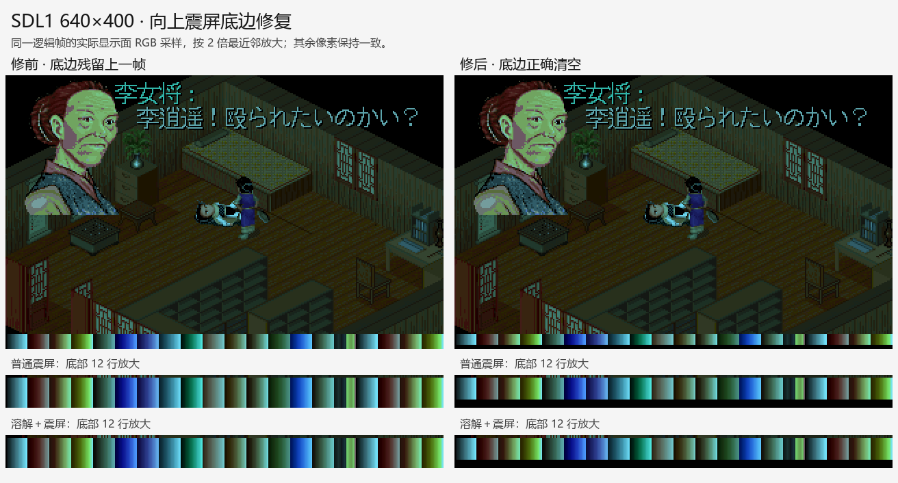
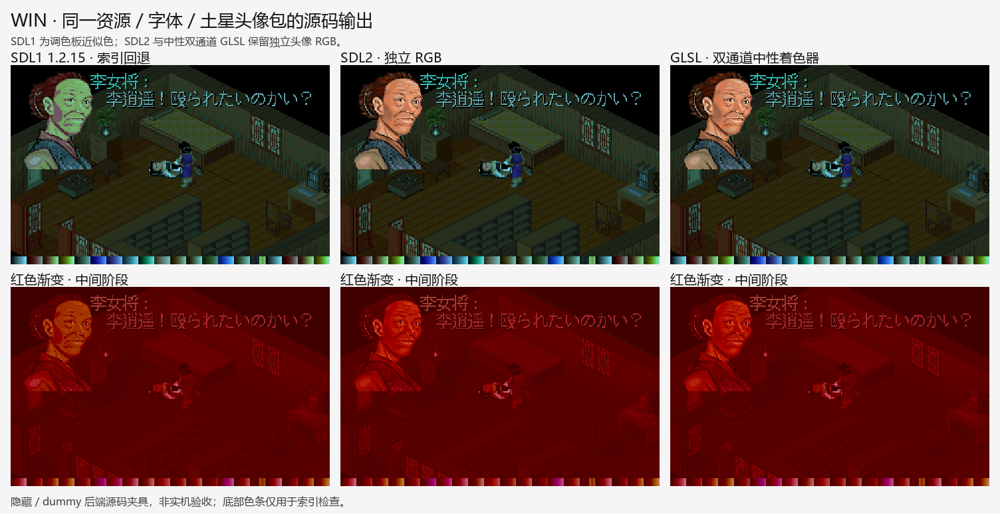
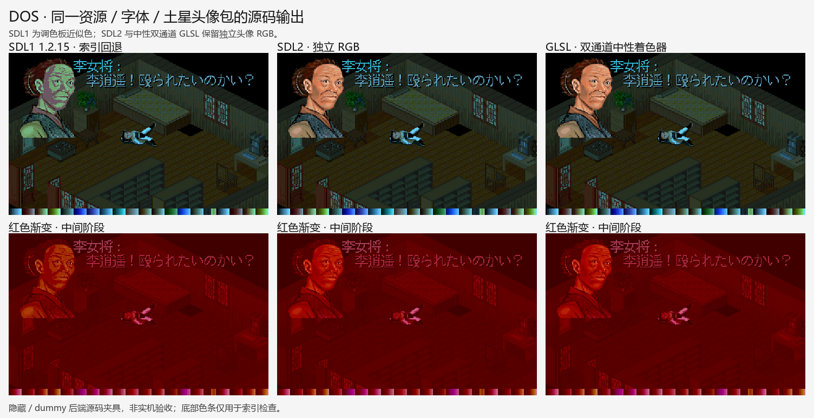

# Issue #9 R4：SDL1 构建与 GLSL 输出兼容验证

2026-10-21，从 `feature @ 81691383862747f3441c4eda3f3a5ed216231239` 跟进
[#9](https://github.com/othercat/sdlpal-jp/issues/9)，总管为 [#1](https://github.com/othercat/sdlpal-jp/issues/1)。
**SDL1／SDL2 Release 和 Test 构建、源码输出验证通过。发现并修复 SDL1 缩放震屏的边缘残留；
GLSL 中性单／双通道未发现头像输出差异。实机仍待所有实现结束后由用户统一验收，Issue 保持开放。**

## 现有实现和最小修复

- `common.h` 已在 SDL1 下关闭 GLSL；`text.c` 先按场景 PAT 最近邻映射头像索引，
  `VIDEO_PortraitLayer` 在 SDL1 返回空，保留索引回退。SDL1 不具备 SDL2 的独立头像 RGB，
  夜景肤色近似是当前兼容边界，本轮没有扩大到 SDL1 真彩色重写。
- SDL2 先将独立头像颜色合成到 `gpScreenReal`，GLSL 再将它上传为输入纹理。
  沿用这个实现，仅在 `UNIT_TEST` 下增加交换缓冲前的输出读回、隐藏窗口和后端／通道日志。
  原 Test 入口强制关闭 GLSL，其通过结果不能用作 GLSL 已验证的证据。
- 实际发现 `VIDEO_UpdateScreen` 和 `VIDEO_FadeScreen` 将物理底边坐标再次缩放。
  SDL1 640×400、震幅 3 时，清空起点变成 794，落在窗口外。仅改这两处震屏几何：
  共用 `shakeHeight = level * viewportHeight / 200`，内容高为 `viewportHeight - shakeHeight`，
  所有目标位置都加物理原点一次，避免非整数缩放的取整缝隙和留边偏移。
  SDL2 默认 320×200 合成尺寸下保持原结果；头像包、文字、索引、色表与特效时序不变。
- Test 入口的 SDL2 类型声明加条件保护，并让 SDL1 使用同一组特效夹具。
  SDL1 缓存表面使用独立色表副本；恢复夹具场景前更新其色表，防止测试自身引入索引重映射。

## 源码对比图

以下为真实绘图／特效函数的受控资源夹具，无游戏路线、存档回放或人工按键。
客栈对白来自 Win 1317／DOS 1898 的已审对应文本。底部色条仅用于覆盖全部索引。
PNG 均为不透明 RGB，避免原始 BMP 的 alpha 在预览器中显示成黑块。



该图取实际 SDL1 显示面的逻辑 RGB 采样并放大。626 对非计时帧的索引及色表相同；
仅 37 帧的第 197–199 行发生必要变化：普通震屏 1 帧、溶解震屏 36 帧。
其余非计时 RGB 保持一致；计时渐变按各帧实际色表独立核对，不强行要求墙钟循环帧数相等。





后端横向图来自完整 640×400 显示面／最终 GLSL 缓冲读回。
SDL1 的头像近似色与 SDL2 源色不同；场景索引和色表一致。
单通道 GLSL 也在矩阵中验证，图中选择双通道作为代表。

## 构建、配置与结果

| 项目 | 实际结果 |
| --- | --- |
| 主机 | Windows 11 Pro 10.0.26200；VS 2026，MSVC 14.51.36231／v145 |
| SDL1 | 官方 1.2.15 VC SDK、Win32；Release／Test 成功；动态 SDL.dll |
| SDL2 | 仓库内 2.0.10、x64；Release／Test 成功；静态 SDL2.lib，未借用外部 SDL2.dll |
| OpenGL | NVIDIA GeForce RTX 5060，驱动 616.64，GL 4.6.0，GLSL 4.60；`manualSRGB=0` |
| 输入 | PAL98 v1.72 的 Win 资源工作副本、Steam PAL_DOS；R1 的 86 头像包与 #6 R2 Win／DOS SLF，逐文件 SHA256 核对 |
| 字体／输出 | SLF 指定的日文 16px 字形、ISO 替代关闭；逻辑 320×200、输出 640×400、ScaleQuality=0、HDR=0、触控层关闭 |
| 矩阵 | Win／DOS × 默认 PC／启用土星头像包 × SDL1 dummy／SDL2 direct3d／GLSL 单通道／GLSL 双通道，共 16 组 |
| 特效 | 每组 19 序列：R3 的 18 序列加普通震屏；共 11,362 个逻辑帧，独立颜色／索引／几何公式全部通过 |
| 后端配对 | 10,016 对非计时索引／色表一致；SDL2 和 GLSL 的对应合成 RGB 一致；SDL1 按索引回退核对 |
| 物理读回 | 795 次完整 640×400 显示面／纹理／最终 GLSL 缓冲读回，均等于预期最近邻输出 |
| 震屏边界 | 640×400／640×480 × 有／无留边 × 普通／溶解，共 8 组合、300 次完整显示面像素检查通过；修前失败已保留 |
| 单元检查 | SDL1 15 项 C++、SDL2 21 项 C++、4 项后端标签／通道数正负例通过 |
| 原资源 | 全部工作副本与输入指纹一致，原资源未修改；GLSL 自动写入的缓存 preset 留在各组隔离资源副本 |

[完整机器记录](evidence/issue-9-backend-verification.json)包含每组命令、配置、SLF／头像包／资源、
执行文件、SDL 库、源码、shader、原始帧和图片的指纹，以及前后修复、失败复现与静态复核记录。
最终提交、普通合并 SHA 和分支清理由 #9／#1 按完整 SHA 记录，不依赖长期保留分支。

## 复现入口

SDL1 SDK 来自[官方发布目录](https://www.libsdl.org/release/)，
文件为 [SDL-devel-1.2.15-VC.zip](https://www.libsdl.org/release/SDL-devel-1.2.15-VC.zip)，
SHA256 `7443ee5cd1bd2a0f9fa8c01acbeb4c779d0b03f9ce8a2aa47b0637d2a5461e50`。
官方预编译 SDLmain.lib 引用旧 CRT 的 `__iob_func`，本机 v145 无法直接链接；
改用[同版官方 SDL_win32_main.c](https://www.libsdl.org/release/SDL-1.2.15/src/main/win32/SDL_win32_main.c)
编译启动入口，不添加 CRT 假实现。依赖只解压到 artifacts，未全局安装。

SDL1 直接编译现有 `win32/sdlpal.vcxproj`，通过外部 `ForceImportBeforeCppTargets`
置前 SDK include、替换 SDL 库并加入官方启动源；保留系统库，避开 solution 的 SDL2 依赖工程。
SDL2 编译原 `win32/sdlpal.sln`。两者指定 v145、SDK 10.0、独立 OutDir；SDL1 另设独立 IntDir。
预构建生成的 `generated.h` 均先备份、构建后恢复。具体命令与导入文件内容在机器记录中。

```powershell
$jpPython = Join-Path $env:USERPROFILE 'CodexTools\python\Scripts\python.exe'
# 在每组自己的工作目录保存 sdlpal.cfg，GamePath 指向资源副本。
# GLSL 指定 tests/fixtures/portrait-identity.glsl 或 portrait-identity-2.glslp。
# 配置至少设置 ShaderPath、Shader、EnableGLSL=1、EnableHDR=0。
$env:SDL_VIDEODRIVER = 'dummy'
& 'SDL1 Test\sdlpal.exe' --render-evidence '@config' paljpn-win.slf out jp-portrait-effects paljpn-win.por
Remove-Item Env:SDL_VIDEODRIVER
& 'SDL2 Test\sdlpal.exe' --render-evidence '@config' paljpn-win.slf out jp-portrait-effects-glsl paljpn-win.por
# DOS 使用 dos-portrait-effects 或 dos-portrait-effects-glsl；省略最后的头像包参数即默认 PC。
& $jpPython -B -X utf8 tools\japanese\verify_portrait_backends.py '本轮产物根目录' 'R1头像产物根目录'
& $jpPython -B -X utf8 tools\export_portrait_backend_previews.py '本轮产物根目录' '图片目录' --font '中文字体路径'
```

`@config` 是渲染器参数，PowerShell 调用时应写成引号包裹的 `'@config'`。
核验器读取 `runs/validated-{sdl1,sdl2,glsl1,glsl2}-{win,dos}-{native,adapted}`；
`run.json` 格式和 16 组完整记录见机器证据。构建、运行、归档脚本及原始大文件保留在
`D:\Workspace\PALWork\artifacts\sdlpal-jp-issue-9\portrait-r4-backends-20261021`。

## 验证边界

这证明所列 Windows SDL1／SDL2 构建和本机 OpenGL 中性单／双通道的兼容。
不推广到全部显卡／GLES／第三方 CRT shader，也未开启 HDR 或触控覆盖层。
每帧有逻辑 RGB 检查；SDL1 逻辑帧从显示面按 2×2 一个相位采样，GLSL 每帧记录合成输入。
完整物理输出只在 795 个代表帧读回，不能称为每帧每个物理像素都已检查。
新增震屏几何专项另在 300 次更新中检查全部显示面像素。

SDL1 继续采用调色板近似色；本轮没有改变 R1–R3 的土星来源结论，也未宣称土星动态硬件逐帧等价。
配置保存重载、连续场景／RNG／特效组合、窗口／DPI 和游戏完整流程，仍留给最后统一实机验收。
