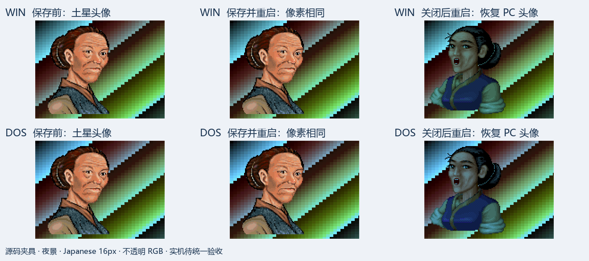

# Issue #9 R5：配置保存、重启读取与头像关闭验证

2026-10-21，从 `feature @ 244fcdb04f386fab13602f0c893a3bd48cdcdd77` 核对
[#1](https://github.com/othercat/sdlpal-jp/issues/1) 及九个子 Issue 后，继续补齐 #9 的配置专项证据。
**本轮没有发现新的生产代码缺陷。现有配置读写可沿用；保存并重启后画面相同，关闭头像包后恢复 PC 头像。**
改动只涉及 Test 入口、核验工具和证据；实机验收仍由用户最后统一执行，全部 Issue 保持开放。

## 核对和补齐的内容

`palcfg.c` 已有 `PortraitFileName` 的解析、保存、Set/Get/Clear 与释放；
`text.c` 使用同一文件打开链路读取配置指定的头像包。原配置单测只覆盖内存 Set/Get/Clear，
原渲染入口即使使用 `@config` 仍会用 argv 覆盖消息文件，不能直接作为“仅靠配置重启”的证据。

- Test-only `--config-roundtrip-evidence keep` 调用生产 Load／Save／Free／Load，
  比较游戏／存档／shader／消息／字体／头像路径及相关显示字段，并报告编译时 SDL 版本。
- `clear-portrait` 通过生产配置 setter 清空头像，再保存、释放并重载。
  文件核验必须确认 `PortraitFileName` 字段已消失，其余已保存字段保持不变。
- `--render-evidence '@config' '@config' ...` 使用实际配置指定的游戏、消息和头像文件，
  拒绝附加头像参数；日志绑定实际路径，消息加载也经过资源版本检查。
- 每次渲染启动独立 Test 进程。四个状态为：原生 PC 对照、启用头像保存前、保存后重启、关闭后重启。
  不复用上一进程的内存配置或头像覆盖层。

这两个入口只编入 Test；现有 VS 工程明确排除其 Release 构建，本轮没有改变工程或 Release 源码。

## 源码渲染对比



图中是完整源帧同一矩形的最近邻裁图，使用不透明 RGB PNG，未重绘像素。
底图包含所有索引的测试色条，用于检测背景／色表污染；不是自然剧情截图。
左、中两栏逐像素相同，右栏与另起进程的原生 PC 对照完全相同。
这组头像 ID 55 上下方、日／夜四个夹具都经过独立资源公式校验；没有借此扩大头像身份审查范围。

## 实际结果

| 验证 | 结果 |
| --- | --- |
| Issue 核对 | #1–#10 完整正文及折叠历史、全部评论（0 条）、九个原生子 Issue 关系；各单均开放 |
| 构建 | VS 2026 v145；SDL1 1.2.15 Win32 Test、SDL2 2.0.10 x64 Test 成功 |
| 配置矩阵 | Win／DOS × 相对 ASCII 路径／UTF-8 中文绝对路径，4 组；中文消息、头像文件名同时覆盖 |
| 配置往返 | 两后端各 keep／clear，共 16 次通过；保存前文件均先备份，原游戏配置未使用 |
| 独立进程 | 4 状态 × 4 组，共 16 次 SDL2 源码渲染 |
| 逻辑帧 | 256 帧的顺序、尺寸、索引、完整色表、独立头像 RGB 全部符合资源公式 |
| 保存／关闭 | 保存前后全部 BIN／CSV／BMP 相同；关闭后与 native 对照相同；启用态必须与 native 有实际 RGB 差异 |
| 展示图绑定 | 每个基础索引 BMP 和 RGB BMP 都绑定到已校验的 stage 0 帧，再核对缩放；不能用两份同步错误图片通过比较 |
| 缩放读回 | 128 张 2×／3×完整 SDL 目标纹理读回逐像素正确；另 64 张 2.5×仅核对尺寸 |
| 回归与负例 | SDL1 15 项、SDL2 21 项 C++ 通过；10 个入口拒绝检查、6 项 Python 正负例通过 |
| 资源保护 | 全部原资源、SLF、头像包和工作副本指纹不变；只改新建验证目录中的配置 |

独立复核指出的基础 BMP 绑定和 SDL 后端标签两个证据缺口已收紧。
早期单测的灰阶 BMP 被 Pillow 自动读为 L 模式，改用非灰阶测试色表后，六项正负例通过；
这是测试夹具修正，不是引擎错误。早期日志保留，最终结论仅使用 `final-sdl1`、`final-sdl2` 和 `verification-final`。

[完整构建、命令、输入／输出指纹和测试证据](evidence/issue-9-config-verification.json)。
源码与构建归档保存在 `D:\Workspace\PALWork\artifacts\sdlpal-jp-issue-9\portrait-r5-config-20261021`。
最终实现、普通合并完整 SHA、目标 `feature` 与清理记录写入 #9／#1。

## 复现与边界

使用官方 CPython 3.11 的固定 Codex venv；新输出目录必须不存在。参数依次为
SDL2 Test、SDL1 Test、Win 工作资源、DOS 资源、R1 头像产物根目录、#6 R2 文本产物根目录、
新输出目录、用于证据标题的中文字体：

```powershell
& (Join-Path $env:USERPROFILE 'CodexTools\python\Scripts\python.exe') -B -X utf8 `
  tools\japanese\verify_portrait_config.py `
  'SDL2 Test/sdlpal.exe' 'SDL1 Test/sdlpal.exe' 'Win资源' 'DOS资源' `
  'R1头像产物根目录' '译文R2产物根目录' '新的证据目录' 'C:/Windows/Fonts/msyh.ttc'
& (Join-Path $env:USERPROFILE 'CodexTools\python\Scripts\python.exe') -B -X utf8 `
  -m unittest discover -s tests -p test_portrait_config.py -v
```

游戏字形仍由 SLF 选择 Japanese 16px、UseISOFont=0；本轮夹具只绘头像，未重跑对白正文／说明校译。
没有启用外部字体文件、GLSL、HDR 或触控层；GLSL 输出证据继续参见 [R4](japanese-portrait-backends.md)。
SDL1 本轮验证配置文件往返，图像来自 SDL2 Direct3D；不冒称 SDL1 本轮也执行了头像像素矩阵。
配置文件 API 的通过不代替真实设置窗口交互、连续场景／RNG／特效组合、窗口／DPI 或完整流程验收。
