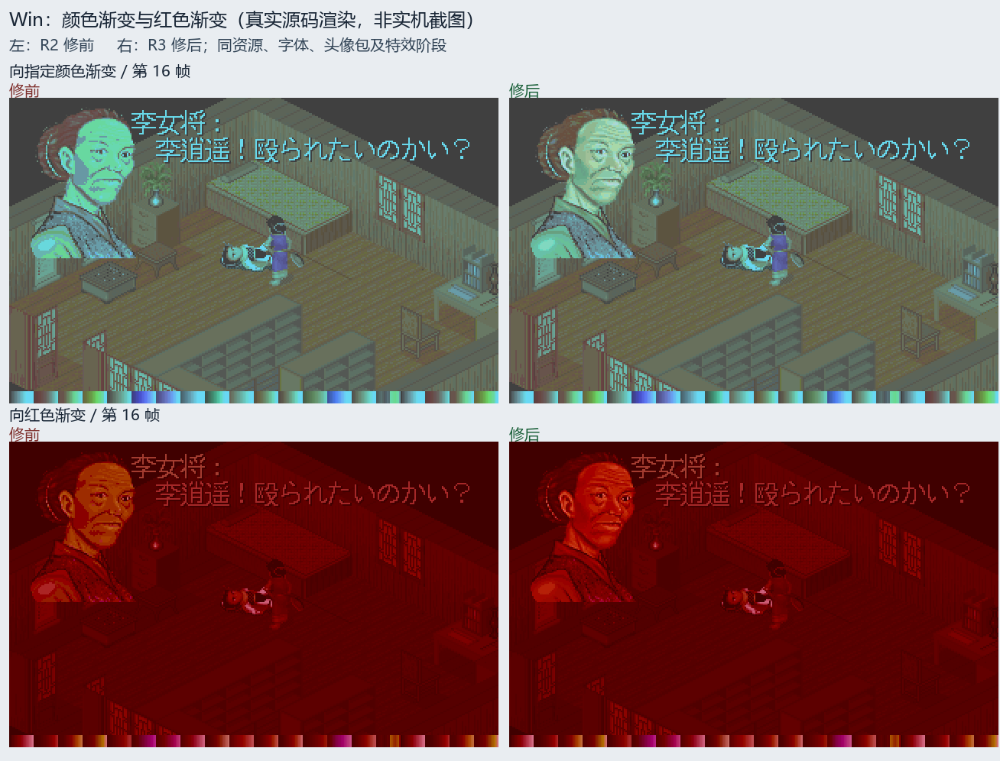
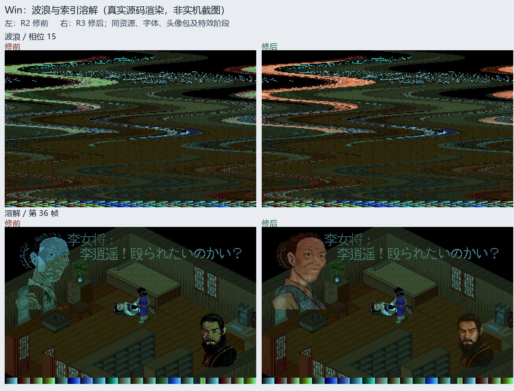
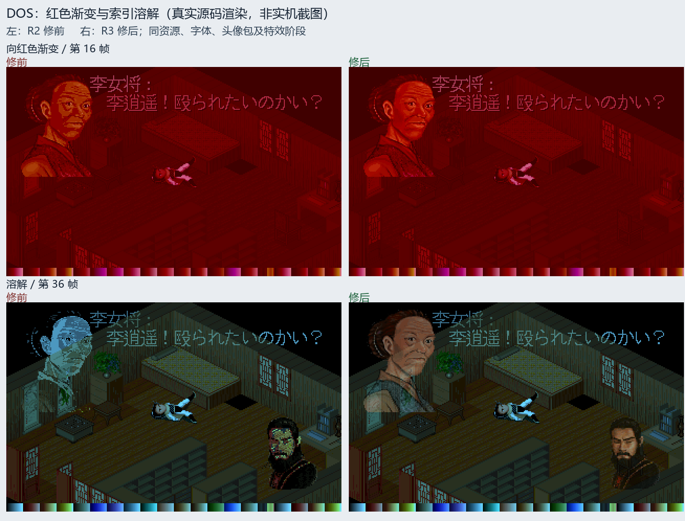

# Issue #9 R3：特殊渐变和索引特效中的头像颜色

2026-10-21，基于 `feature @ 58d24476bfb78b7f238f357ca87f56423fa6a92b`，
跟进 [#9](https://github.com/othercat/sdlpal-jp/issues/9)。
沿用 [R1 头像包](japanese-portrait-palettes.md)和 [R2 源色合成](japanese-portrait-night-colors.md)；
本轮将已知特效接入头像颜色和覆盖信息。实机验收仍在所有 Issue 解决后由用户统一进行。

## 原盘和现有实现的核对

[原盘静态报告](evidence/issue-9-effects-source-review.json)绑定输入 SHA256、SH-2 字节、
文件偏移及调用路径；[脚本使用点](evidence/issue-9-effects-operation-uses.json)保存九类指令的全部扫描结果。
延续已经核实的 NBG1／bank 3 共用色表，不改动头像编号、尺寸、透明规则或转换包。

- 本盘 `004F`（PC 红渐变）、`0071`（PC 波浪）、`008C`（PC 指定颜色渐变）
  对应处理器均为完整 12 字节空函数，偏移分别为 `0xB130`、`0xC910`、`0xDAA4`。
  这只证明对应脚本入口的行为，不能推出全游戏所有路径均无同类效果。
- `0050` 收尾清除覆盖 NBG1 的 VRAM 区域；`0073`、`0093` 的已审路径也先清除 NBG1。
  这些路径不支持把旧头像永久保留在屏幕上。
- `0050/0051/0093` 的已审颜色计算调用使用 `r4=-7`，写 sprite0 比率。
  对同一 ratio writer 的 22 个直接字面量候选，排除一个字面池假阳性后，
  21 个代码调用中的三个 NBG1 调用只重置比率零。间接调用和其他模块未穷尽。
- `0080` 有 32 次更新／等待，不能称为空函数；其处理器没有直接写头像色表或 NBG1 比率。
  `009B` 在固定脚本中无使用；战斗低 opcode 路径未完整追踪。

因此本轮采用 **PC 特效兼容策略**：保留当前引擎的时间、条带顺序、索引背景和几何位移，
让适配后的头像源色参与这些特效。原盘证据不能证明这些 PC 效果与土星硬件逐帧等价。

R2 在无法识别非均匀调色板变化时回到场景索引色；波浪／溶解也清除独立颜色层。
夜景的场景色表缺少头像肤色，故特效过程中重新出现偏绿、偏蓝和突变。

## 最小修复

- 复用 R2 的可选附加平面；普通像素保存源色索引，过渡像素保存已经计算的 RGB。
  透明覆盖、非透明黑色、字形覆盖和备份恢复继续使用原有接口，没有增加配置、资源格式或运行时依赖。
- 已知调色板函数同时传递场景色表和头像色表：指定颜色渐变、红渐变、日夜渐变、
  黑场淡出／淡入、显式另一套 PAT 的淡入以及场景渐变。
  源 RGB 按相同阶段变换，逐分量钳制到目标；等待色轮 F9–FE 仍不改头像颜色。
- 波浪逐行移动源色索引及透明覆盖；擦屏按原六组条带替换覆盖。
  溶解、战斗淡入和 FBP 切换只在前后头像覆盖的并集内插值 RGB，背景继续原索引算法。
- 12 轮索引溶解仅推进 11 次低半字节，`0↔15` 最后仍可能停在 `11/4`。
  最后展示阶段保留准确目标 RGB，整个过渡结束后才恢复源覆盖，避免旧头像残影或终点跳色。
  FBP 收尾另清除展示副本的临时覆盖，包含特殊结尾图不重绘的分支。

默认未设置 `PortraitFileName` 时继续 PC 头像；SDL1 继续索引适配。
未通过已知函数进行的、无法识别的直接调色板改写继续回退，不能声称支持任意第三方效果。
关闭 `PortraitFileName` 可恢复 PC 头像。实现和普通 merge 的完整 SHA 记录在 Issue；
回滚代码时从最新 `feature` 建立新的 #9 修复分支，不改写既有历史。

## 源码前后图

全部图片来自真实生产特效函数上传后的 RGB 帧，修前、修后使用相同 Test 入口，
相同版本的资源、SLF、字体和头像包。只添加标签并最近邻放大，保存为不透明 RGB PNG。
字体为 Japanese 16px、UseISOFont=0。底部色条用于覆盖全部 256 个场景索引。
客栈、李大娘文字及上下头像切换是受控源码夹具，不是自然剧情路线或土星实机截图。
DOS 文字使用已审映射 `Win 1317–1319 ↔ DOS 1898–1900`。







[溶解最后条带与 FBP 过渡](images/portrait-effects/win-transition-endpoint.png)
另展示旧头像淡出、下方目标头像恢复及 FBP 交叠阶段。波浪期间的文字扭曲是原有几何效果。

## 验证和可复现输入

[完整验证记录](evidence/issue-9-effects-verification.json)保存构建、源文件、工具、资源、
原始帧、元数据、纹理读回和图片的指纹；[独立静态复核](evidence/issue-9-effects-code-review.json)
记录已修正的溶解终点问题和未执行实机的边界。

| 检查 | 实际结果 |
| --- | --- |
| 构建 | VS 2026/v145 Test x64；修前基线加相同测试入口、修后分别成功 |
| 特效源码帧 | 修前 2,734 + 修后 2,736 = 5,470；Win／DOS，各含启用头像包及默认 PC 对照 |
| 特效范围 | 每组 18 个序列：初始／目标、指定色双向、红渐变、红→黑、黑→PAT5、日夜双向、红→夜、32 相位波浪、擦屏、溶解、溶解＋震屏、FBP、战斗、场景淡出／淡入 |
| 独立颜色核对 | 由固定头像包、原 PAT 和独立公式计算每帧预期 RGB，未用修后 RGB 生成预期 |
| 索引与背景 | 非计时序列逐帧与修前索引／色表相同；计时黑场按实际色表独立反推阶段，同阶段再比对，全部像素按预期核对 |
| 默认 PC | 两版本所有可对齐帧 RGB 不变；计时循环按墙钟可能跳过不同阶段，不要求帧数强行相等 |
| SDL 纹理 | 376 次实际 640×400 读回，与 320×200 观测 RGB 的 2×最近邻结果逐像素相同 |
| R2 回归 | 最终同一 Test binary：8,356 帧索引／RGB、150 个对白／菜单视图通过，含 50 个独立 PAT／日景推导的夜景视图 |
| 单元测试 | 15 C++ + 5 Python 全通过，含同索引覆盖、透明黑、混合覆盖、波浪环绕、无头像路径及 `0↔15` 溶解终点 |
| 输入保护 | 原资源、SLF、头像包指纹与 R1/R2 绑定资料相同；既有 generated.h 恢复，用户 AGENTS.md 保留 |

时间驱动的黑场序列捕获实际发生的阶段，未改变引擎计时函数以强制固定帧数。
本次没有 SDL1 构建、GLSL／硬件土星输出对照或自然路线游戏验收。
真实场景＋RNG 连续过场、配置保存重载和所有特效组合仍由用户最终统一验收。

原始产物保留在 `D:\Workspace\PALWork\artifacts\sdlpal-jp-issue-9\portrait-r3-effects-20261021`。
资源沿用指定 PAL98 v1.72_20261014 的已校验副本、Steam PAL_DOS、
#6 R2 的 Win／DOS SLF，以及 #9 R1 固定土星 bank 3 头像包。
源码验证执行者 Codex，2026-10-21，Windows 11，隐藏 SDL Direct3D 目标纹理。

Test 模式调用真实特效，只通过 `UNIT_TEST` 捕获回调观察上传帧；Release 不含捕获回调。
输出目录需预先创建且为空，`PortraitFile` 省略时验证默认 PC 头像。

```powershell
& 'Test构建\sdlpal.exe' --render-evidence 'Win资源目录/' 'paljpn-win.slf' '输出目录' jp-portrait-effects 'paljpn-win.por'
& 'Test构建\sdlpal.exe' --render-evidence 'DOS资源目录/' 'paljpn-dos.slf' '输出目录' dos-portrait-effects 'paljpn-dos.por'
$jpPython = Join-Path $env:USERPROFILE 'CodexTools\python\Scripts\python.exe'
& $jpPython -B -X utf8 tools\japanese\verify_portrait_effects.py 'R3产物根目录' 'R1产物根目录' 'Win资源' 'DOS资源'
& $jpPython -B -X utf8 tools\export_portrait_effect_previews.py 'R3产物根目录' '新的预览目录' --font '中文字体路径'
```

核验器读取 `effects/{before,after}-{win,dos}-{native,adapted}` 下的 trace 和 `run.json`，
拒绝执行文件、测试入口、SLF、头像包或配置不一致的对照。
`run.json` 的命令和 SHA 字段格式见完整验证记录。Python 使用固定 3.11 环境中的 NumPy／Pillow。
全部 Issue 的实机项保持未勾选；通过实机并记录构建、设备、资源配置、步骤和结果后才关闭。
