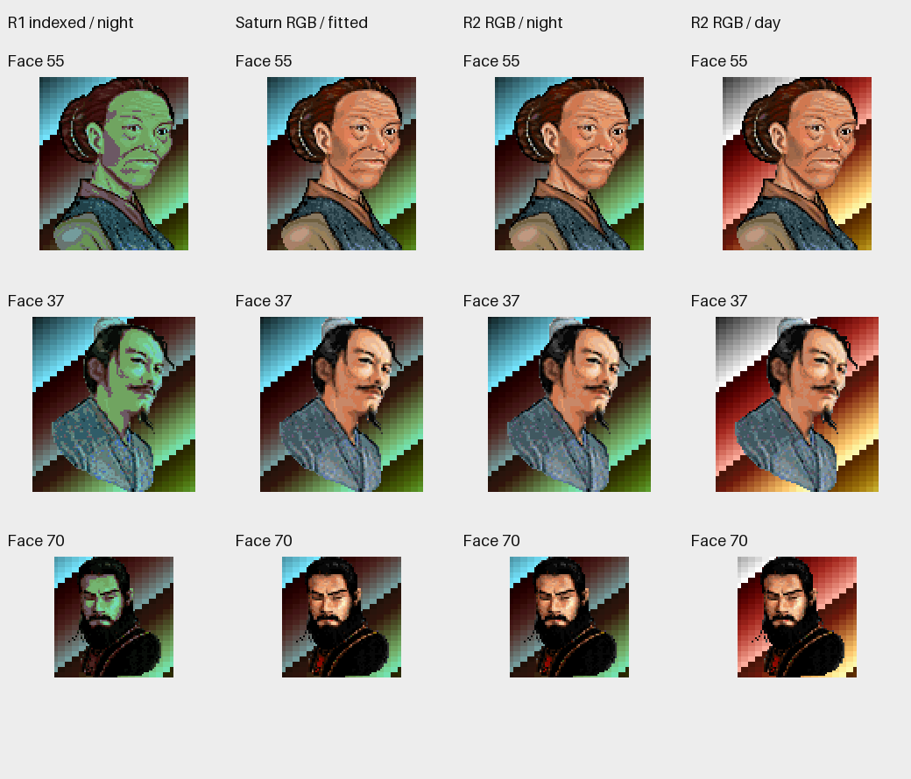
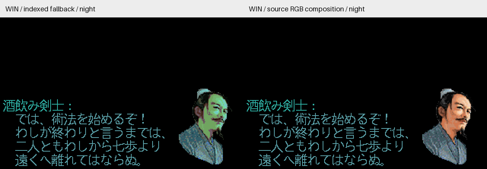

# Issue #9 R2：夜景头像保留源调色板颜色

2026-10-21，基于 `feature @ 25834d9f8db93ecffdf812b744e38ca546012190`，跟进 [#9](https://github.com/othercat/sdlpal-jp/issues/9)。[R1](japanese-portrait-palettes.md) 的 86 个头像包、编号白名单、等比尺寸适配和默认 PC 回退全部沿用。本轮只处理场景调色板对头像的量化色差。

SDL2 启用 `PortraitFileName` 后，正常日夜画面在最终 RGB 输出中使用头像源色。场景仍使用自己的 PAT 色表；资源、SLF、字体、对白坐标和存档不变。配置默认仍为空。这里的“源色”指已审 bank 3 的 RGB555 解码结果，不表示逐像素复刻土星最终视频输出。

## 原版复核及原因

[原盘静态证据](evidence/issue-9-night-source-review.json)记录固定文件指纹、指令字节、地址约定、脚本实际使用点和反汇编片段。原盘 `PROG.BIN` 的 `0053`／`0054`（日夜）、`008B`（调色板）及 `008C`（颜色渐变）处理器，在文件偏移 `0xB254`／`0xB260`／`0xDA98`／`0xDAA4`，均为空函数。普通 `003C/003D` 头像对白路径仍为 NBG1 选择固定 bank 3。

已核对的七处 CRAM 地址候选中，覆盖 bank 3 的两条路径重载固定 `ALLDAT.NEW`，其他动态资源写入 bank 0、4、6。没有在这些路径中发现头像夜景色表；没有穷尽所有间接写入或实际运行状态。全屏淡出另有清层和关闭显示逻辑。

NBG1 的硬件颜色计算还有混合比率；Sega 的[颜色计算文档](https://www.infochunk.com/saturn/segahtml_en/hard/vdp2/hon/p12_14.htm)将比率零解释为 31:1。因此本轮验证目标是“保留适配后源 RGB”，土星动态硬件合成仍待最终实机对照。

R1 逐色寻找当前 PAT 的最近 RGB，夜景缺少肤色时没有足够颜色可选。Win palette 0 夜间的逐通道 RMSE 为 42.1736，DOS 为 42.1208。仅改变匹配距离无法消除这个色域限制。

## 改动与兼容边界

- 保留原 8 位像素和最近色映射作为兼容路径。启用头像时，为引擎的索引表面附加一张带透明覆盖信息的 RGB 平面，最终转换为显示表面时合成；不占用或改写场景调色板。
- 屏幕复制、备份、分页恢复和菜单局部保存同步复制覆盖信息。字形、RLE 和矩形绘制在实际写入处清除覆盖；即使新旧索引数值相同，也不会留下头像色块。透明源索引零不覆盖，非透明黑色正常显示。
- 新场景、FBP 和 RNG 绘制清除旧覆盖。截图保存使用最终合成表面。SDL2 的部分刷新、缩放、震屏和既有显示后端继续消费同一最终表面。
- 与场景基准色表吻合的正常颜色及 `/64` 黑场渐变按源 RGB 同步明暗；对白等待色轮 `F9–FE` 不改变头像颜色。全黑时首次绘制头像保持全黑。
- **特殊效果仍有兼容回退**：非均匀颜色／红色渐变、与当前场景基准不一致的显式调色板渐变，以及索引溶解／波浪，沿用原有 8 位效果。索引擦屏结束后恢复目标帧 RGB。没有声称所有过场均保持独立源色，SDL1 也继续使用 R1 的索引适配。
- 新增 `PAL_ReadPalette` 向调用方缓冲区读取。合成过程不再触碰 `PAL_GetPalette` 的共享数组，避免渲染中覆盖正在淡入的另一套调色板。

生产改动集中在显示合成、表面复制和像素覆盖维护；其他文件的少量调用点用于保持上述生命周期。没有新增配置、包格式或依赖。清除 `PortraitFileName` 可恢复默认 PC 头像；实现与合并完整 SHA 在 Issue 中记录，保留普通 merge 历史。

## 源码前后图

第一列是仍保留的 R1 索引映射路径；第二列是独立解码、按相同 PC 矩形拟合的源 RGB 参考；后两列是本轮实际源码合成输出。背景条带覆盖全部场景索引，用于检验背景颜色未变。不是土星实机截图。



下图是相同夜景色表、日文字形、对白和坐标下的源码输出。左边是引擎保留的 8 位兼容帧，右边是 SDL 最终 RGB 输出。与 R1 已验证矩阵相同的索引算法继续保留，不能把这些中性背景的测试对白说成自然游戏路线截图。



[Win 巫王夜景](images/portrait-night-colors/win-night-dialogue-12078.png)与[DOS 酒剑仙夜景](images/portrait-night-colors/dos-night-dialogue-8166.png)同步归档。PNG 为不透明 RGB，图片只增加标签和最近邻放大。

## 验证与复现

[最终验证记录](evidence/issue-9-night-verification.json)绑定构建、输入资源、R1 已验证原始帧、全部新帧、元数据、图片、命令和独立复核。使用 Windows、VS 2026/v145 Test x64，Japanese 16px／UseISOFont=0，隐藏 SDL Direct3D 目标纹理；没有交互游戏验收。

| 检查 | 实际结果 |
| --- | --- |
| Test x64 构建 | 通过；可执行文件 SHA-256 `0dfb7c7e247d8fbb30eaa5ebc28079ab10d1cb9fc9e8080c220633ab587e0499` |
| C++／转换器单元测试 | 11 + 5 项通过 |
| Win 默认／适配矩阵 | 各 2,188 帧，索引与 R1 相同，最终 RGB 与独立参考相同 |
| DOS 默认／适配矩阵 | 各 1,990 帧，同样通过；两版本共 8,356 帧 |
| 正常日夜头像源色误差 | 已审颜色矩阵 RMSE 为 0；不包括上述索引兼容特效 |
| 白天默认、白天适配、夜间适配 | Win 各 27 个、DOS 各 23 个对白／菜单视图，共 150 个，全部通过 |
| 资源与文本 | Win／DOS 原资源指纹不变；引擎查表与描述元数据不变 |
| 实机／SDL1 构建 | 未执行；实机验收留待最后统一进行，SDL1 仅做静态兼容检查 |

帧检查将每个 8 位索引和调色板字节与 R1 完整证据逐一比较，再独立计算最终 RGB：头像覆盖处必须等于已审源色或对应黑场亮度，其他像素必须等于原场景颜色。发布基础 RGB 必须绑定该帧，2×／3× SDL 输出与其最近邻放大逐像素一致；2.5×只核对尺寸。

50 个夜景对白／菜单视图的色表直接与原始 `PAT.MKF` 夜半数据比较；索引参考由已绑定 R1 哈希的白天帧和头像映射独立推导。背景和正文须保持原索引，仅菜单选中字形允许完整、均匀的色轮相位变化。预览还校验裁剪 CSV 的既有哈希、头像编号、日夜标记与尺寸。新增报告保存所有 CSV 哈希；历史 R1 未保存对白 CSV 的逐文件哈希，因此不追认它曾做过该项校验。

测试还覆盖透明黑、同索引写入遮挡、裁剪填充、局部备份恢复、65 档黑场亮度及未知调色板变换的索引回退。资源渲染实际执行 `PAL_FadeIn(5,FALSE,1)`，保持 globals 为 palette 0，检验渲染重入不会篡改显式目标色表；这是源码执行的定时效果，不代替完整游戏流程。

使用固定的 Codex Python 3.11 环境。R1 根目录应保留 `build/sdlpal.exe`、`generated-win`、`generated-dos` 与 `verification-final2`；文字目录为 #6 R2 已验证产物。所有输入先核对指纹，输出必须使用新目录。

```powershell
$jpPython = Join-Path $env:USERPROFILE 'CodexTools\python\Scripts\python.exe'
& $jpPython -B -X utf8 tools\japanese\verify_portrait_colors.py '本轮Test.exe' 'R1产物根目录' '#6 R2产物根目录' 'Win资源' 'DOS资源' '新的验证目录'
& $jpPython -B -X utf8 tools\export_portrait_color_previews.py '验证目录' 'R1产物根目录' '新的预览目录'
```

`--check-existing` 复核同一构建的已有输出，不重新渲染。新 Test 模式 `jp-portraits-rgb`／`dos-portraits-rgb` 保留索引帧并输出 RGB 帧；`jp-translation-rgb`／`dos-rgb` 及其 `-night-rgb` 变体检查实际对白与菜单路径。

本机产物目录：`D:\Workspace\PALWork\artifacts\sdlpal-jp-issue-9\portrait-r2-night-20261021`。本轮实机验收未执行，Issue 继续开放。最终统一检查上／下对白、日夜切换、分页、重叠菜单、场景／RNG 清屏、渐变、索引特效及默认 PC 回退，再由用户记录被测构建、设备、资源配置和结果。
