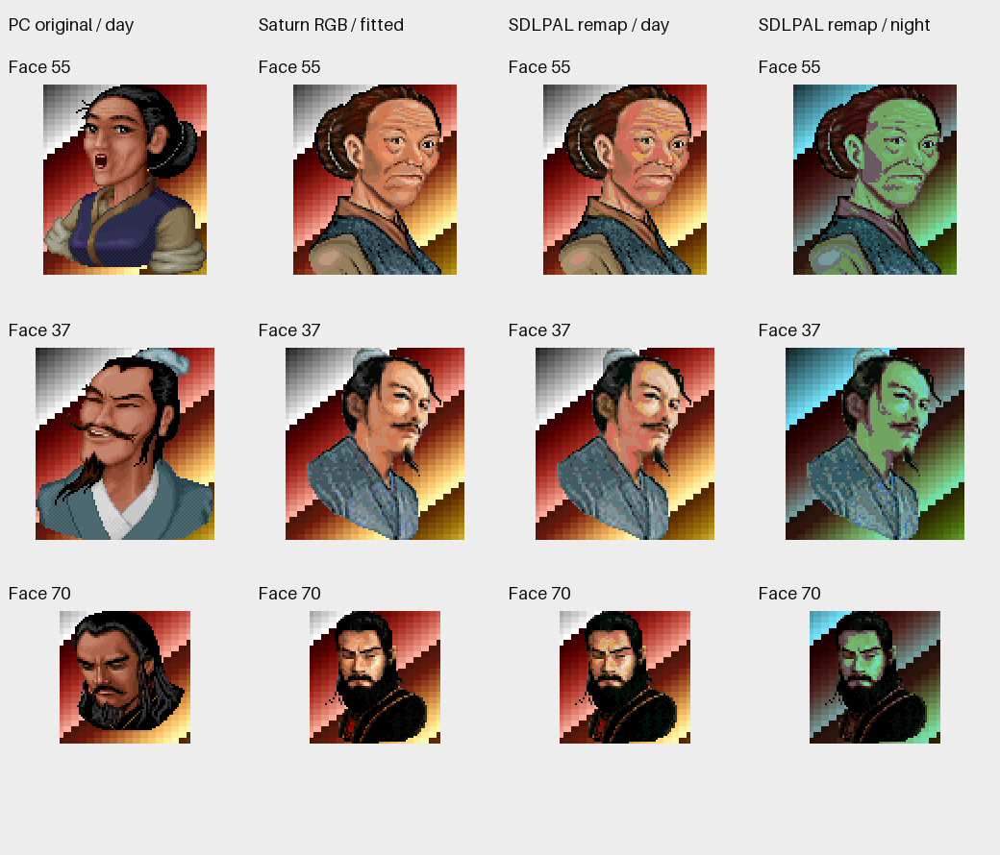
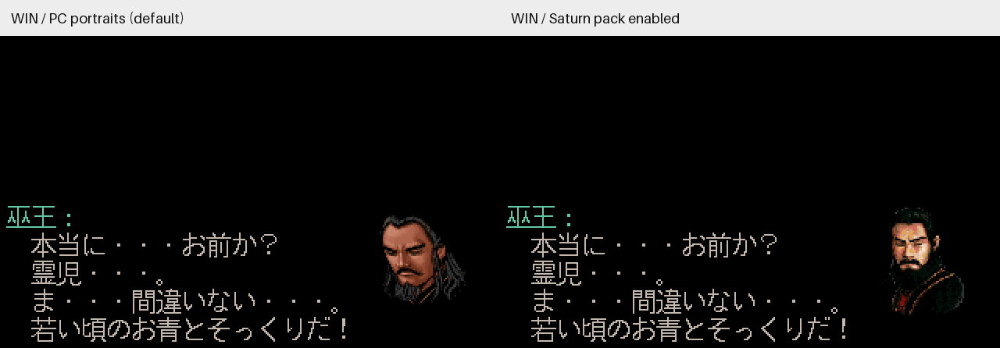
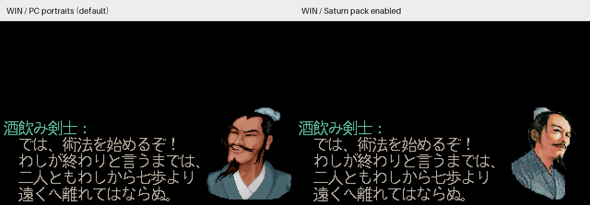

# Issue #9：土星头像调色板核实与可选配色适配

> 本文保留 R1 的资源审计与索引配色验证。当前 SDL2 夜景修复、独立 RGB 输出、兼容边界和新图见 [R2 夜景头像颜色](japanese-portrait-night-colors.md)；下文夜景量化误差属于 R1 基线。

2026-10-21，关联 [#9](https://github.com/othercat/sdlpal-jp/issues/9)、[总管 #1](https://github.com/othercat/sdlpal-jp/issues/1)。实施基线为 `feature @ 8d562693d7bbe23f8b7cca06bc44b7ce0d6b978f`。

**原版确实把头像放在独立于场景的调色板层上；本轮提供可选的按场景重新配色适配。** 保留 SDLPAL 现有 8 位屏幕、PC 头像矩形和渐变流程，没有引入独立 RGB 合成层。夜景等调色板可用颜色不足，仍有可见量化误差。默认不启用，继续使用 PC 头像；本轮源码验证完成，实机验收最后由用户统一进行。

## 原版证据与现有实现

[原资源和 SH-2 复核](evidence/issue-9-portrait-source-review.json)、[指令片段](evidence/issue-9-portrait-sh2.json)记录原始光盘扇区、文件指纹、指令地址、寄存器及解码规则。它们是静态二进制与资源证据，没有运行土星游戏或模拟器。

| 已核实项目 | 结果 |
| --- | --- |
| 头像文件 | `RGM.JOE`，1,013,760 字节，99 个固定 `0x2800` 字节槽 |
| 头和像素 | BE16 宽／高，逐行 RLE；字节大于 127 表示跳过 `字节−128`，否则复制相应个数的索引 |
| 空槽 | 0、20、38、78、79；94 个非空槽，587,960 个原始不透明像素 |
| 透明规则 | 跳过段保留目标像素。全部字面像素均非零；调色板字的 bit15 不是透明标志 |
| 原始尺寸 | 最大宽 133、高 155；不能按 127 像素限制原始图像 |
| 尾部 | 32 槽在最后消耗位置有一个非零尾字节，之后全零；原解码器按高度终止，不读它 |
| 调色板 | `ALLDAT.NEW[0x600:0x800]`，零基 bank 3，256 个 BE16 RGB555；R 为低 5 位，G 为中 5 位，B 为高 5 位 |
| 绑定 | 对话 `003C/003D` 路径给 NBG1 bitmap layer 选择 bank 3；是头像／对白层共用的一套颜色，不是每张头像另带一套颜色 |
| RGB 参考约定 | 每个 5 位分量左移 3 位，范围 0–248；本文参考图是资源解码，不代表土星显示器的实际输出色值 |

可追溯链路：`PROG.BIN` 的加载基址为 `0x06020000`；文件偏移 `0xF136–0xF158` 加载 `ALLDAT.NEW` 并把前 `0x1000` 字节复制到 CRAM `0x25F00000`。`003C/003D` 处理器 `0x9E94/0x9F48` 调用 `0x10DA4`，传入 `r7=3`；经 `0x2574 → 0x3D7E0` 写 NBG1 的 BMPNA bank 位。shadow register 从 `0x060FFCC0` 复制到 `0x25F80000`；NBG1 是位于 `0x25E20000` 的 8bpp bitmap，CRAOFA/B 为 0。完整指令、字面池及校验值在上述证据文件中。

寄存器解释按 Sega 原始 [VDP2 bitmap palette number 文档](https://www.infochunk.com/saturn/segahtml_en/hard/vdp2/hon/p04_90.htm)、[CRAM 模式](https://www.infochunk.com/saturn/segahtml_en/hard/vdp2/hon/p03_40.htm)与 [RAM control](https://www.infochunk.com/saturn/segahtml_en/hard/vdp2/hon/p03_20.htm)交叉核对。原解码坐标还有 NBG1 滚动偏移，本文没有把 CPU bitmap 坐标冒充最终屏幕位置。

关键输入 SHA256：

```text
RGM.JOE     185ad075b447fd670316cf39b335f05868f547405f036d5ef88413a9181a5542
ALLDAT.NEW  86c8b9728c7b80447cc41babf99951d60b134362a11eeee5e0dd854db4e0ca5c
PROG.BIN    4ff1d34c0345a1e0ba2959ef5d1d437338f9370f6eaaa68e6d3bbe3e07d6e33c
bank 3      50d47e5f888d08d10de34b1ea55222dfc83a64c69e8d36343a14e7fd8a407867
RGB24       cf41187d66351296925fe8b82a88553d5dc0e3d63ec97e45793f2d15d39b52e1
```

核对 PalMusicFan 上游 `6dafc9c79718058f3a1a4ab8a3d3e30a102ab207` 和官方 SDLPAL `d4bf69b64d335cd680555af9df90e7ec4f3006a3`，现有链路仍是 `RGM.MKF → PAL_RLEBlitToSurface → 8bpp gpScreen → VIDEO_UpdateScreen`，没有可直接沿用的土星头像独立调色板加载。场景颜色来自 `PAT.MKF`。日文 SLF 本身仅替换文本，原来的 PC 头像并非全部错色。

## 编号、布局及最小适配

[编号与对白锚点](evidence/issue-9-portrait-id-review.json)分别核对 Win 的 2,227 个、DOS 的 2,226 个相邻对话／文本锚点；两版得到相同的 **86 个同 ID 白名单**：

```text
1–19, 21–37, 39–67, 69–77, 80–91
```

并非简单按文件顺序配对。每个白名单 ID 保留 Win／DOS 的原始脚本指令、相应土星指令与文本样本；全部锚点文件的指纹也已归档。江少云例外最明确：Win 脚本 10899 是 `003C,38,0,0`，消息 3911–3912；土星对应脚本 11871 是 `003C,0,0,0`，消息 5161–5162，槽 38 为空。因此 38 必须使用 PC 原图。68、92–98 没有本轮认可的使用锚点；99、100 超出土星槽范围，均不猜测替换。

- [`convert_portraits.py`](../tools/japanese/convert_portraits.py) 固定核对 Win／DOS 的 RGM、PAT、SSS、M.MSG 及三个土星文件指纹，写入新的 `PALJPOR1` 包和生成记录，不覆盖原资源或既有输出。
- 土星画面保持宽高比、不放大、最近邻采样，居中放入原 PC 头像宽高范围，余量透明。PC 的 ID 72 为 95×131、84 为 135×98，也保留原矩形。原版上下方坐标、文本位置与既有边界裁剪不变；这是 PC 布局适配，不是土星屏幕布局复刻。
- 配置 `PortraitFileName` 默认空。加载器核对魔数、版本、Win／DOS、计数、重复 ID、尺寸、保留位、截断和尾随数据；显式配置错误包会报错停止加载。没有配置、未映射 ID 或原图尺寸不匹配时使用原 PC 绘制。
- 在上／下对白开始时，以当前场景／日夜的**基准**调色板做最小 RGB 平方距离匹配；同距离优先较小索引。即使此时屏幕已淡至全黑，也不以全黑颜色做匹配。
- 排除等待时旋转的 `0xF9–0xFE`，透明源索引 0 不写屏幕；非透明像素可映射到黑色索引 0。没有更换全局调色板，没有修改 `video.c`、`palette.c` 或原始 RGM/PAT。结果继续参与既有屏幕备份、恢复及调色板变换。

包格式：16 字节头（8 字节 `PALJPOR1`、LE16 版本 1、目标 0=DOS/1=WIN95、条目数、保留 0），随后 768 字节 RGB24；每项为 LE16 ID／宽／高／保留 0，加 `宽×高` 个源索引。索引 0 专用于透明。当前包各 661,789 字节：

```text
paljpn-win.por 71e774bc3a6a8cd0a15d97b5e79bc91b9eb4dcca92fdf009ef4c4874ca92fb7f
paljpn-dos.por d1d0b6ef444870ccb9cff0a427263c68fe7105207044cb76637535ceaab4c03e
```

## 源码对比图与颜色边界

下图第一、三、四列是实际引擎输出的头像区域；第二列是原调色板解码并适配尺寸后的 RGB 参考。背景条带是覆盖全部索引的测试图，用于发现全局颜色被意外修改。参考图没有经过 8 位颜色量化，也不是土星实机截图。



两组日文对白沿用 #6 R2 原文和原始下方头像指令；仅开关头像包。中性黑背景、文字、字体和坐标相同，图片是隐藏 SDL 目标纹理导出的不透明 RGB，不是自然游戏路线截图。





DOS 同步核对：[巫王对照](images/portrait-palettes/dos-dialogue-442-comparison.png)、[酒剑仙对照](images/portrait-palettes/dos-dialogue-8166-comparison.png)。

与拟合后的土星源 RGB 比较，按 86 张图的不透明像素加权，RGB 每通道 RMSE 如下。左列“直接套索引”是未重配色导入的计算对照，**不是原来的 PC 头像错误率**：

| 场景色表 | 直接套土星索引 | 本轮按场景重配色 |
| --- | ---: | ---: |
| Win palette 0，白天 | 107.2215 | 8.3615 |
| Win palette 0，夜间 | 103.4119 | 42.1736 |
| DOS palette 0，白天 | 107.1950 | 8.3687 |
| DOS palette 0，夜间 | 104.7640 | 42.1208 |

11 套颜色中适配 RMSE 约为 8.36–50.76；夜景和某些场景仍明显偏色。固定只转换成白天颜色还会在换场景时失配，本实现避免了这一点，但不能创造场景调色板中没有的颜色。若最终验收要求完全保留土星颜色，需要另行设计独立 RGB 合成及其渐变／RNG 生命周期；本轮不把近似配色说成无损多调色板支持。

## 验证及复现

[完整验证记录](evidence/issue-9-portrait-verification.json)保存最终命令、构建、原始资源及产物指纹、逐项统计、图片和独立复核。Windows 11、VS 2026/v145、x64 Test 构建；Japanese 16px、UseISOFont=0、SDL Direct3D 隐藏目标纹理。没有启动交互游戏。

| 项目 | 已执行结果 |
| --- | --- |
| 独立原始解码 | 全部 99 槽与独立解码的宽、高、索引平面 SHA、消耗字节相符；86 个拟合结果另行逐像素核对 |
| 全矩阵 | Win 97 个非空 PC ID、DOS 88 个，各测 11 套日夜调色板及上／下方；再加选定色轮、半亮、全黑和全黑时首次画头像 |
| 帧验证 | Win 原图／适配各 2,188 帧，DOS 各 1,990 帧，合计 8,356 帧；每帧全部 64,000 索引及 768 调色板字节吻合 |
| 默认与回退 | 白名单外 Win 11 个／DOS 2 个 ID 保留 PC；含江少云 38。无包行为与上一轮一致 |
| 颜色与生命周期探针 | 背景／透明像素不变、不用色轮索引、备份／恢复一致；全黑首次画头像仍用基准配色 |
| 实际文本与菜单路径 | Win 4,766 键、DOS 4,476 键及分页／描述 CSV 与 R2 一致；50 对基础视图仅 15 对发生头像掩码内变化；其余文本、菜单和背景受保护 |
| 菜单动画 | 选中名称使用 `SDL_GetTicks()/100 % 6` 高亮；从 SLF 名称、源字体位图和菜单坐标独立计算完整墨迹掩码，只允许全部选中墨点统一模 6 相位变化；其余索引和完整调色板严格相同 |
| 缩放与输出 | 2×／3×与各自基础帧最近邻结果逐像素一致，2.5×只查尺寸；PNG 为不透明 RGB |
| 负例及单测 | 8 项 C++、5 项 Python 通过；真实加载同时拒绝 Win 包配 DOS 与 DOS 包配 Win，无图像输出；原资源指纹不变 |
| 配置检查范围 | 内存 Set/Get/Clear 已测试，文件读／写路径经静态复核；没有声称完成设置界面或配置保存重载的实机验证 |
| 实机 | 尚未进行；真实等待、渐变、场景切换、RNG 背景和土星实际参考画面仍属最终统一验收 |

色轮、半亮和全黑是直接施加调色板变换的受控探针；不能把它们写成完整实机等待或渐变流程已通过。此前全局字体、文本修订和布局没有更改。菜单高亮的定时相位导致过一次比对失败，查明原因后单独约束该动画再完成最终验证，失败日志保留在本地证据目录。

先从同一张已审土星光盘提取 `RGM.JOE`、`ALLDAT.NEW`、`PROG.BIN`；原文件指纹须吻合上表。输出目录必须尚不存在，建议放在工作区 `artifacts`，不要写入原始资源目录：

```powershell
$jpPython = Join-Path $env:USERPROFILE 'CodexTools\python\Scripts\python.exe'
& $jpPython -B -X utf8 tools\japanese\convert_portraits.py 'Win资源目录' '土星提取目录' '新的generated-win目录' --target win
& $jpPython -B -X utf8 tools\japanese\convert_portraits.py 'DOS资源目录' '土星提取目录' '新的generated-dos目录' --target dos
```

将对应包放到配置使用的资源路径，或使用绝对路径；在 `sdlpal.cfg` 中设置：

```ini
# Win 资源；DOS 改成对应 paljpn-dos.por
PortraitFileName=paljpn-win.por
```

清除此项即可恢复 PC 头像。SLF、RGM.MKF、PAT.MKF、存档均无需改写；只更新 exe 或 SLF 不会自动启用土星头像。完整头像包留在本机生成目录，仓库仅提交转换器、审计证据和少量对比图。

资源级验证复用 [#6 R2](japanese-translation-followup.md) 的 `after`、`verification` 和 `render` 子目录，独立原始解码的 [99 槽记录](evidence/issue-9-portrait-slots.json)已纳入仓库。`pack-root` 下包含 `generated-win` 和 `generated-dos`：

```powershell
& $jpPython -B -X utf8 tests\test_portrait_conversion.py -v
& $jpPython -B -X utf8 tools\japanese\verify_portrait_rendering.py 'Test版sdlpal.exe' 'Win运行资源' 'DOS运行资源' '土星提取目录' 'pack-root' 'R2产物根目录' '新的render目录'
& $jpPython -B -X utf8 tools\export_portrait_previews.py 'render目录' 'pack-root' '新的preview目录'
```

Test 新增 `jp-portraits`／`dos-portraits` 模式；通用出图命令末尾可加头像包绝对路径。Win 出图使用与指定 PAL98 v1.72_20261014 一致的 ASCII 路径资源副本，DOS 为已审 Steam PAL_DOS。本轮完整产物保留于 `D:\Workspace\PALWork\artifacts\sdlpal-jp-issue-9\portrait-r1-20261021`。

最终使用 `--check-existing` 对最终构建已生成的帧再次核查完整集合、元数据顺序、位置、色彩、源字形和图像指纹；此步骤固定同一 binary／头像包／原资源／R2 SLF，并未再次运行渲染器。发布基础 BMP 与对应原始 stage 0 帧逐像素绑定，预览导出再核对图片、帧、元数据和包的 SHA，防止错配画面。

Issue 保持开放。最终需记录包含本轮实现的游戏构建、头像包／SLF 指纹、资源、系统设备、配置、上／下对白与场景／日夜／RNG／渐变路线、结果、测试人及日期，再决定是否接受近似颜色及关闭 Issue。
