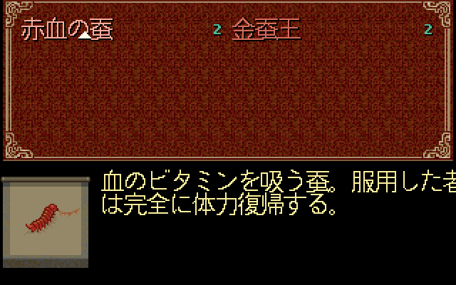
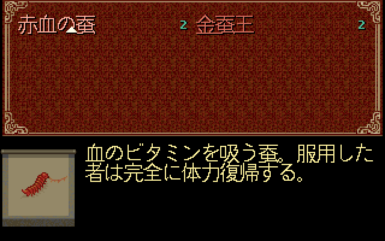

# Issue #5：赤血蚕说明的换行适配

日期：2026-10-20；关联 [#5](https://github.com/othercat/sdlpal-jp/issues/5)、[总管 #1](https://github.com/othercat/sdlpal-jp/issues/1)。此前 [83–87 布局修复](japanese-description-layout-verification.md) 消除了 11 行法术裁切，本轮处理剩余的赤血蚕。

后续 [#6 日译校读](japanese-translation-review.md) 已把“血的维生素”修成“吸血维生”，新译由转换器直接输出为两行。适配器对该受保护新译原样通过；下文原文、换行修改和图像保留为 #5 当时的历史证据。

后续实机记录：[赤血蚕与 10 个法术的实际游戏验收](japanese-description-runtime-verification.md)，保留两张代表性截图、用户逐项确认与未覆盖边界。

**土星原文确实分为 16 全角 + 11 全角两条消息。** 本次仅在生成的 Win 日文 SLF 中，把首行末字「者」移至第二行，适配 SDLPAL 的 249px 物品说明区。全部文字、两行数量、消息区间和界面坐标不变。加载适配后 SLF 时，源码渲染的剩余正文越界由 **31→0 像素**；296 对象 / 793 行静态复核无正文或阴影越界。

这是移植文本的布局适配，不将土星换行认定为翻译错误。源资源不改动，其他译文问题仍由 #6 跟踪。

## 土星原始换行证据

来源为审计中提取的 `JM.MSG`、`JM.NOR`、`JM.SEC`、`PROG.BIN`；SHA256 与[原始输入指纹](japanese-localization-audit.md#输入文件-sha256)一致。

| 土星消息 | 原文 | Shift-JIS 字节 / 全角数 | 原始 JM.MSG 字节区间，右端不含 |
| --- | --- | ---: | --- |
| 16424 / `0x4028` | 血のビタミンを吸う蚕。服用した者 | 32 / 16 | `[0x47F32, 0x47F52)` |
| 16425 / `0x4029` | は完全に体力復帰する。 | 22 / 11 | `[0x47F52, 0x47F68)` |

两段连续存放，内部及边界没有 CR、LF 或 NUL。分行由索引和两条独立的说明脚本确定：

- `PROG.BIN` 索引表起点 `0x579D4`；消息 16424–16426 的索引字节位于 `0x5FA24..0x5FA29`：`53 db 53 fb 54 11`。展开 16 位回绕并按转换器去除整个消息流的零字节后，边界为 `0x453DB → 0x453FB → 0x45411`。
- `JM.NOR` 偏移 `0x9BC8` / `0x9BD0` 分别为 `ff ff 40 28 00 00 00 00`、`ff ff 40 29 00 00 00 00`。与 `JM.SEC` 拼接后对应脚本 **43500 / 43501**；前一条为 `0x00A7` 说明标记，后一条为结束。
- 转换映射 row **4342** / section **26**：土星 16424–16425 → Win **12920–12921**；Win 对象 **149**、说明入口 **40481**、消息指令 **40482–40483**。
- `makemessage_j.py`（SHA256 `c6957be6eb3081c111509353e89d8559e5744e07d828bd0c9afb1ae415cdc149`）按每条土星消息追加换行，没有把两条粘接，也没有按字宽重新折行。

233 个道具的 671 条土星消息中，最长为 16 个全角单位，仅赤血蚕首行达到该值。这只能证明原始文本编排。现有本地材料没有土星原生物品截图；`JM.FNT` / `ASCFONT.15` 尚未解码，**不能确定土星的实际字宽、说明起点或动态换行行为**，也不能把本页 SDLPAL 图作为土星实机证据。

## 最小适配与使用方式

SDLPAL 已沿用日文 8 全角名称、两列物品、额外说明行；83–87 只调整法术区域。物品说明仍在 `x=71`，两行分别 `y=119/135`，内置 Japanese 字形宽高均 16px。首行 256px 大于可用 249px，末字「者」的笔画被裁切。

| | 首行 | 次行 |
| --- | --- | --- |
| 原始生成 SLF | 血のビタミンを吸う蚕。服用した者 | は完全に体力復帰する。 |
| 适配后 SLF | 血のビタミンを吸う蚕。服用した | 者は完全に体力復帰する。 |
| 字框宽度 | 256 → **240px** | 176 → **192px** |

[适配工具](../tools/adapt_red_silkworm_description.py) 仅接受消息区间 12920–12921 和上述完整原文，保留其余 SLF 字节及 LF/CRLF。重复键、正文漂移、错误编号或编码会报错；已适配正文可再次读取而不改变内容。输出必须是新文件，拒绝覆盖原件或已有输出。

在 `makemessage_j.py` 生成 Win SLF **之后**执行；#2 尚未纳管原转换器，因此本次采用独立、可追溯的生成后步骤。它不是引擎自动换行功能；只更新 exe 而继续加载旧 SLF，仍会裁字。

```powershell
# 将两个路径替换为本机文件位置；输出文件须尚不存在。
& (Join-Path $env:USERPROFILE 'CodexTools\python\Scripts\python.exe') -B -X utf8 tools\adapt_red_silkworm_description.py 'D:\path\paljpn-win.slf' 'D:\path\paljpn-win-adapted.slf'
```

运行时让 `sdlpal.cfg` 的 `MessageFileName` 指向 `paljpn-win-adapted.slf`。修改自己的配置前先备份；本轮验证直接向 Test 出图入口传入两个 SLF 路径，没有修改原安装配置。回滚只需重新指向原 SLF。

## 同一源码渲染器的前后图

两图均调用真实 `PAL_ItemSelectMenuUpdate`、`PAL_RunAutoScript`、`PAL_DrawText`，并使用同一个 Test exe、资源、Japanese 16px 字形与调色板。图像是 320×200 输出的 2 倍最近邻 PNG，无重画文字。修复前图与 #10 已入库图 SHA256 相同；新图仅 20,516 字节。

| 原始 SLF：末字被裁 | 适配后：完整两行 |
| --- | --- |
|  |  |

## 验证结果与复现

[完整 manifest](evidence/issue-5-red-silkworm-rendering.json) 记录两份 SLF、18 个根资源、字体、验证代码、exe 和全部 24 张 PNG 的 SHA256。

| 检查 | 结果 |
| --- | --- |
| 真实引擎越界正文，赤血蚕 | **31 → 0** |
| 全部 296 对象 / 793 行静态审计，正文 / 纯阴影越界 | **31 / 38 → 0 / 0** |
| 10 个受影响法术菜单及李大娘对白，共 11 图 | 前后 BMP 逐字节相同 |
| 赤血蚕图的变化范围 | 仅 `x=[71,320)`、`y=[119,151)`，限于原两行说明 |
| 24 张 PNG 还原为 320×200 RGB | 全部与引擎 BMP 逐像素一致 |
| 同对象不同说明行的正文重叠 | **0 → 0** |
| 相邻行含阴影的交集 | 1,154 → 1,156 像素，增加 2 个阴影接触像素；没有正文重叠，不声明所有像素互不接触 |
| Python 适配器测试 | **3/3 通过**，覆盖 LF/CRLF、其他相同文本不变、重复执行、输入漂移及文件保护 |

静态验证工具本身从审计 JSON 读取文本；本轮[验证脚本](../tools/verify_red_silkworm_rendering.py)先确认适配 SLF 与受保护的字节替换完全一致，再派生仅更新对象 149 两行的 JSON，分别计算现有 83–87 布局。不能把向旧静态脚本单独传入新 SLF 当成已检查新正文。

原始 SLF SHA256：`f15a22cb2e999680119e08bae021cb61f366d6f45655ef4e33019472e9388c54`；适配后：`f4ffb5753a1a168a23a27426aa6163cd35c35a85d3fd5a8d5f69c0ef2e7f595e`。文件长度、消息块和正文行数不变，仅移动一个换行。

验证基线 `feature @ 9ad6f945687ccb692f47c6693e7ad2c5413c33be`。本轮未修改 C/C++ 绘制代码，复用 #10 Test exe：SHA256 `24999f4503462c15733bf4a6bc1c5e445584d493e9e62d81acc520f989775ff6`；其绘制源码及字体与当前基线一致。`render_evidence.cpp` 在 Git 切换后由 LF 变为 CRLF，原始文件 SHA 与 #10 manifest 不同；规范化为 LF 后相同，Git 内容差异为空。manifest 的源码 SHA 按采集时工作区字节记录。没有声称本轮重新构建 Release。环境为 Windows 11 Pro 10.0.26200、官方 CPython 3.11.9 / Pillow；18 个资源文件已再次核对，与用户指定的 `PAL98_v1.72_20261014` 根资源一致；执行者 Codex。

从仓库根目录复现；先按上节生成适配 SLF，Test exe 构建方法见[#10 文档](pal98-font-rendering-comparison.md#验证与复现)。`$out` 须为尚不存在的新目录：

```powershell
$audit = 'D:\Workspace\KnowledgeRoots\PAL\PalMusicFan\sdlpal\artifacts\saturn-japanese-audit-20261020'
$previous = 'D:\Workspace\PALWork\artifacts\sdlpal-jp-issue-10\rendering-comparison-20261020'
$evidence = 'D:\Workspace\PALWork\artifacts\sdlpal-jp-issue-5\red-silkworm-r2-20261020'
$out = "$evidence\render-recheck"
& (Join-Path $env:USERPROFILE 'CodexTools\python\Scripts\python.exe') -B -X utf8 tests\test_red_silkworm_adapter.py -v
& (Join-Path $env:USERPROFILE 'CodexTools\python\Scripts\python.exe') -B -X utf8 tools\verify_red_silkworm_rendering.py "$previous\offscreen\build\sdlpal.exe" "$previous\sdlpal-jp" "$audit\paljpn-win.slf" "$evidence\paljpn-win-adapted.slf" "$audit\description-render-layouts.json" $out
```

全部 BMP/PNG、日志、适配 SLF、派生 JSON 与原始 manifest 保留在上述 `$evidence`；仓库只纳入适配代码、验证代码、精选图和证据记录，不上传完整游戏资源。

## 验收边界与追溯

本轮赤血蚕源码呈现专项通过。#5 仍开放，完整游戏流程、普通对白分页、其他字体及 DOS 未纳入本次验收；原版 PAL98 同源字体的对照继续在 #10 跟踪。后续游戏验收必须使用包含 83–87 的构建 **及适配后 SLF**，记录配置和资源指纹。

独立分支 `richardli/fix/5-red-silkworm-description-r2` 从最新 `feature` 创建并关联 #5；实现与普通合并的完整 SHA、远端祖先验证及清理记录写回 Issue。重开时按这些 SHA 定位，无须保留已合入分支。
