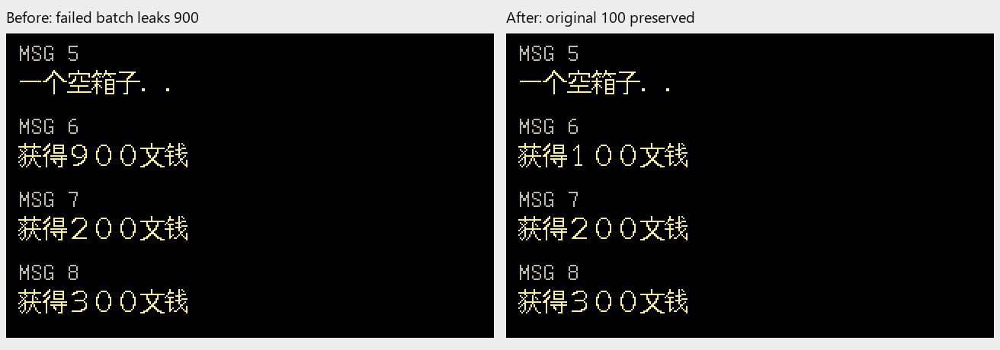
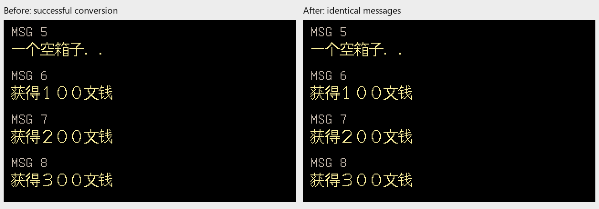
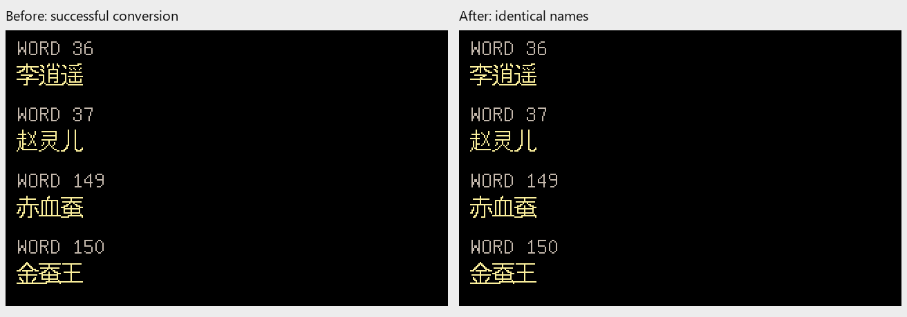

# Issue #2 R3：多文件准备失败回滚

2026-10-21，关联 [#2](https://github.com/othercat/sdlpal-jp/issues/2)、[总管 #1](https://github.com/othercat/sdlpal-jp/issues/1)。
基线 `feature @ e1a41d68215f3684f149ea94dbdeb25623e31c98`，分支 `richardli/fix/2-resource-preparation-rollback`。

**CLI `all` 和 GUI 在消息成功、词表失败时不再留下半套结果；发布中途失败会恢复已有文件、移除本轮新文件。**
没有修改日文正文、资源映射、字体、引擎渲染或原游戏目录。源码与工具验证已完成，实机最后统一验收，Issue 保持开放。

## 写入流程复核与最小修改

| 入口 | 修前 | 修后与保留的规则 |
| --- | --- | --- |
| CLI `all` | 直接覆盖 M.MSG，再写 WORD.DAT；后者失败，前者已经改变 | 两个文件先在输出目录的临时子目录完成转换；完整预检、备份已有目标后发布；失败恢复原状态，成功仍替换一对输出 |
| GUI 准备 | 缺规范文件时先复制缓存，或先写编码缓存再复制规范名；词表失败会留下消息缓存与 M.MSG | 最多四个新文件一起准备和发布；已有 M.MSG／WORD.DAT 优先，其次所选编码缓存，最后才转换；已有缓存及其他编码缓存不改 |
| GUI 日志刷新 | root.update() 可触发重复点击，后续读取 StringVar 可能混用新输入 | 入口防重入，开始时固定 PC／土星／输出／编码；退出时释放保护；异常先终止并等待子进程，再清理暂存文件 |
| GUI 后续生成 | 准备后启动 makemessage_j.py | 保持独立阶段；准备成功后的日志／SLF 生成失败不撤销准备，也不误报准备回滚失败 |

共享实现为 [resource_transaction.py](../tools/japanese/resource_transaction.py)，由两个现有脚本调用。
使用同目录暂存与 `os.replace`，只触碰本批登记的输出；不引入第三方运行依赖。
复制或分发 CLI／GUI 时须带上这个同目录模块，不能只复制单个入口脚本。
备份在第一个目标发布前全部完成；暂存文件缺失、目标不是普通文件或备份失败时，已有目标不变。
GUI 不覆盖准备期间出现的目标；全套规范文件已经存在时，不创建临时目录。
已存在的空规范文件仍按原规则优先，切换编码不会主动重建它们。

独立复核发现了一个 Ctrl+C 边界：替换已经成功、登记尚未执行时，旧逻辑会漏掉这个目标。
现改为替换前登记尝试，通过暂存文件是否已移走识别实际发布项；四种“真实替换完成后中断”注入均恢复原字节和修改时间。

若恢复操作本身也被系统拒绝，会报告 `Resource rollback incomplete`，保留临时目录中的旧文件备份，
并尽可能写入 `recovery.json` 记录目标路径；不会把这种情形写成回滚成功。
仅清理暂存目录失败时，提示残留路径及是否已提交，不撤销成功输出。
这套流程针对可捕获错误与中断，不保证断电、强杀或其他进程并发写相同目录时原子恢复。
单独 `msg`／`word` 入口的写入行为不变，仍建议使用工作副本。

## 源码渲染对比

下面使用真实 Steam 简体资源的工作副本：将 MSG 6 的全角“１００”改成同长度“９００”，
再给 WORD 0 注入 11 字节超长内容，故意令第二步失败。两次 CLI 都返回 1。
这只是失败注入用的输入，未修改实际游戏金额或翻译。
运行前输出目录已有完整、正确的 M.MSG／WORD.DAT。

左图是修前失败后遗留的文件，被修改的“９００”已经泄漏；右图是修后失败后保留的原文件，仍是“１００”。
图像由同一个 R2 Test 引擎加载真实输出文件，经生产消息查表、Japanese 16px 绘字与隐藏 SDL 目标纹理生成。
这是受控编号面板，不是自然剧情或实机截图；本轮所有文件长度完整，**未使用 R2 稀疏测试的 EOF 补空格**。



正常输入成功时，修前修后完整文件逐字节相同，下面的消息、角色和物品名称面板均为 0 像素差异。





三张 PNG 为不透明 RGB，共 29,759 字节，已目视核对文字。
简／繁体失败对比各有 53 个基础像素变化，位于被保留金额的字形；词条面板无变化。
修后失败图与正常原文件的源码面板逐像素一致。
GUI 在准备失败后不应启动日文生成器，因此其失败结果以文件快照和子进程记录验证，不伪造缺失资源的运行图。

## 已执行验证

| 项目 | 实际结果 |
| --- | --- |
| Python 测试 | 33 项通过：原 17 项及新增 16 项，多组合通过 subTest 覆盖 |
| 失败注入 | 消息／词表失败、缓存复制失败、备份失败、CLI 发布失败、GUI 四个发布位置、替换成功后中断；对比原字节／mtime、应不存在的新文件及暂存清理 |
| 恢复失败 | 故意拒绝恢复旧文件，确认备份仍在、recovery.json 记录目标与失败；不冒称原状态已恢复 |
| GUI 生命周期 | 日志回调失败后活动子进程被回收；重复点击不启动第二批；刷新时修改输入不影响本次命令；生成失败仍保留准备结果 |
| 真实资源专项 | 简／繁体 × 正常、词表失败、CLI 发布失败、GUI 发布失败，共 8 组；8 次 CLI 子进程、8 次 GUI 准备；另外 2 次 CLI 函数发布故障注入 |
| 正常输出 | 各 212,668 字节消息、5,660 字节词表；独立全文件布局核对通过；GUI 规范文件／缓存与 CLI 一致；成功替换既有 CLI 输出 |
| 源码结果 | 8 次引擎加载，64 条记录的码点匹配实际文件区间；16 个基础面板、48 个缩放 BMP；2×／3×逐像素，2.5×仅尺寸 |
| 原始资源 | 23 个 Steam 文本／资源指纹前后相同；未向原 Steam、PAL98 v1.72 或 PAL_DOS 写入 |
| 独立复核 | GUI 流程只读核对；实现审查发现的中断窗口已修正，窄复核无新增阻塞 |

复用 R2 的 Test x64 构建，SHA256 为 `3307d7ef0082055b4b28269b710b9773c9f936510311d01200a5722ed5008c66`。
核对 C／C++／头文件及 VS 工程相对 R2 实现提交无差异，Test 渲染入口与构建归档在换行规范化后相同。
本轮没有重建引擎或声称重跑 C++ 回归；构建来源和完整指纹一并写入[证据 JSON](evidence/issue-2-resource-preparation-verification.json)。

执行环境：Windows 11，官方 CPython 3.11.9 的 `C:\Users\other\CodexTools\python`；
验证器使用 Pillow／NumPy，转换与回滚本身仅标准库。执行者 Codex，2026-10-21。
输入是 `D:\SteamLibrary\steamapps\common\PAL\PAL`，并非已认证的 PAL98 日文桥接输入。
GUI 测试直接执行仓库中的真实回调和真实转换子进程，Tk 控件以测试对象替代，没有进行窗口操作验收。

## 复现、证据与后续

先从本轮基线提取未修改的 `rungui.py`、`steam_to_legacy.py` 到同一个外部目录，再使用新的验证输出目录：

```powershell
$jpPython = Join-Path $env:USERPROFILE 'CodexTools\python\Scripts\python.exe'
& $jpPython -B -X utf8 -m unittest discover -s tests -p test_japanese_conversion_tools.py -v
& $jpPython -B -X utf8 -m unittest discover -s tests -p test_resource_transaction.py -v
& $jpPython -B -X utf8 tools/japanese/verify_resource_preparation.py 'Steam PAL目录' '修前工具目录' 'R2 Test/sdlpal.exe' '新的外部验证目录'
```

完整命令、日志、输入／输出／源码指纹及每组前后结果见[验证记录](evidence/issue-2-resource-preparation-verification.json)。
本机工作副本、BMP／PNG、故障日志、恢复样例验证及精确源码归档保存在
`D:\Workspace\PALWork\artifacts\sdlpal-jp-issue-2\transaction-r3-20261021`；最终运行目录为 `verification-r2`。
只提交小型对比图、代码和证据，不提交游戏资源或完整转换文本。

实现、源分支最终 SHA、普通合并 SHA、远端内容核对和清理结果记录到 [#2](https://github.com/othercat/sdlpal-jp/issues/2)
及 [#1](https://github.com/othercat/sdlpal-jp/issues/1)，合入目标 `feature`，不使用自动关闭关联。
本轮回滚项已完成；随后 [R4](japanese-gamepath-unicode.md)已用最新构建复现并修复中文绝对 GamePath。
Tk 操作、游戏加载和完整流程由用户在所有实现完成后统一验收；没有本轮实机通过证据，Issue 继续开放。
