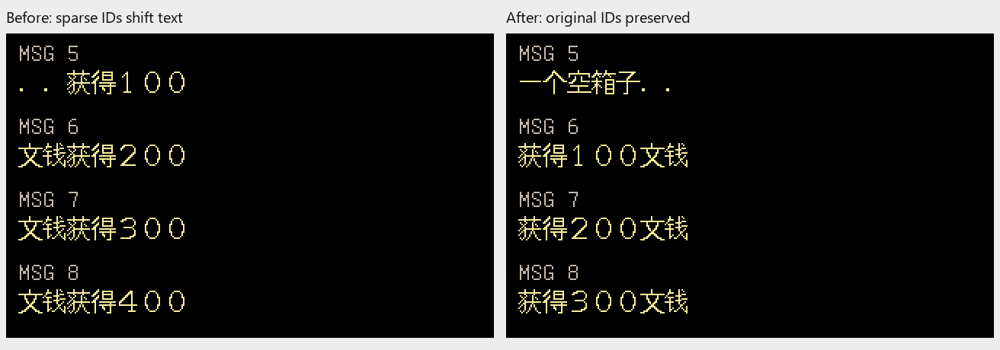
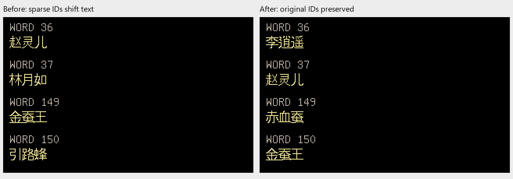

# Issue #2 R2：Steam 跳号与首记录 BOM

本文保留 R2 历史；下文当时未完成的多文件准备回滚已由 [R3](japanese-resource-preparation-rollback.md)处理。当前剩余项见[总管核对](japanese-issue-status.md)。

2026-10-21，关联 [#2](https://github.com/othercat/sdlpal-jp/issues/2)、
[总管 #1](https://github.com/othercat/sdlpal-jp/issues/1)。
本轮基于 `feature @ 68c56490a9c55c223b93ff0d2b6ae6f455885337`，
分支 `richardli/fix/2-steam-sparse-record-offsets`。

**Steam 文本缺少一个编号时，后续对白／词条不再整体前移；BOM 紧邻首编号也不会丢掉该记录。**
这是中文旧格式资源的转换修复，未改日译正文、日文映射、字体或生产渲染代码。

## 原文件与读取规则

本机真实 Steam `PAL` 目录中的四个简／繁体文本均带 UTF-16LE BOM。
文件头明确说明允许跳号，重复编号时后者覆盖。每份 MSG 有 12,881 条记录，
其中 ID 12,880 是零长 EOF；前三条显式空消息位于 1,578／2,729／2,742。
WORD 有 566 条，编号 0／1 本来为空。这些合法内容不应一律拒绝。
完整输入的 23 个文本／资源文件指纹见[验证记录](evidence/issue-2-steam-record-verification.json)。

生产 `text.c` 按 `SSS.MKF` 第 3 块偏移切分 M.MSG，
按固定 10 字节及编号切分 WORD.DAT。旧转换器却只遍历实际出现的编号并顺序追加数据。
删除编号 0 后，M.MSG 和 WORD.DAT 都缩短 10 字节，后续文本读到错误位置。
旧 UTF-16LE 解析器还把 BOM 视为首编号的一部分；若没有开头注释，编号 0 会被跳过。
官方整包的 BOM 后恰好是注释，所以此前整包并不会因这一点丢记录。

## 最小修改

- 按 SSS 最后偏移分配 MSG，缺号部分保留空格，现有消息写回自己的绝对区间。
- WORD 按最大编号分配 `(max ID + 1) × 10`，每条写回 `ID × 10`，保留编号空洞。
- 支持有／无 LE BOM；保留重复编号最后一条覆盖、显式空文本、空格和冒号。
- 检查 SSS 块边界、索引尺寸、零起点及单调性；拒绝坏记录、无记录输入、负数／越界 ID、超长内容。
- WORD 限于旧版脚本／对象可引用的 16 位编号。WORD 没有独立总数索引，不能猜出被省略的末尾词条。

验证失败发生在单文件写入前；**CLI `all`／GUI 多文件准备仍非事务**，后续回滚工作见[总管剩余项](japanese-issue-status.md)。
SSS 结构合法不等于版本语义匹配，现有日文生成器的固定资源身份保护继续保留。

## 源码前后图

下图来自真实 Steam 简体文本的工作副本，仅删除 MSG／WORD 的 ID 0。
使用同一个本轮 Test 引擎加载修前／修后产物，Japanese 16px、UseISOFont=0，
通过生产 `PAL_GetMsg`／`PAL_GetWord`、`PAL_DrawText` 与隐藏 SDL Direct3D 目标纹理出图。
面板是受控编号探针，不是自然游戏剧情截图。

旧 MSG 比 SSS 所需长度短，直接让旧引擎读取存在越界风险。
左图的输入因此**仅在文件末尾补 10 个空格**，不修正中间任何偏移；
验证器断言每个显示区间都落在旧文件原始长度内。WORD 左图也只在末尾补齐 10 字节。
这一处理只保障修前探针可安全加载，不将左图冒称未经处理的旧文件运行结果。





两张 PNG 都是不透明 RGB，总计 20,851 字节。修前 WORD 36 从“李逍遥”错到“赵灵儿”，
149 从“赤血蚕”错到“金蚕王”；修后所有显示项与完整输入参考逐像素相同。
这是转换编号错误，不是日译用词问题。

## 实际验证

| 项目 | 结果 |
| --- | --- |
| 工具单元／CLI／真实 GUI 回调 | 17 项通过；包含稀疏／乱序／缺 EOF、BOM、重复覆盖、空文本、负例与已有目标保护 |
| Test x64 构建 | VS 2026 v145，构建成功；临时 generated.h 恢复原字节 |
| C++ 回归 | `*DescriptionLayout*:*Portrait*`，12 项通过；没有声称重跑整个引擎测试集 |
| 真实简／繁体整包 | 各 12,881 条消息记录／566 词条；修前修后完整产物逐字节相同 |
| 复现输入 | 两编码 × 完整／删除 ID 0／BOM 紧邻 ID 0，共 6 组，12 次 CLI 与源码加载 |
| 独立全文件核对 | 独立解析输入并按固定长度拼接期望文件；全部 6 组修后匹配，4 组故障修前不匹配 |
| 源码结果 | 96 个显示记录逐码点匹配实际文件区间；完整输入 0 像素差异，故障修后与完整参考一致 |
| 图像规模 | 24 个基础面板、72 个 SDL 缩放 BMP；2×／3×逐像素检查，2.5×仅尺寸 |
| 原始资源 | 23 个输入指纹前后相同，未向原游戏目录写入 |

完整输入 M.MSG 为 212,668 字节，WORD.DAT 为 5,660 字节。
简体 SHA256 分别为 `37d89f2990c984d26f77ebb747dd470bb04a8d83798da081c1186675a343d826`、
`1823ba3bd48b487dd267f1e8a78c829f8204fb5c257efbf8d64fade32335229f`；
繁体为 `931cfc2a7a54a1579fadbce371212693a503625819a81e578f1461d0ad9cb7fc`、
`bf7f9b013e290df9417b686be60218d296ee3c6160f72ceda22f55284c37f63b`。

执行环境：Windows 11／官方 CPython 3.11.9 的 `C:\Users\other\CodexTools\python`，
验证器用 NumPy／Pillow。原输入为 `D:\SteamLibrary\steamapps\common\PAL\PAL`，
并非 #7 的 `PAL_DOS` 或用户指定的 PAL98 v1.72 包；后二者未修改。
执行者 Codex，2026-10-21。

复现时先从基线取修前脚本，再使用全新外部输出目录：

```powershell
$jpPython = Join-Path $env:USERPROFILE 'CodexTools\python\Scripts\python.exe'
& $jpPython -B -X utf8 tests/test_japanese_conversion_tools.py -v
& $jpPython -B -X utf8 tools/japanese/verify_steam_conversion.py 'Steam PAL 目录' '修前steam_to_legacy.py' '本轮Test\sdlpal.exe' '新的验证目录'
```

实际完整命令、输入／输出／源码／构建／日志指纹在[证据 JSON](evidence/issue-2-steam-record-verification.json)。
本机日志、完整转换文件、运行副本及 BMP 保留在
`D:\Workspace\PALWork\artifacts\sdlpal-jp-issue-2\steam-r2-20261021`。
原游戏资源和整份转换文本不提交到仓库。

## 尚未完成与追溯

本轮只完成 Steam 中文格式转换的编号专项；该 Steam 版本没有因此成为已认证的日文桥接输入。
CLI／GUI 多文件失败回滚、中文绝对 GamePath 旧失败的最新构建复核继续列为 #2 跟进。
Tk 操作、游戏加载／完整流程由用户最后统一验收，Issue 保持开放。

普通合入 `feature`，实现／合并完整 SHA、分支最终提交、远端核对及清理结果记录在
[#2](https://github.com/othercat/sdlpal-jp/issues/2) 与 [#1](https://github.com/othercat/sdlpal-jp/issues/1)。
不使用自动关闭关联，源码专项结果不代替实机验收。
