# Issue #4：比武招亲 NPC 台词错配

2026-10-20，关联 [#4](https://github.com/othercat/sdlpal-jp/issues/4)、[总管 #1](https://github.com/othercat/sdlpal-jp/issues/1)。

**10 组 / 28 个 Win 消息 ID 已解除错配。** 本轮采用依据 Win 原文校读的新补译，没有把未确认的土星段落冒充直接对应。原正确的五组 NPC 台词、#3 恢复的 119 组及其他输出内容保持不变；全部 Issue 实现后由用户统一实机验收。

后续 [#8 重复键修正](japanese-duplicate-message-keys.md)保留本单十组文本；下方历史命令用 `--before-duplicate-fix` 重现 #4 完成时的输出。当前默认转换及分阶段核对步骤见[工具用法](../tools/japanese/README.md)。

## 原版、土星与事件核对

旧转换器的 section=1、section=5 都从土星脚本 8253 连取五组，把书生、刘楚香、拳师、护院、小僧重复套给家仆和观众。原始 Win `SSS.MKF` 证明这些正文直接挂在 scene33 / map31 的 17 个事件上，属于比武进行中的评论；场景入场脚本为 9038。静态事件引用与剧情语义不能代替存档状态验收。

| Win 消息 | 脚本入口 | 事件 ID | 原说话者 / 内容 | 错套土星 ID |
| --- | ---: | --- | --- | --- |
| 2714–2715 | 7685 | 553 | 家仆赞小姐 | 3443–3447 |
| 2716–2717 | 7688 | 554 | 家仆嘲讽男子武艺 | 3448–3454 |
| 2718–2719 | 7691 | 555 | 家仆赞堡主亲传剑法 | 3455–3457 |
| 2720–2722 | 7694 | 556 | 家仆怜悯挑战者 | 3458–3462 |
| 2723–2726 | 7698 | 557 | 家仆加油后担心招亲无结果 | 3463–3466 |
| 2860–2861 | 8128 | 558, 560, 565, 566, 567 | 观众要求别挤 | 3443–3447 |
| 2862–2863 | 8131 | 559, 562 | 观众惊叹小姐强悍 | 3448–3454 |
| 2864–2867 | 8134 | 561, 564 | 观众认可小姐武艺 | 3455–3457 |
| 2868–2871 | 8139 | 563, 569 | 观众称七分真传 | 3458–3462 |
| 2872–2874 | 8144 | 568 | 观众判断不出百招必败 | 3463–3466 |

已逐组阅读这 10 组 Win、五组错套日文、苏州相邻 185 组，并补读 JP 2954–3201 的报名/街谈段；对全部 17,171 条土星索引作关键词、相邻行拼接及数字归一化检索。没有找到可确认属于这十个事件的直接原段，**不声称穷尽证明文本绝不存在**。

- JP 2954–2955 的“押さないで”属于报名排队，4598–4599 属于尸变剧情附近村人，均不能直接挂给擂台观众。
- 3519–3523 是住民介绍小姐武艺；4067–4070 是仆人称婿殿配得上小姐。说话阶段和语义不同。
- 2999–3018 提到招亲及家传剑法，但说话者、问答和正文不同；8648 的“林家七剣法”是招式名，不是“七分真传”。

逐组原文、错套日文、近似命中原文、事件与校读说明见 [完整审阅 JSON](evidence/issue-4-dialogue-review.json)。沿用土星用语 `婿取り武術会`（3604）、仆人称呼 `旦那様`（3961、4076）及 `林天南`（3184 等）。#6 的战斗说明术语仍独立跟进，本轮不改全库人名。

## 采用的新补译

主 agent 与独立只读 agent 完成语义、日语表达和分行校读；未声称真人日语审校。全角说话者冒号保留姓名行处理；正文每行最多 17 全角、每组最多四行，无新增控制码或 CLEAR。重点保留自我纠正的笑点、粗鲁语气、七分传承和不出百招必败。

| Win ID | Win 原文 | 新日译（按实际分行） |
| --- | --- | --- |
| 2714–2715 | 林家家仆：<br>小姐好厉害喔！ | 林家の使用人：<br>お嬢様、すごい！ |
| 2716–2717 | 林家家仆：<br>这男的功夫好菜！ | 林家の使用人：<br>あの男、ひどい腕前だな！ |
| 2718–2719 | 林家家仆：<br>我们堡主亲传的剑法果然厉害 | 林家の使用人：<br>旦那様直伝の剣法は、<br>やはり見事だ！ |
| 2720–2722 | 林家家仆：<br>这些兴致勃勃的年轻人真可怜<br>根本不是我们家小姐的对手。 | 林家の使用人：<br>あんなに張り切った若者たち、<br>気の毒になあ。<br>うちのお嬢様の相手には<br>まるでならないんだから。 |
| 2723–2726 | 林家家仆：<br>小姐加油！　啊．．不对<br>每次小姐都赢，这比武招亲<br>何时才会有个结果出来？ | 林家の使用人：<br>お嬢様、頑張れ！<br>あっ・・・いや、違うな。<br>毎回お嬢様が勝っていたら、<br>婿取り武術会はいつ決着がつくんだ？ |
| 2860–2861 | 观众：<br>别挤啊！ | 観客：<br>押すなよ！ |
| 2862–2863 | 观众：<br>姓林的这娘们好厉害！ | 観客：<br>林って女、えらく強いな！ |
| 2864–2867 | 观众：<br>只听得林家千金多么泼辣<br>今日一看，手上的功夫倒<br>也不弱。 | 観客：<br>林家のお嬢様は<br>じゃじゃ馬だとばかり聞いていたが、<br>今日見ると、武術の腕も<br>なかなかのものだな。 |
| 2868–2871 | 观众：<br>林家堡堡主林天南的家传剑法<br>果然名不虚传，林家小姐已得<br>七分真传了。 | 観客：<br>林家の主、林天南の家伝の剣法は<br>さすが評判通りだな。<br>お嬢様もその技の七割を<br>すでに身につけているな。 |
| 2872–2874 | 观众：<br>场上这男的下盘不稳，我看<br>不出百招，一定败下阵来。 | 観客：<br>台の上のあの男、<br>足元がぐらついているな。<br>俺の見立てじゃ、百手も<br>交えぬうちに必ず負けるぞ。 |

## 最小改动与验证

转换器只在两个已知段落发出 MESSAGE 时替换上述十个正文，并检查首尾 Win ID、首脚本及最终十键完整集合；源锚点不符即退出，不写输出。两个审计参数互斥：`--upstream-baseline` 重现原上游，`--before-tournament-fix` 重现 #3 完成后 / #4 修前；GUI 和默认 CLI 使用修正后的正文。

独立校验器从原始 Win/Saturn 资源与审阅记录核对来源、事件及台词，在固定指纹的修前文件中只替换十个 MESSAGE 正文，再与实际输出做**完整字节比较**。因此设置、说明、注释、消息顺序或额外块的变化都不能被 MESSAGE 正则忽略。

| 检查 | 结果 |
| --- | --- |
| 7 个转换输入指纹 | 与固定版本一致，未改原始资源 |
| 消息块 / 唯一键 | 前后均 4,773 / 4,766；缺失 0 |
| 正文修改 | 仅 10 组 / 28 个 Win ID |
| 其他内容 | 4,763 块 / 4,756 唯一键和其余文件字节不变 |
| 原正确 NPC | Win 2555–2558、2559–2563、2564–2566、2567–2570、2571–2574 全部不变 |
| 相邻与历史保护 | #3 的 119 组全部保留；6 个重复键 / 2 个内容冲突留给 #8，原样保留 |
| 上游 / 修前审计输出 | 分别与固定上游 / #3 后输出逐字节相同 |
| 工具 / GUI | 9 项测试通过；真实 GUI generate 回调与 CLI 文件相同，未创建 Tk 窗口 |
| 负例 | 错译、漏组、误改正确 NPC、误改 #3、额外说明块、重复组共 6 项均拒绝且不建验证目录；损坏来源锚点不生成 SLF；互斥审计参数退出 2 |
| 引擎 | Test/x64 构建成功，有既有警告；前后各 4,766 键全部读取，10 组全部绘制；截短/重复/无绘制组夹具均退出 1 |
| #3 渲染回归 | 既有 jp-recovery 模式 40 张 BMP 的 RGB 与 CSV 均保持一致 |

当前 SLF SHA256：`d15d7ad24eb16f33e56a4c993d8b5f995a4eb98438ee9bd98f2b498513ac2229`。继续应用 #5 赤血蚕适配后为 `d6abc90ed3c32b6d289f65ef1b35a90873187f9f6498ad7b03e2de7a167aeae8`，仅移动 12920–12921 组原有的一个换行。仅替换 exe 不会改变旧 SLF，实际使用需重新生成并配置加载文本。

## 源码渲染前后图

下列为 **Test 引擎绘制的黑色中性背景画面，非剧情实机截图**。这些事件直接以 FFFF 开始，没有显式对话命令；使用 `PAL_EndDialog` 的上方、无头像默认值，姓名 (12,8)、正文 (44,26)、行距 18，不继承其他人物头像。

内置日文字体 16 px、UseISOFont=0；17 个运行资源与指定 PAL98 原包指纹一致。实际 SDL Direct3D 隐藏目标纹理输出 320×200、640×400、960×600、800×500。前后共 88 张 BMP，发布 22 张不透明 RGB PNG（61,550 字节）。

前后共核对 799 个字形实例、41,588 个姓名及正文墨点，无缺字、错色或实字裁切；66 张缩放图每张保留 64,000 个源像素，无混合新颜色，整数倍率与最近邻精确一致。PNG 编码后重新检查 RGB 与有效 alpha=255，白色/深色背景合成都与源 RGB 一致。此检查针对预期字形墨点，不据此宣称剧情、背景或头像已验收。

修前刘楚香长对白在两处各产生一次自动翻页；修后这些 NPC 均不超过四行正文，所以无需翻页。正文变短来自解除错套，并未删除目标消息区间。两张修前第二页也保留在下方。

| Win ID / 内容 | 修前 | 修后 |
| --- | --- | --- |
| 2714–2715 / 家仆赞小姐 |  |  |
| 2716–2717 / 家仆嘲讽男子武艺 |  | 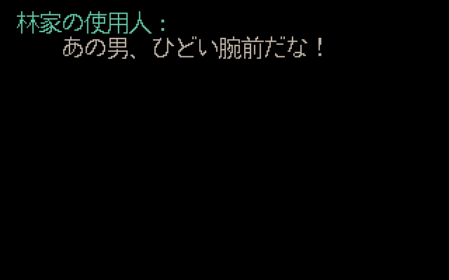 |
| 2718–2719 / 家仆赞堡主亲传剑法 | 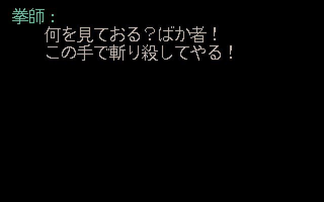 | 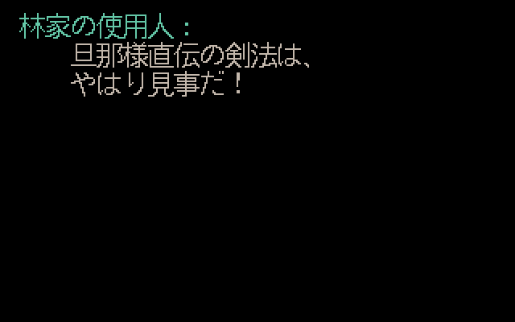 |
| 2720–2722 / 家仆怜悯挑战者 |  | 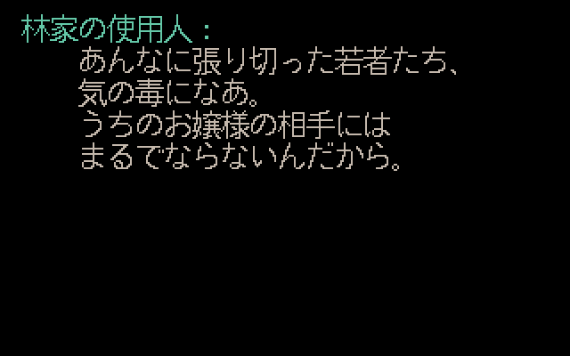 |
| 2723–2726 / 家仆加油后担心招亲无结果 | 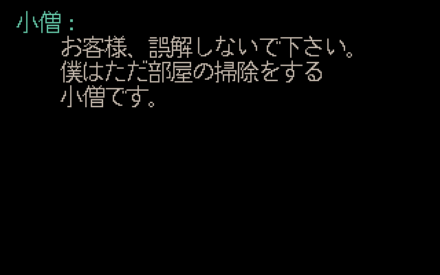 | 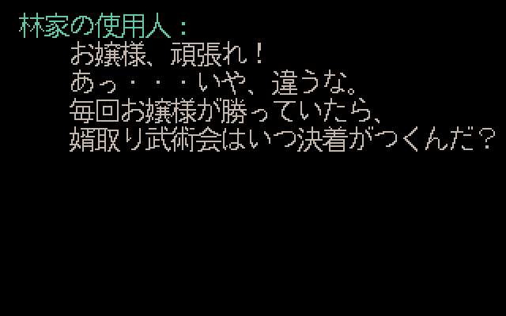 |
| 2860–2861 / 观众要求别挤 | 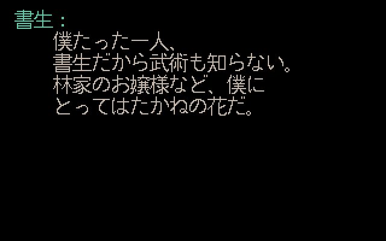 |  |
| 2862–2863 / 观众惊叹小姐强悍 | 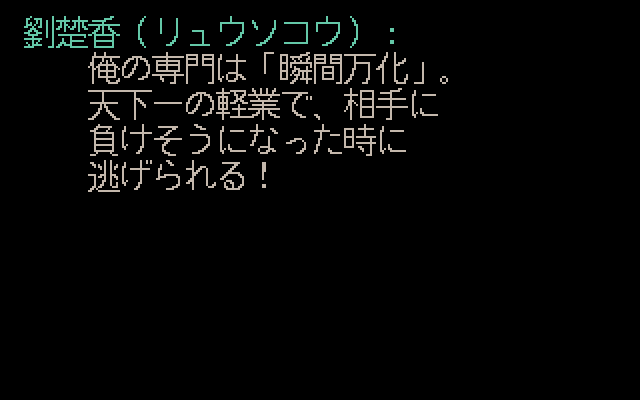 | 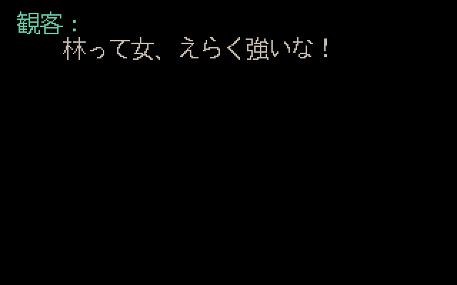 |
| 2864–2867 / 观众认可小姐武艺 |  | 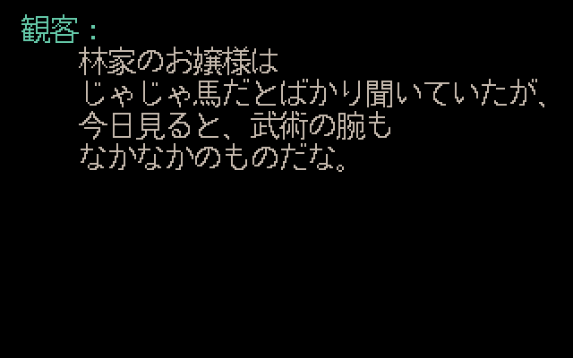 |
| 2868–2871 / 观众称七分真传 | 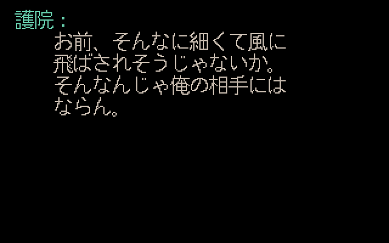 | 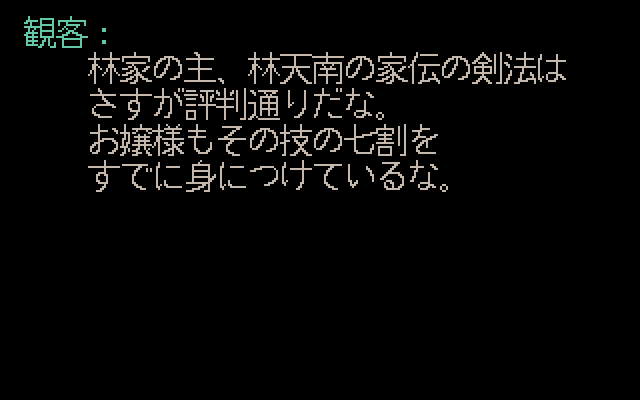 |
| 2872–2874 / 观众判断不出百招必败 |  | 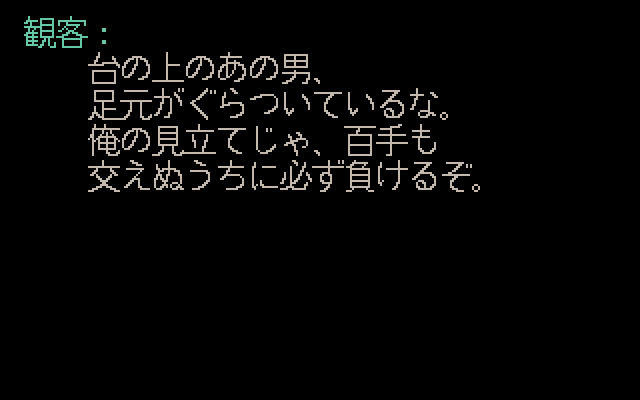 |

| 修前 2716–2717 第二页 | 修前 2862–2863 第二页 |
| --- | --- |
|  | 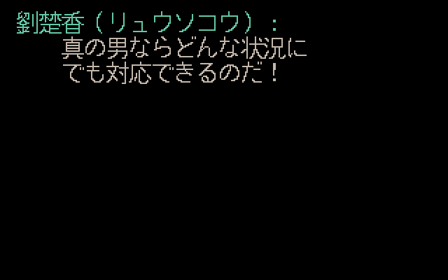 |

## 复现与追溯

PC、SAT 采用 [upstream.json](../tools/japanese/upstream.json) 的固定输入。输出位置使用新路径；先做映射核对，再执行 #5 说明适配：

```powershell
$jpPython = Join-Path $env:USERPROFILE 'CodexTools\python\Scripts\python.exe'
& $jpPython -B -X utf8 tools\japanese\makemessage_j.py 'PC' 'SAT' 'OUT\before.slf' gbk --before-tournament-fix
& $jpPython -B -X utf8 tools\japanese\makemessage_j.py 'PC' 'SAT' 'OUT\after.slf' gbk --before-duplicate-fix
& $jpPython -B -X utf8 tools\japanese\verify_tournament_dialogues.py 'PC' 'SAT' 'OUT\before.slf' 'OUT\after.slf' 'OUT\verify'
& $jpPython -B -X utf8 tests\test_japanese_conversion_tools.py -v
& $jpPython -B -X utf8 tools\adapt_red_silkworm_description.py 'OUT\after.slf' 'OUT\after-adapted.slf'
```

构建 `win32/sdlpal.sln` 的 Test/x64（本机 VS2026 / v145，`CL=/utf-8 /DGTEST_HAS_TR1_TUPLE=0`），建立 `render-before`、`render-after`，分别放入 `OUT/verify/recovery-fixtures.csv`：

```powershell
& 'BUILD\sdlpal.exe' --render-evidence 'ASCII_PC\' 'OUT\before.slf' 'OUT\render-before' jp-npc-before
& 'BUILD\sdlpal.exe' --render-evidence 'ASCII_PC\' 'OUT\after.slf' 'OUT\render-after' jp-npc
```

Python 转换可直接读原始中文路径；旧引擎 GamePath 的非 ASCII 限制沿用 #2 记录，源码渲染使用逐项指纹相同的 ASCII 资源副本。PNG 使用现有 `export_recovery_previews.export_preview` 导出并校验有效透明度；该工具的 #3 批量 CLI 固定为 8 组，不用于本单 10 组。

完整 [验证记录、执行命令及图片指纹](evidence/issue-4-npc-verification.json) 随项目保存；本机产物 `D:\Workspace\PALWork\artifacts\sdlpal-jp-issue-4\npc-mappings-r1-20261020` 包含源码前后 SLF、构建/日志、所有 BMP/PNG、负例与 GUI 工作副本。Test 二进制 SHA256：`3c9f37461d9b97f6653ebc9518ef54d7d1f28ca57851705675c175d7f87bdadc`。

专用分支 `richardli/fix/4-correct-tournament-npc-mappings` 从最新 `feature @ 74ba817f610e68bd6adff669404d4601e31b2442` 开始实施，保留建单时的历史基线。实现提交、普通合并 SHA、推送与清理记录见 #4、#1；Issue 保持开放。

统一实机验收时覆盖比武进行中 17 个事件、前后剧情状态切换、原正确的五组 NPC 及 #3 相邻苏州段。由用户确认实际构建/SLF、配置、存档与结果，本轮没有填写实机通过。
