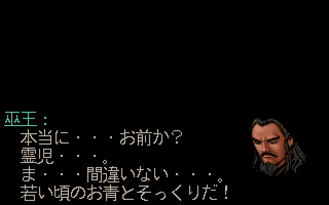
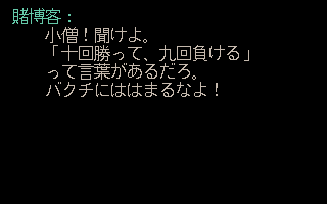
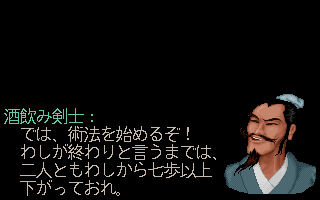
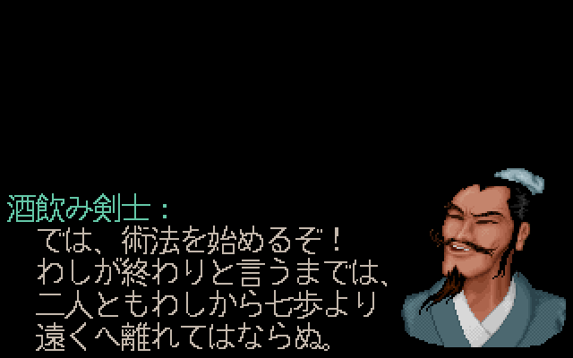
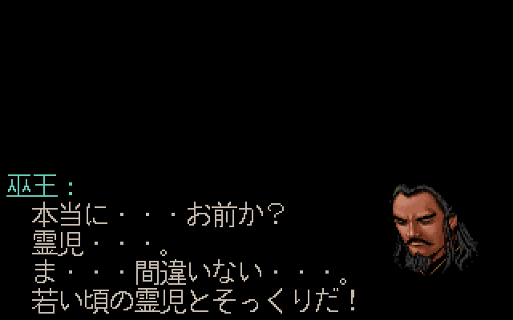
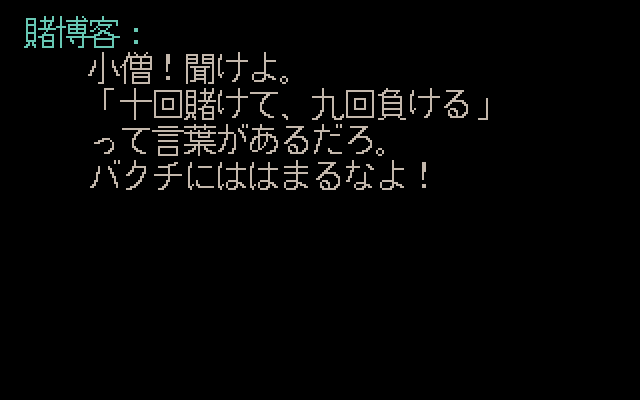
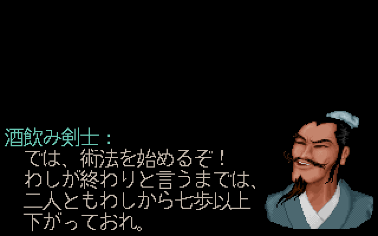
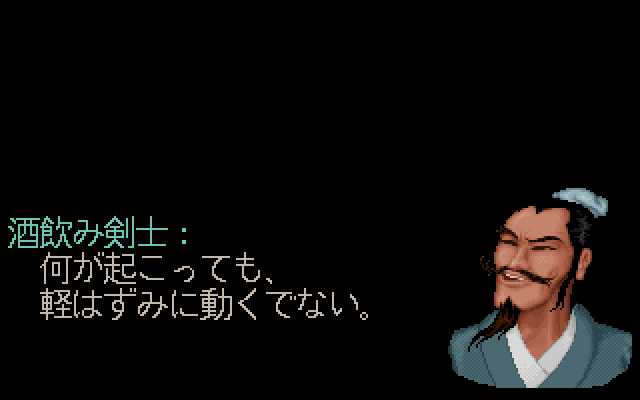
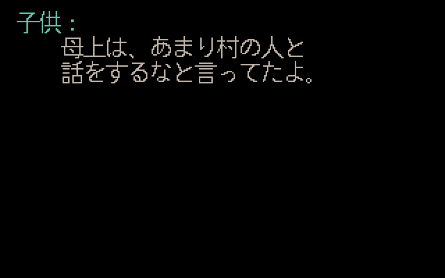
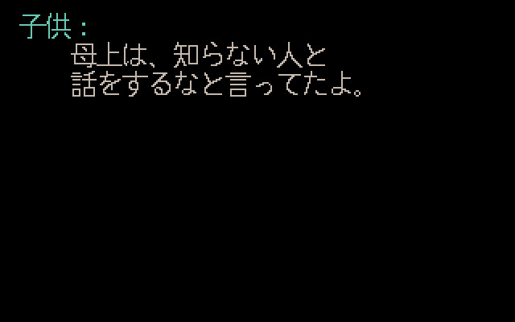

# Issue #6 R2：四组共享日译修订

2026-10-21，关联 [#6](https://github.com/othercat/sdlpal-jp/issues/6)、[DOS #7](https://github.com/othercat/sdlpal-jp/issues/7)、[总管 #1](https://github.com/othercat/sdlpal-jp/issues/1)。本轮基于 `feature @ 9af0b588f81536e7b876889628e4a9ec3d885319`，只处理 #7 调查中新发现的四组；R1 的十八组修订保持原样。

**四组共修改六行日文，Win／DOS 使用完全相同的修订正文。** 两版消息键、组序、其他正文、名称表、设置、说明及原资源均未改变；不增加或删除日文行及 CLEAR。全部实机验收仍由用户最后统一进行，Issue 保持开放。

## 原文与最小决定

[独立来源复核](evidence/issue-6-followup-review.json)记录实际 Win GBK、DOS CP950、土星 Shift-JIS 的固定输入指纹、完整原句、脚本指令、原始字节偏移和上下文。新译是依据中文纠正土星原译，不能称为土星原文。

| Win / DOS / 土星消息区间 | 中文含义 | 土星原译 → 修订 | 依据及保留内容 |
| --- | --- | --- | --- |
| 12078–12083 / 442–447 / 15442–15449 | 灵儿像当年的阿青 | `若い頃の霊児とそっくりだ！` → `若い頃のお青とそっくりだ！` | 同场 JP 15436 为「青・・・お青・・・」，JP 14291 也由巫王称巫后「お青」。沿用土星既有人名，不全库替换霊児 |
| 2396–2399 / 2978–2981 / 3233–3237 | 十赌九输 | `「十回勝って、九回負ける」` → `「十回賭けて、九回負ける」` | 只把“赢十次”改为“赌十次”，保留劝戒句与说话者 |
| 7583–7589 / 8166–8172 / 9746–9755 | 术法结束前不能离开七步之外；不可轻举妄动 | `二人ともわしから七歩以上` / `下がっておれ。` → `二人ともわしから七歩より` / `遠くへ離れてはならぬ。`；`動揺してはならぬ。` → `軽はずみに動くでない。` | 修正距离方向，并把同组“不要动摇”的情绪要求恢复为行动禁令。其余句子及 CLEAR 位置保持 |
| 3447–3448 / 4029–4030 / 4507–4509 | 不能与陌生人说话 | `母上は、あまり村の人と` → `母上は、知らない人と` | Win 3448 末尾有原始损坏字节，DOS 4030 严格解码的完整句子也明确为“陌生人”；不修改该资源坏字节 |

复核时区分了同名炼丹 NPC 的「お青」，人物确认依赖巫王／巫后的同场上下文。最长日文显示行仍为 13 字；原姓名、未改句子的本地化风格和其他可选扩写不在本轮调整。

## 实现与 Win／DOS 同步

- [`makemessage_j.py`](../tools/japanese/makemessage_j.py) 在独立 `TRANSLATION_FOLLOWUPS` 表记录四组原脚本、消息首尾、完整土星正文和替换正文，校验后才输出。当前 CLI／GUI 默认应用 R1＋R2。
- 新审计选项 `--before-translation-followup` 重现 #7 后／R2 前的带版本标签 Win SLF。四种更早的审计选项仍逐字节重现历史结果；选项互斥。
- [`dos-map.json`](../tools/japanese/dos-map.json) 只更新共享 Win 桥接整体指纹和这四组的译文来源标签。原 DOS／Win／土星锚点、原文指纹、五条 ASCII 标记、秀蘭专属姓名、296 条说明及 DOS 307／308 专属机制说明保持不变。没有取消版本或来源保护。
- 新桥接正文 LF SHA256：`f940767ccc3812dabc09bb82d71fd4ab16fb2633bce7e38f96bc890ca7b16caf`。生成 DOS 时继续核对完整新桥接正文；旧桥接清单会在写输出前拒绝新译文。

[`verify_translation_followup.py`](../tools/japanese/verify_translation_followup.py) 从固定原资源重新核对四组及「お青」上下文，验证 Win／DOS 同文和整个 SLF 非目标字节不变。Win 保留 4,773 块／4,766 唯一键，其余 4,769 块不变；DOS 保留 4,476 唯一块，其余 4,472 块不变。全部重复键、控制序列和各组行数保持。

## 源码前后图

使用 #7 已验证的 Test x64 引擎（SHA256 `9ec63d25e64b3aa97c6614816285ccb8e76f357b83165192c277f445c777c5b3`），本轮 C/C++、字体和绘制实现未变，未重新构建或重复宣称 C++ 单测。使用真实加载、消息查表、分页、文字、头像及菜单绘制函数，SDL Direct3D 隐藏窗口的目标纹理出图；Japanese 16px、UseISOFont=0。

阿青与七步段分别使用原始 `003D,0046,0,0`、`003D,0025,0,0`，即下方头像 70、37。赌客和小孩是事件 527、811 的直接对白入口，没有对应原始 003B–003E；它们采用**明确标记的上方无头像夹具**，不冒称原路线布局。黑色是中性背景，所有图都是不透明 RGB；不是自然剧情实机截图。

| 对象 | 修前 | 修后 |
| --- | --- | --- |
| Win 阿青 |  |  |
| Win 十赌九输 |  |  |
| Win 七步范围 |  |  |
| Win 不可轻举妄动 |  |  |
| Win 陌生人 |  |  |
| DOS 阿青 |  |  |
| DOS 十赌九输 |  |  |
| DOS 七步范围 |  |  |
| DOS 不可轻举妄动 |  |  |
| DOS 陌生人 |  |  |

未改的后续页也已出图并验证一致：Win [阿青修前第二页](images/translation-followup/win-before-dialogue-12078-page-2.png)／[修后](images/translation-followup/win-after-dialogue-12078-page-2.png)，[七步修前第三页](images/translation-followup/win-before-dialogue-7583-page-3.png)／[修后](images/translation-followup/win-after-dialogue-7583-page-3.png)；DOS [阿青修前第二页](images/translation-followup/dos-before-dialogue-442-page-2.png)／[修后](images/translation-followup/dos-after-dialogue-442-page-2.png)，[七步修前第三页](images/translation-followup/dos-before-dialogue-8166-page-3.png)／[修后](images/translation-followup/dos-after-dialogue-8166-page-3.png)。合计 28 张、171,595 字节。

## 验证与复现

[完整验证记录](evidence/issue-6-followup-verification.json)保存运行命令、输入／输出／图片指纹、原文保护、负例及每页字形检查。

| 检查 | 结果 |
| --- | --- |
| 实际引擎查表 | 前后各 Win 4,766 键／DOS 4,476 键全文匹配生成文本 |
| 四组前后字形 | 998 个显示字形实例、45,900 个正文／标题墨点完整，无裁切或覆盖 |
| 前后画面变化 | 50 对基础视图中仅 10 对发生变化；差异限于六条修订行的原／新字形及阴影掩码内，其他页面、头像和菜单像素一致 |
| 分页／控制 | 四组各 7 页，两个版本前后页数及等待均一致，CLEAR 不变 |
| 缩放 | 100 个视图的 2×／3×逐像素一致；2.5×仅核对 800×500 尺寸 |
| 说明回归 | Win 19 个代表说明和 DOS 全部 296 个说明的探针无裁切，DOS 10 个生产菜单说明墨点完整；说明文字没有修改 |
| 转换器 | 五种历史输出逐字节一致，R1 验证器通过；真实 GUI 回调与 CLI 输出逐字节一致 |
| 保护检查 | 错译、无关换行／设置、移除 CLEAR、陈旧 DOS 桥接、冲突审计选项共 7 种负例被拒绝；输出不被覆盖或不产生新输出 |
| Python 单测 | 13 个转换器、4 个 DOS、3 个本轮字节／锚点保护测试通过 |
| 实机验收 | 未执行，最后统一进行；不以源码图、单测或历史构建代替 |

以下路径替换为本机目录，使用固定 `CodexTools/python` 解释器。修前 Win 可由新审计选项复现；修前 DOS 使用 #7 固定提交生成的产物，指纹由验证器固定核对。`before` 和 `after` 目录均需包含对应 `paljpn-win.slf`、`paljpn-dos.slf`、`dos-objects.csv`、`expected-descriptions.json`。

```powershell
$jpPython = Join-Path $env:USERPROFILE 'CodexTools\python\Scripts\python.exe'
& $jpPython -B -X utf8 tools\japanese\makemessage_j.py 'Win资源' '土星资源' '修前Win.slf' gbk --before-translation-followup
& $jpPython -B -X utf8 tools\japanese\makemessage_dos.py 'DOS资源' 'Win资源' '土星资源' '新的after目录'
& $jpPython -B -X utf8 tools\japanese\verify_translation_followup.py 'Win资源' 'DOS资源' '土星资源' 'before目录' 'after目录' '新的verification目录'
& $jpPython -B -X utf8 tools\japanese\verify_followup_rendering.py 'Test版sdlpal.exe' 'Win运行资源' 'DOS运行资源' 'before目录' 'after目录' 'verification目录' '新的render目录'
```

本轮输入是指定 PAL98 v1.72_20261014、Steam PAL_DOS 和固定土星提取资源；Win 出图使用已校验与指定根包一致的 ASCII 路径副本。资源原文件及存档未改动。要在游戏中看到新译文，需重新生成并加载相应版本 SLF。

本轮不扩展到全剧本人工校读、其他资源版本或 #9 头像调色板。最终统一验收需记录明确构建／SLF、设备系统、资源配置与四个场景的实际表现。
