# Issue #6：日文误译核对与最小修订

2026-10-20，关联 [#6](https://github.com/othercat/sdlpal-jp/issues/6)、[总管 #1](https://github.com/othercat/sdlpal-jp/issues/1)。

2026-10-21 后续：[R2 新增四组修订及 Win／DOS 源码对比](japanese-translation-followup.md)已完成，涉及阿青、十赌九输、七步范围和陌生人。本文保留 R1 的十八组历史记录；默认转换已包含两轮，R1 输出用 `--before-translation-followup` 重现。

**修订 18 组 MESSAGE 正文：5 组对白、3 组物品说明、10 组法术说明。** 对照指定 PAL98 中文资源、土星原日文及相关战斗源码，修正语义反转、格助词和误导性机制说明。4,773 块、4,766 唯一键保持不变，其他 4,755 块及所有非目标字节不变。原资源、脚本、映射、WORDS 人名和战斗行为均未修改。实机验收由用户在所有 Issue 实现后统一进行。

本单是有定位的抽查与关联条目复核，**不是全 17,171 条土星文本审校通过**。完整原文、来源、上下文和保留理由见 [逐组核对记录](evidence/issue-6-translation-review.json)，战斗脚本、对象及代码证据见 [战斗说明复核](evidence/issue-6-battle-review.json)，执行结果和图片指纹见 [验证清单](evidence/issue-6-translation-verification.json)。

## 原版中文、土星日文与修订

下表保留实际换行及控制标记；MESSAGE 的 Win 区间是运行时键，JP 区间是原土星来源，两者不要求行数相同。原 $NN、~NN、CLEAR、等待图标等控制序列完全保留。

| Win / JP ID | 中文原文 | 土星原译 | 本轮修订 | 判定理由 |
| --- | --- | --- | --- | --- |
| 1–4<br>JP2–8 | 李逍遥:<br>$01哇哇！作恶多端的罗煞鬼婆~40<br>[CLEAR MESSAGE]<br>既然落在你的手里，<br>  要杀要剐不用多说！~60 | 李逍遥：<br>$02わああ！<br>とんでもない悪事を働く<br>鬼ばばあだ〜~40<br>[CLEAR MESSAGE]<br>なるほど、<br>お前の手中にあったか。<br>おのれ、殺してやる！~60 | 李逍遥：<br>$02わああ！<br>とんでもない悪事を働く<br>鬼ばばあだ〜~40<br>[CLEAR MESSAGE]<br>なるほど、<br>お前の手中にあったか。<br>殺すなり斬るなり、好きにしろ！~60 | 任凭对方杀剐、无需多言，不能反转成主动杀对方。仅改末句，原分页和$02/~40/~60原样保留。 |
| 9207–9208<br>JP11888–11889 | 剑圣：<br>$03你怎么不阻止他们呢！？~60 | 剣の聖人：<br>$03奴等を止めよ！~60 | 剣の聖人：<br>$03なぜ奴等を止めなかった！？~60 | 锁妖塔崩塌后剑圣责问酒剑仙为何没有阻止，不是下令现在阻止；改为否定过去式疑问。 |
| 9211–9212<br>JP11893–11894 | 剑圣：<br>$01岂有此理！~60 | 剣の聖人：<br>$02そうかのう！？~60 | 剣の聖人：<br>$02けしからん！~60 | 剑圣对酒剑仙天意之说的愤怒反驳，不是询问是否如此；使用けしからん表达不满。 |
| 9324–9325<br>JP12030–12031 | 李逍遥：<br>这颗蛋．．你．．孵？( | 李逍遥：<br>この卵は・・・キミの？( | 李逍遥：<br>この卵・・・キミが孵すの？( | 阿奴先答应孵出小凤凰后送蛋壳，逍遥惊问是否由她孵蛋；不是询问所有权，保留等待图标控制。 |
| 12053–12056<br>JP14853–14856 | 来福伯：<br>这位公子～你是外地来的吗？<br>好像以前都没见过，你是李家<br>的亲戚吗？ | 来福おじさん：<br>青年よ、よそ者かい？<br>どっかで見たようだが、<br>李家の親戚かね？ | 来福おじさん：<br>青年よ、よそ者かい？<br>見たことがないようだが、<br>李家の親戚かね？ | 十年前来福伯这条状态对白说以前未见此人；恢复否定，不连带改相邻认错李父的其他状态。 |
| 12660–12661<br>JP16089–16090<br>圣灵披风（234） | 巫后的遗物，潜藏神圣的力量<br>防御+66　灵力+30 | 巫女の遺産で、神聖な力な持つ。<br>霊力＋３０　防御＋６６ | 巫女の遺産で、神聖な力を持つ。<br>霊力＋３０　防御＋６６ | 持つ的宾语用を；保留巫女的本地化称呼和灵力30/防御66。 |
| 12920–12921<br>JP16424–16425<br>赤血蚕（149） | 吸血维生的毒蛊，使服食者<br>体力完全恢复。 | 血のビタミンを吸う蚕。服用した者<br>は完全に体力復帰する。 | 血を吸って生きる毒虫。<br>服用すると体力が全回復する。 | 维生是依靠吸血生存，不是维生素。明确毒虫、服用后体力全恢复，并将不自然的体力復帰改成全回復；两行均适合现有物品区域。 |
| 12945–12946<br>JP16452–16453<br>金刚符（63） | 使用后如有金钟铁罩护身。<br>增加防御七回合 | 使用後は不死身の護身となる。<br>７回の攻撃中、防御が上がる。 | 鉄の鎧を身にまとい、<br>７ターンの間、防御が上がる。 | 物品与金刚咒同设Protect7；后者按回合扣减，不是攻击7次，也不是不死。统一为护甲和7ターン。 |
| 13436–13436<br>JP17076–17076<br>冰心诀（307） | 解定身、昏睡、疯魔、咒封 | 麻酔、催眠、魔術、呪いを解く。 | 麻酔、催眠、混乱、<br>術封じを解く。 | 清除状态1/2/0/3对应定身、昏睡、疯魔、咒封；只把泛称魔術/呪い明确为混乱/術封じ，保留本地化麻酔/催眠。 |
| 13438–13439<br>JP17078–17079<br>金刚咒（309） | 使用后如有金钟铁罩护身。<br>增加防御七回合。 | 鉄の鎧を身にまとい、<br>７回の攻撃中、防御が上がる。 | 鉄の鎧を身にまとい、<br>７ターンの間、防御が上がる。 | Protect计数7，整轮扣减；不是攻击7次，采用7ターン。 |
| 13442–13443<br>JP17082–17083<br>真元护体（310） | 使用后如有铁铠金甲护体。<br>增加防御九回合。 | 鉄の鎧を身にまとい、<br>９回の攻撃中、防御が上がる。 | 鉄の鎧を身にまとい、<br>９ターンの間、防御が上がる。 | Protect计数9，整轮扣减；不是攻击9次，采用9ターン。 |
| 13444–13445<br>JP17084–17085<br>天罡战气（311） | 七回合内，使用武器攻击，<br>威力加倍。 | ７回の攻撃中、武器攻撃の威力が<br>倍増する。 | ７ターンの間、武器攻撃の<br>威力が上がる。 | Bravery计数7；武器伤害强化的引擎公式不是中文/土星所写简单翻倍，去掉未经支持的倍率，保留7ターン及威力提升。 |
| 13453–13454<br>JP17093–17095<br>灵葫咒（384） | 当妖物体力低于四分之一时，<br>可将其收入紫金葫芦中炼药。 | パワーが相手の四分の一より<br>少ない時、紫金壷の中の薬を<br>服用する。 | 敵の体力が四分の一以下の時、<br>紫金のひょうたんに収め、<br>薬を作ることができる。 | 实际是收取弱敌供紫金葫芦炼药，不是服药；0064检查敌方现有/最大HP且边界为≤25%，并有概率和可收取限制。 |
| 13455–13456<br>JP17096–17097<br>醉仙望月步（390） | 五回合内，使用武器攻击，<br>可连续出手两次。 | ５回の攻撃中、武器攻撃の回数が<br>倍増する。 | ５ターンの間、武器で<br>２回続けて攻撃できる。 | DualAttack计数5；每次武器攻击执行两次，持续单位是回合，明确5ターン和2回。 |
| 13457–13457<br>JP17098–17098<br>仙风云体术（393） | 身法暂时加倍九回合。 | 速さが９回の攻撃中、倍増する。 | ９ターンの間、速さが上がる。 | Haste计数9；经典和非经典加速公式都不是简单2倍，用9ターン和速さが上がる，不改战斗机制。 |
| 13466–13467<br>JP17108–17109<br>灵血咒（308） | 解赤毒、尸毒、瘴毒、毒丝<br>、定身、昏睡、疯魔、咒封 | 赤の毒、屍の毒、瘴の毒、毒糸、<br>麻酔、催眠、魔術、呪いを解く。 | 赤の毒、屍の毒、瘴の毒、<br>毒糸、麻酔、催眠、混乱、<br>術封じを解く。 | 解毒及四种状态，修正疯魔/咒封术语，保留四毒和麻酔/催眠的已有译名；分成三行避免加长后裁切。 |
| 13468–13468<br>JP17110–17112<br>回梦（303） | 敌方单人昏睡四回合。 | 一人の敵を４回の攻撃中、<br>昏睡させる事ができるかも<br>しれない。 | 敵一人を４ターンの間、<br>昏睡させる事ができるかも<br>しれない。 | 敌人Sleep计数4，存在失败/抗性；保留可能失败的原语气，仅明确敌方单人、4ターン。 |
| 13469–13469<br>JP17113–17115<br>鬼降（305） | 敌方单人疯魔四回合。 | 一人の敵を４回の攻撃中、<br>狂わせる事ができるかも<br>しれない。 | 敵一人を４ターンの間、<br>混乱させる事ができるかも<br>しれない。 | 敌人Confused计数4，存在失败/抗性；使用与解状态说明一致的混乱和4ターン。 |

## 说话者、场景与战斗依据

| Win 区间 | 说话者及场景 | Win / 土星消息组脚本 | 源码图使用的对话指令 |
| --- | --- | --- | --- |
| 1–4 | scene1/map20入场4，开场梦境李逍遥向罗刹鬼婆讲话 | 13 / 14 | `003d(0,0,0)`，原脚本 12 |
| 9207–9208 | scene151/map137入场24998，剑圣与酒剑仙 | 25006 / 27428 | `003d(63,0,0)`，原脚本 25005 |
| 9211–9212 | scene151/map137入场24998，剑圣与酒剑仙 | 25016 / 27439 | `003d(63,0,0)`，原脚本 25015 |
| 9324–9325 | scene189/map153入场26368，神木林阿奴与李逍遥 | 26553 / 28771 | `003d(1,0,0)`，原脚本 26552 |
| 12053–12056 | scene273/map199、268/map195、274/map196，来福伯对陌生来客；event4719入口35006，默认上方无头像 | 35006 / 35380 | `003c(0,0,0)`，默认布局夹具；不是原前置指令 |

来福伯消息入口 35006 在先前返回指令后恢复，不能把更早的其他对白头像套给本组。渲染用默认上方无头像；神木林孵蛋问句则直接核对前文阿奴答应孵出小凤凰后交付蛋壳，保留问句而非所有权询问。

战斗用语按当前源码实际含义处理，相关原始指令和行号均保存在战斗复核 JSON：

- `global.h` 状态编号、`script.c` 状态设置与清除、`global.c::PAL_SetPlayerStatus` 及 `fight.c` 扣减路径表明，经典模式按整轮结束扣减，不是每次武器命中；非经典模式在角色行动后扣减。统一写 `Nターン`，不保证两模式的实际时间相同。死亡、战斗结束、回合中途施法会影响可利用次数，重复施法不是回合数相加。

- 金刚符／金刚咒为 Protect 7，真元护体为 Protect 9；提高防御不能写成“不死身”。醉仙望月步为 DualAttack 5，武器动作可连续攻击两次。回梦和鬼降分别为敌方单人的 Sleep／Confused 4，保留可能失败的措辞。

- 天罡战气为 Bravery 7，强制进入暴击分支，涉及中间计算乘三，并非最终伤害稳定乘二；仙风云体术为 Haste 9，经典模式身法乘三并受 999 上限限制，非经典模式为整数乘 6/5。译文只写威力／速度提高，不把中文或原日译的“双倍”照抄为精确机制。

- 灵葫咒 `0064` 检查敌人剩余 HP 与自身最大 HP，允许边界 **≤25%**，因此使用 `四分の一以下`；中文原句是“低于”。还存在可收取条件及概率，收取值之后通过物品 270 紫金葫芦用于炼药，不是立即服药或保证成功。

- 冰心诀／灵血咒对疯魔、咒封改用 `混乱`／`術封じ`；保留土星的 `麻酔`／`催眠` 及四毒译名。状态 1 在不同战斗模式有差异，本单不据此声称全部既有状态名已统一重译。


上述为原始脚本与源码核对，未执行实战伤害、成功率或持续时长测量。

## 关联复核与保留项

- #3 关键恢复段：两条剑圣对白、孵蛋问句及来福伯否定句在本轮修订。其余 115 组恢复正文保持原字节；这项字节保护不等于重新人工审完 115 组。代表段与额外待判定段的逐组阅读结论见核对 JSON。

- #4 十组 NPC 补译全部重读，称赞、调侃、自我纠正、七成胜算和百手等语义保持正确，本轮不改。

- #5 原十一项说明对象全部复核，其中赤血蚕及五个法术在本轮改译；净衣咒、酒神、爆炸蛊、飞龙探云手、乾坤一掷保留定性原译，未补写未经证明的伤害或成功率。十九项菜单还覆盖新增修订对象和雪蛤蟆。

- 雪蛤蟆 12866–12868 省略产地及钱币大小，但三项 +2 仍在；保留土星压缩，不为风物描写增加说明行。9121–9128 的书中仙名字及池水保护细节、9155–9159 的会合、9175–9180 的锁剑柱动作均记为可选扩写，本轮保留。

- `お鈴`、`お彩`、`三姫` 和既有说话者名称保留；`化身の水`、神像的 `奥様` 等连续本地化用语没有在本单全库重写。不能仅因与中文名不同判为错配。


## 最小修复与保护

`makemessage_j.py` 在现有 #3/#4/#8 修复之后按 18 个已审键替换正文，要求 Win/土星脚本锚点、土星首尾消息 ID 及完整原日译一致。目标缺失、重复或来源不符会在写出前停止。转换器本身未固定全部 Win 资源指纹；完整资源 SHA、原中文分组和战斗代码指纹由独立 `verify_translations.py` 核对，不能把两层保护混为一谈。

2026-10-21 [#7 后续](japanese-dos-mapping.md)已将固定输入指纹检查加入默认转换入口，并为新 Win 输出增加唯一的 `ResourceVersion=WIN95` 标签；本页 18 处正文及旧历史产物保持不变。验证器只允许这一明确标签的字节例外，其他换行或设置变化仍拒绝。

验证器从固定 #8 后输出重建仅 18 处替换的预期文件，然后逐字节比较。控制序列、注释、设置、名称、排列及六个同文复用键均受保护。四个互斥审计参数仍可复现原上游、#3 后、#4 后、#8 后输出；实际游戏使用默认 CLI/GUI 输出。

赤血蚕新译两行已适合现有区域，#5 适配器对其原样返回，仍支持原译的旧换行适配并拒绝未知正文。修前图片采用已完成 #5 适配的旧译；修后直接使用本轮新译，避免把已修换行问题混入译文比较。只更新 exe 不会替换已有 SLF，需要重新生成并在配置中加载。

## 源码渲染对照

真实 Test 引擎读取 SLF，使用内置 Japanese 16px、UseISOFont=0、320×200 原生画布及 SDL Direct3D 目标纹理。物品与法术图调用生产菜单绘制函数；夹具仅设置内存中的物品、法术和 HP/MP，不写存档。17 个运行资源与指定 PAL98 原包完全一致。黑色是中性背景，未重放实际地图或剧情。

每侧 5 组对白形成 6 页，另有 19 个真实菜单，共 25 张原生画面，各输出 320/640/800/960 尺寸，合计 200 张 BMP。以下 38 张 640×400 PNG 为不透明 RGB，已重新打开核对 alpha=255 和白／深背景合成，避免之前透明预览的问题。

| 条目 | 修前 | 修后 |
| --- | --- | --- |
| Win 1–4 | 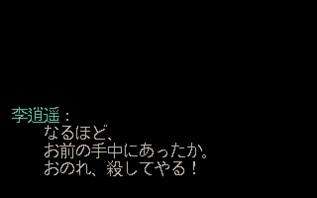 | 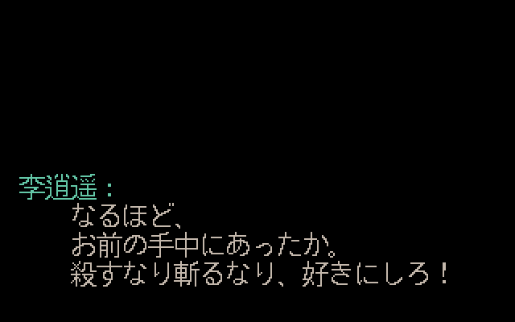 |
| Win 9207–9208 | 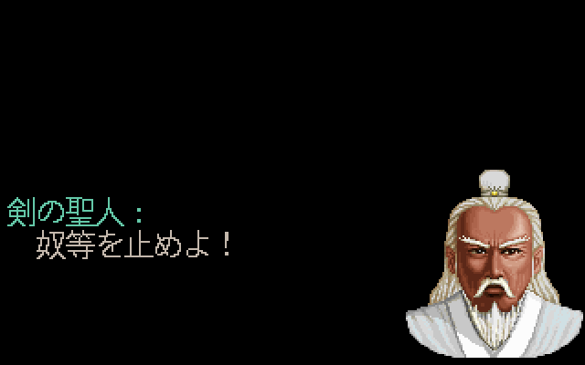 | 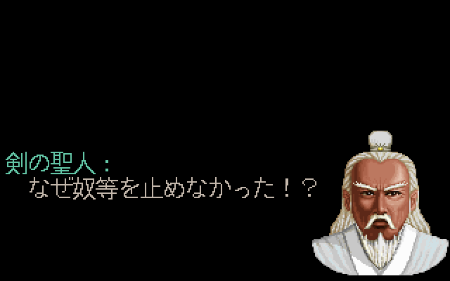 |
| Win 9211–9212 |  | 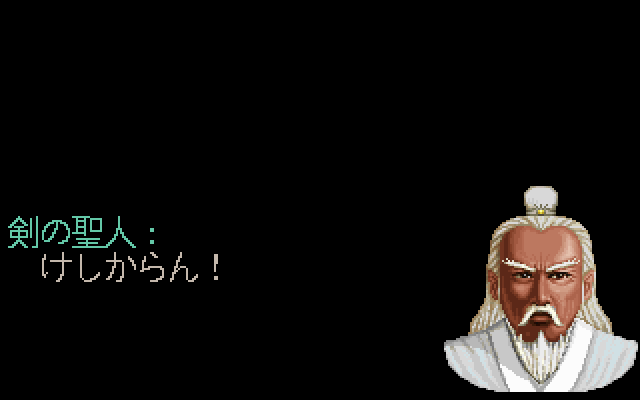 |
| Win 9324–9325 | 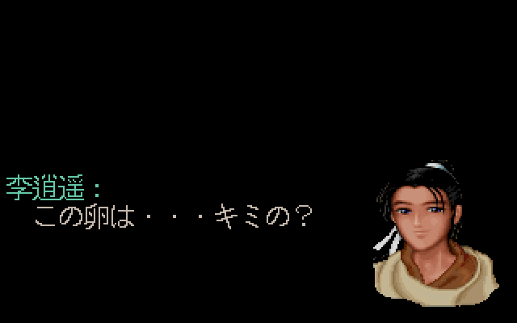 | 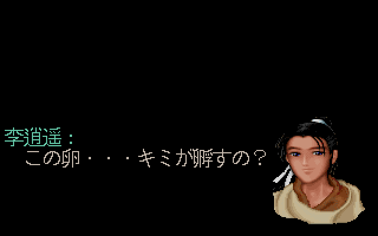 |
| Win 12053–12056 | 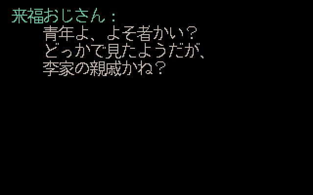 | 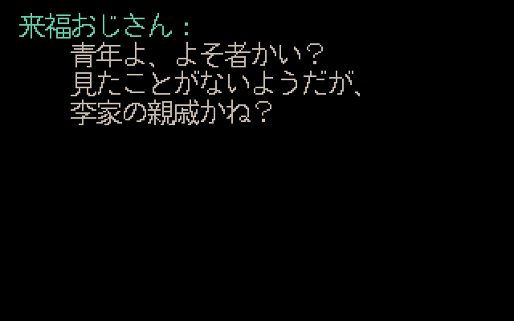 |
| 圣灵披风（Win 12660–12661） |  | 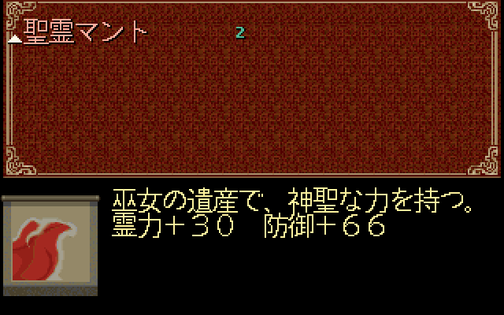 |
| 赤血蚕（Win 12920–12921） | 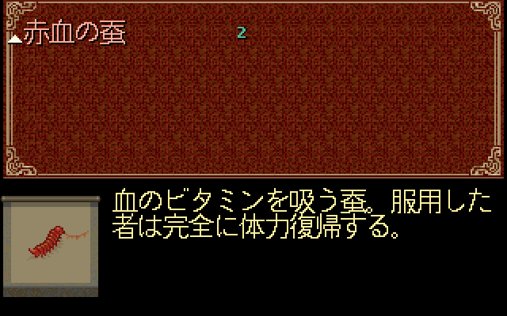 | 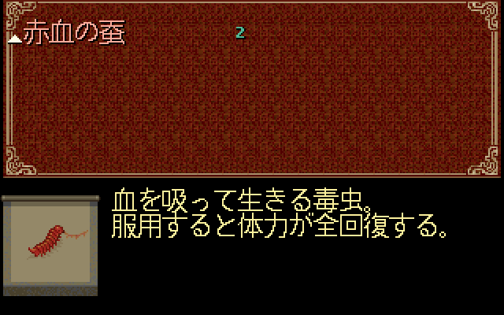 |
| 金刚符（Win 12945–12946） | 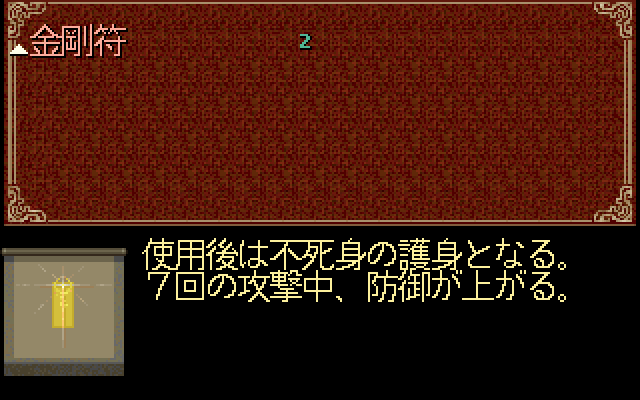 | 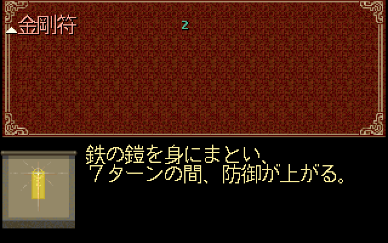 |
| 冰心诀（Win 13436–13436） | 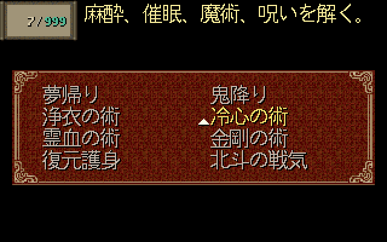 | 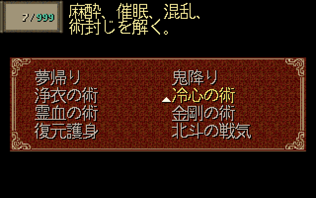 |
| 金刚咒（Win 13438–13439） | 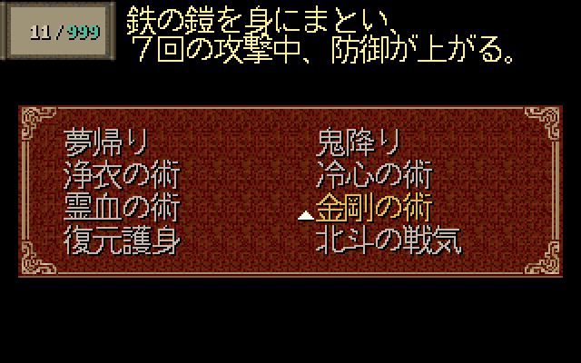 | 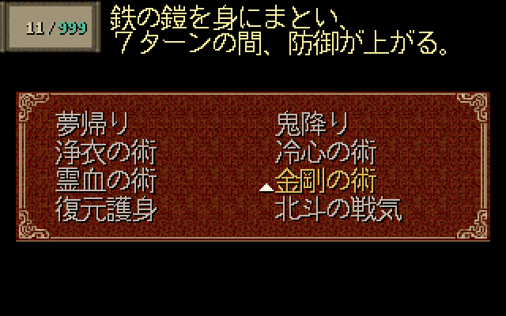 |
| 真元护体（Win 13442–13443） | 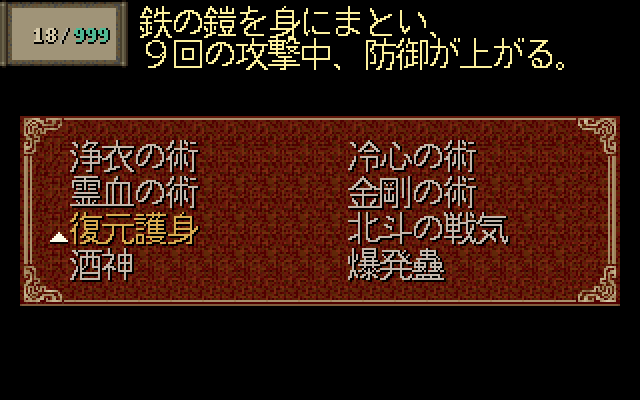 | 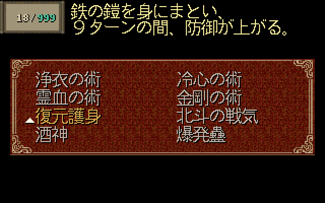 |
| 天罡战气（Win 13444–13445） | 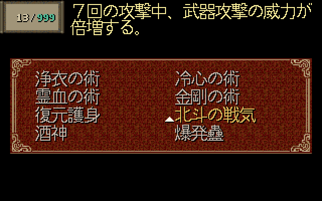 | 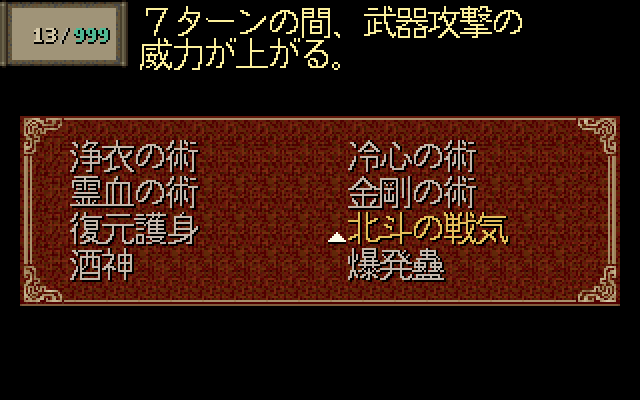 |
| 灵葫咒（Win 13453–13454） | 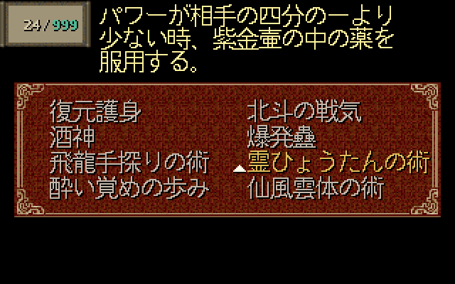 | 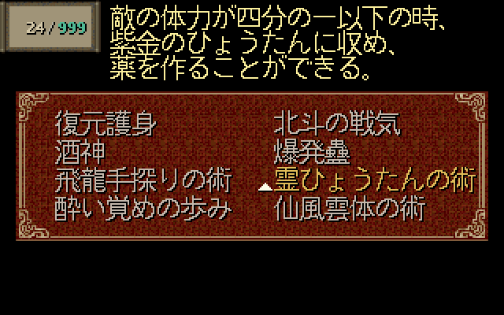 |
| 醉仙望月步（Win 13455–13456） | 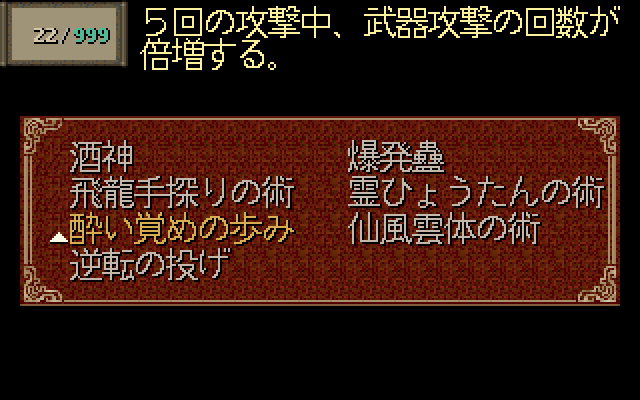 | 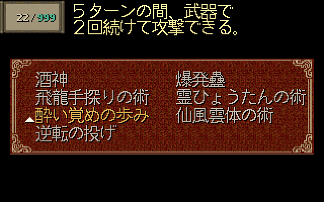 |
| 仙风云体术（Win 13457–13457） | 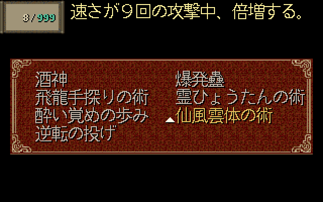 | 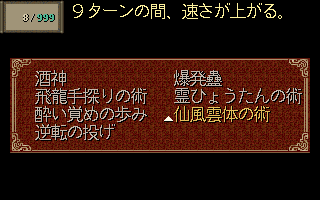 |
| 灵血咒（Win 13466–13467） | 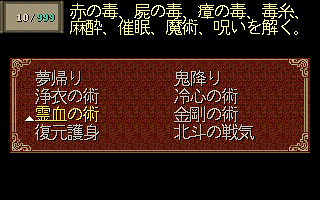 | 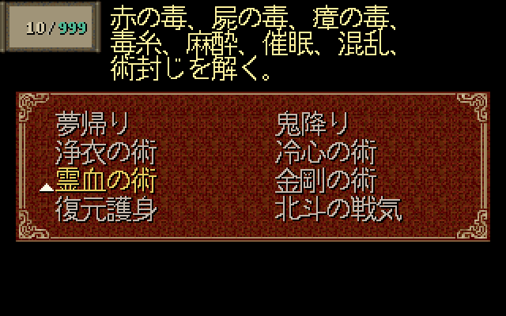 |
| 回梦（Win 13468–13468） | 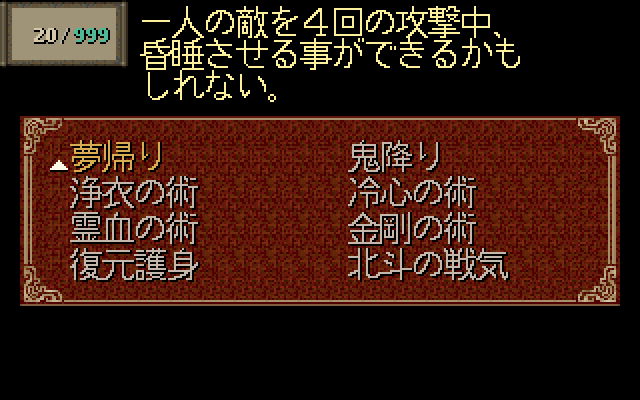 | 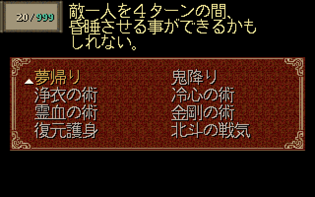 |
| 鬼降（Win 13469–13469） | 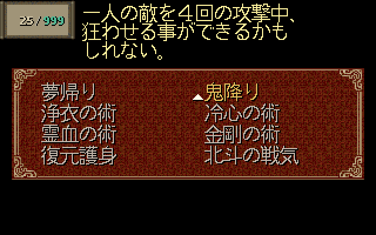 | 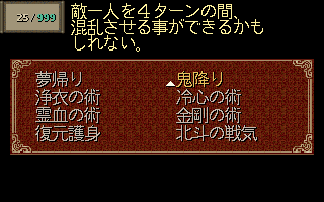 |

开场第一页正文未改，前后 RGB 相同：[修前](images/translation-review/before-dialogue-1-page-1-640.png)、[修后](images/translation-review/after-dialogue-1-page-1-640.png)。十九菜单中的六项未改说明（132、306、370、374、377、394）也逐像素一致，BMP 和指纹保存在本机证据目录。十三项变更菜单的差异均限于说明区域。

## 验证结果

| 检查 | 实际结果 |
| --- | --- |
| 输入与输出 | 固定 Win／土星原资源及 DATA.MKF 核对通过；18 组正文变化，其他 4,755 块、4,748 唯一键和全部非目标字节不变 |
| 历史与调用入口 | 四份历史输出及 #3/#4/#8 验证器通过；重复执行 CLI 与真实 GUI 回调输出逐字节一致，未打开 Tk 窗口 |
| 工具测试 | 13 项转换工具测试、4 项赤血蚕适配测试通过 |
| 负例 | 五种 SLF 腐坏、一种实际源脚本漂移、三种非法审计参数组合均拒绝且无输出；单元测试另覆盖四个锚点、正文及控制标记漂移 |
| 构建 | VS 2026 v145 Test/x64 构建和最后增量构建通过，初次构建既有警告保留 |
| 实际加载 | 修前／修后均 4,766 键完整加载、零缺失；引擎导出的每行 Unicode 正文与各自 SLF 一致 |
| 字形与缩放 | 1,177 个字形实例、65,216 个墨点逐像素及颜色核对，零缺失／裁切；150 张缩放图保留全部 64,000 源像素，2×／3×精确最近邻 |
| 全说明边界 | 从实际两份 SLF 重建 296 个说明对象，793→795 行；当前 #5 布局下前后均零裁切墨点／阴影、零前景字形重叠；相邻阴影接触未冒称为零 |
| 图片发布 | 38 张不透明 RGB PNG，共 654,548 字节，解码及背景合成核对通过 |
| 旧渲染回归 | #3 的 40 张 BMP RGB 与 recovery.csv 一致，真实分页等待仍为 2 次；#8 的 24 张 BMP RGB、recovery.csv、effective-text.csv 一致 |
| 独立复核 | 一名只读 agent 核对战斗来源、最终正文、控制码、适配器和渲染路径，无阻塞发现；未冒称重新运行测试或实机 |

开场 `~40` 已重置行计数，随后 CLEAR 不应额外等待；本轮测试夹具按真实 `PAL_ClearDialog` 条件处理。新五组对白的按键分页等待为零，旧 #3 两次真实等待回归正常。这是测试入口修订，没有修改生产 `text.c`。

当前 SLF SHA256：`ed275fafe97a3cb0e707996e800945d794189614a59f3cb32bdbb35e82031e01`；Test exe SHA256：`4aba1776dfedc2eaf2054290a9dec9b8138c09df201c084dbf83f79a1ed666c1`。

## 复现、追溯与统一验收

基线 `feature @ 443f11b6e558b068fe40e5ba8ea45006f9f94322`；专用分支 `richardli/fix/6-correct-saturn-japanese-translation`。完整实现及普通 merge SHA、远端检查和分支清理结果记录在 Issue #6／#1，不依赖源分支长期存在。

PC 使用 `D:\PAL\完整包\PAL98_v1.72_20261014`；SAT 使用原审计提取的固定土星数据，详见核对 JSON。以下 PC、SAT、OUT、RUNTIME 和 EXE 均替换为实际路径，OUT 采用新的独立目录；RUNTIME 使用经过原包 SHA 核对的 ASCII 路径，避免旧引擎非 ASCII GamePath 问题。验证器输出目录必须尚不存在。

```powershell
$jpPython = Join-Path $env:USERPROFILE 'CodexTools\python\Scripts\python.exe'
& $jpPython -B -X utf8 tools\japanese\makemessage_j.py 'PC' 'SAT' 'OUT\before.slf' gbk --before-translation-fix
& $jpPython -B -X utf8 tools\japanese\makemessage_j.py 'PC' 'SAT' 'OUT\after.slf' gbk
& $jpPython -B -X utf8 tools\japanese\verify_translations.py 'PC' 'SAT' 'OUT\before.slf' 'OUT\after.slf' 'OUT\verify'
& $jpPython -B -X utf8 tools\adapt_red_silkworm_description.py 'OUT\before.slf' 'OUT\before-adapted.slf'
& $jpPython -B -X utf8 tools\adapt_red_silkworm_description.py 'OUT\after.slf' 'OUT\after-adapted.slf'
New-Item -ItemType Directory -Path 'OUT\render-before', 'OUT\render-after'
Copy-Item -LiteralPath 'OUT\verify\recovery-fixtures.csv', 'OUT\verify\translation-objects.csv' -Destination 'OUT\render-before'
Copy-Item -LiteralPath 'OUT\verify\recovery-fixtures.csv', 'OUT\verify\translation-objects.csv' -Destination 'OUT\render-after'
& 'EXE' --render-evidence 'RUNTIME\' 'OUT\before-adapted.slf' 'OUT\render-before' jp-translation-before
& 'EXE' --render-evidence 'RUNTIME\' 'OUT\after-adapted.slf' 'OUT\render-after' jp-translation
& $jpPython -B -X utf8 tests\test_japanese_conversion_tools.py -v
& $jpPython -B -X utf8 tests\test_red_silkworm_adapter.py -v
```

四份历史文件及对应验证命令见 [转换工具说明](../tools/japanese/README.md)；构建实际命令、GUI 子进程命令、渲染命令及指纹见验证清单。字形、缩放、旧图比较和原始 BMP/CSV/日志保存在 `D:\Workspace\PALWork\artifacts\sdlpal-jp-issue-6\translation-r1-20261020`，其中 `render_and_verify.py`、`verify_issue3_render_regression.py` 为本轮执行脚本。

统一实机验收仍待用户执行：

- 使用包含本轮合入提交的明确构建，并重新生成、加载当前 SLF，记录资源、配置和设备。

- 在开场梦境、锁妖塔后剑圣对话、神木林孵蛋及十年前来福伯场景检查说话者、译意、分页、颜色和头像。

- 查看十三项修订说明及六项保留说明，确认菜单、MP 框、游标、右端和底部完整；按实际战斗检查持续回合、状态解除与收取条件。

- 连同 #3/#4/#5/#8 的剧情和界面回归统一验收；记录结果后再决定关闭 Issue。本轮没有新增实机通过记录。
