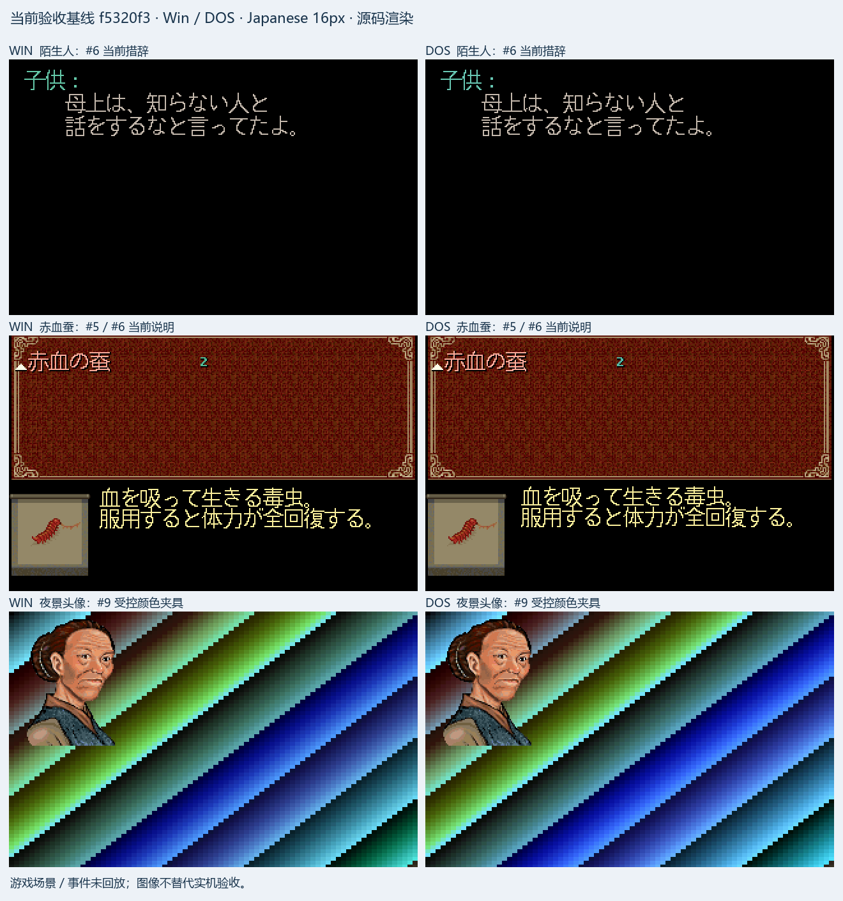

# 日文化统一验收包

2026-10-21，关联 [总管 #1](https://github.com/othercat/sdlpal-jp/issues/1)。
本包冻结最新实现基线 **`feature @ f5320f326d2110a43c32e3af6c9c12c765d2273e`**。
本轮只整理交付物、配置与验收证据；后续文档合并不会改变本包的引擎二进制。
所有子 Issue 继续开放，实机结果由用户填写。

## 启动与查看

本机交付目录：
`D:\Workspace\PALWork\artifacts\sdlpal-jp-issue-1\acceptance-20261021`。
压缩包：`sdlpal-jp-acceptance-f5320f3.zip`；旁边保留同名解压目录和 ZIP 校验文件。

1. 将 ZIP 完整解压到可写目录。打开 `index.html` 查看离线指南、提交表和对比图。
2. 双击 `Start-Win.cmd` 或 `Start-DOS.cmd`。两个入口均为 Windows x64 SDL2 游戏，DOS 指使用 DOS 版数据，不需要 DOSBox。
3. Win／DOS 分别写入各自的 `saves` 目录，日志分别为 `Win/data/sdlpal.log`、`DOS/data/sdlpal.log`（相对日志名按 GamePath 解析）。从新游戏开始，或把相同版本的个人存档**复制**到对应目录；不要混用两版存档。
4. 按[逐 Issue 验收清单](japanese-acceptance-checklist.md)操作，在 `results/验收记录.md` 中填结果。每项都需要记录版本、剧情阶段、实际步骤和证据；没有执行的保持“待测”。

启动脚本先切换到各自配置目录；解压后可整体移动，配置没有绑定开发机的资源绝对路径。
Win／DOS 各附同一个新构建的 Release EXE 和 VS 2026 x64 CRT 本地 DLL；SDL2 静态链接，使用 Windows 自带 UCRT。
仅针对本次 Windows x64 验收环境，不把历史 SDL1 构建混入默认启动入口。

## 固定构建与输入

| 项目 | 本包条件 |
| --- | --- |
| 引擎 | 上述完整 SHA；VS 2026 v145 / SDK 10.0，Release x64，内置 SDL 2.0.10 |
| EXE SHA256 | `381a8312a6b8701a1c0e8172b63a045110b2739b13aeb75714dc9a34e90f1432` |
| Win | `D:\PAL\完整包\PAL98_v1.72_20261014` 根目录的 17 个已审资源，未套其他补丁 profile |
| DOS | Steam `PAL_DOS` 的 20 个已审资源；独立 CP950 消息／对象表 |
| Win SLF | 当前转换器重新生成，4,773 块 / 4,766 个唯一键；与 #6 R2 已审产物逐字节一致 |
| DOS SLF | 当前转换器重新生成，4,476 个独立键 / 296 条说明；与 #6 R2 已审产物逐字节一致 |
| 头像 | #9 已审 86 ID 独立调色板包，按 Win／DOS 分开，默认启用 |
| 字体 | SLF 指定 `FontFlavor=Japanese`、`UseISOFont=0`；内置 16px，无外部字体覆盖 |
| 图像／声音 | 320×200 逻辑、640×400 窗口、最近邻、保持比例；RIX 音乐、CD NONE、音量 70 |
| 禁用项 | 默认全屏、GLSL、HDR、触控层和 AVI 均关闭；不加载原安装目录的 PALDLL 配置 |

完整配置见 [Win](acceptance/win.cfg) 和 [DOS](acceptance/dos.cfg)。每个资源、SLF、头像包、运行库、配置和图的
SHA256 位于包内 `SHA256SUMS.txt`，输入来源与构建记录位于 `evidence/`。
启动前可在 PowerShell 运行 `& '.\Verify-Package.ps1'`；它只检查文件，不启动游戏。
个人验收期间修改配置、存档或结果表后，原始校验表出现差异是正常的，应保留原 ZIP 供追溯。

## 存档、配置变体与验证范围

两个 `saves` 默认没有玩家存档。另附 `optional-fixtures/Win-menu/1.rpg`，仅用于菜单验收：
它源自“001端盘子”存档，离线预置 MP、赤血蚕／金蚕王和十个法术，曾在 PAL98 与 SDLPAL 实际加载。
SHA256 为 `9d19a620534b7108fdb77b641456fdf362c3764f9f6ae7cf8b816243c4ae4318`。
需要时先备份 `Win/saves/1.rpg`，再复制该夹具到第一槽；它不代表自然获得物品、剧情走通或长名称对象 270／384 已在背包。
没有随包提供经核实走通 #3／#4／#6／#8 剧情的专项存档，也没有 DOS 菜单存档。

变更配置前复制当前 `sdlpal.cfg` 备份，完成一项后恢复或注明新条件：

- #9 PC 头像对照：注释 `PortraitFileName` 后重启；恢复该行则重新启用土星头像。设置窗口验收可将 `LaunchSetting=1`，保存后重启检查。
- #2 中文绝对路径：在独立副本将 `GamePath` 指向包含中文的 `data` 绝对路径，UTF-8 保存；核对加载、声音和设置窗口保存后的路径。
- #5／#10 缩放：分别测试 640×400、960×600、800×500，再检查实际窗口 resize、全屏切换和自己的 DPI。非整数缩放不要求逐像素等同。
- #9 GLSL：历史中性单／双通道源码证据和 shader 源文件随包；需要验收时在独立副本指定 `EnableGLSL=1` 与实际 shader 路径。默认入口没有启用 GLSL，不能据此勾选 GLSL 或 SDL1 实机通过。
- #10 PALDLL：附同源 `sdlpal-jp-16px.ttf` 和原有比较记录，未在系统安装字体、修改原 PALDLL 或启动原版。历史原版实机图与 SDLPAL 源码图分别标注。

## 源码图与提交追溯

包内 `index.html` 的当前画面区使用本轮 Test 构建和包内实际配置／资源出图；没有重放剧情或执行实机按键。
历史对比区保留各轮修前／修后图和对应文档，图片为本地文件，当前出图均导出为不透明 RGB PNG。
历史图用于说明该轮差异，不保证其中每句文字都是当前最终版本：

- #3 来福伯 12053 的修后图之后又经 #6 修译，当前预期以 #6 为准。
- #5 早期赤血蚕实机图中的“ビタミン…”是历史文字；本包采用 #6 修订后的说明。
- #7 首轮 DOS 图中的四组后续译文，以 #6 R2 的 Win／DOS 对照为准。

[提交对应表](japanese-acceptance-commits.md)记录全部已合入轮次的完整实现／普通合并 SHA；
包内 `evidence/commits.json` 保留提交正文。`source/sdlpal-jp-f5320f3.zip` 是固定引擎提交的完整 Git 源码归档，含转换工具、测试、第三方源和许可证。
本轮构建命令、生成头文件、复制／归档脚本和检查结果也随包保存。
包的文档提交、合并 SHA、ZIP SHA256 与分支清理记录回写 #1；不要只凭可删除的分支名定位修复。

## 交付检查与待验收边界

新 Release／Test 构建成功，Test 的 21 项 C++ 检查通过。
重新生成的两个 SLF 与已审产物完全相同；包内原始资源和头像包逐项匹配既有指纹。
新 Test 从包内配置核对 Win 4,766／DOS 4,476 个有效消息键，Win 19 项代表说明及 DOS 296 项说明探针无裁切；
两版各 16 个代表头像帧通过独立 RGB／索引公式检查，合计 16 次整数缩放读回与 8 次非整数尺寸检查。
实际输出和完整检查以
[本轮机器记录](evidence/issue-1-acceptance-package.json)为准。ZIP 完整性、清单哈希、启动路径与离线图片引用另外检查。

这些检查覆盖交付一致性和源码输出，**不构成完整流程、音乐播放、窗口交互或实机验收通过**。
后续发现问题时保留对应版本的存档、配置、日志和截图，按清单定位子 Issue；从当前 `feature` 新建修复分支。
本包不关闭 #1 或任一子 Issue。
