# Issue #10 R3：对白分页与缩放对照

2026-10-20，执行者 Codex。关联 [#10](https://github.com/othercat/sdlpal-jp/issues/10)、[总管 #1](https://github.com/othercat/sdlpal-jp/issues/1)。承接 [R2 同源字体、物品和法术对照](pal98-same-source-font-comparison.md)。

**选定长对白的分页、控制符和三档缩放专项通过。** PAL98 对照端是用户的 **PAL.EXE + PALDLL_DX9 v1.72 补丁包**，以下称“PAL98 + PALDLL”；不把它称作未打补丁的原版。SDLPAL 继续直接调用源码绘制；PAL98 + PALDLL 保留实际运行截图。

本轮没有修改产品绘制代码、PALDLL Hook 或游戏资源。新增的是 Test 出图模式和证据校验器。完整游戏路线、操作系统层的 SDLPAL 窗口缩放/DPI、其他字体和 DOS 不在本轮通过范围，#10 保持开放。

## 测试条件

| 项目 | 实际条件 |
| --- | --- |
| 代码基线 | `feature @ a5e77e3b8aea26399c1b2de1b777479eace7fd9a`，叠加本轮 Test 工具改动 |
| 系统与构建 | Windows 11 Pro 10.0.26200；VS 2026 / v145 / Test x64 |
| 资源 | `D:\PAL\完整包\PAL98_v1.72_20261014` 根资源；18 个 MKF/MSG/DAT 与运行副本逐项 SHA256 相同 |
| 字形 | SDLPAL Japanese 16px，`UseISOFont=0`；PALDLL 使用 R2 的 `SDLPAL JP 16px`，字体 SHA256 `9a7996e3860981ce3b19aa58b3d2ce9edccf1332340b21e90fb3bdf293cb5f76` |
| 中文对照 | 两端相同 M.MSG / WORD.DAT；不声称 PAL.EXE 支持日文 SLF |
| 日文补查 | SDLPAL 加载 #5 适配 SLF，SHA256 `f4ffb5753a1a168a23a27426aa6163cd35c35a85d3fd5a8d5f69c0ef2e7f595e` |
| SDLPAL 渲染 | 内部 320×200；Direct3D renderer，flags=14；`ScaleQuality=0`，GLSL/触控覆盖关闭 |
| PAL98 + PALDLL | 沿用 R2 的 EXE 1.00、PAL.dll 1.7.2.2、DxWrapper 1.4.7900.25 和字体规则；仅在隔离副本调整窗口配置并重启 |

[完整 manifest](evidence/issue-10-pagination-scaling.json)记录构建、源码、资源、配置备份、分页 CSV、逐像素结果和图片 SHA256。全部原始产物保留在 `D:\Workspace\PALWork\artifacts\sdlpal-jp-issue-10\pagination-scaling-r3-20261020`。

## 自然对白：上下位置与真实翻页

Test 模式通过 `PAL_GetMsgNum` 读取日文映射，使用真实 `PAL_StartDialog` / `PAL_ShowDialogText` / `PAL_ClearDialog`。只通过现有输入过滤接口提供确认事件，不直接改写页数或行数。每次自动等待、显式 CLEAR、归零、消息总数和映射终止均有断言。场景由启动脚本对应状态重建，不代表执行过整条剧情路线。

| Win 消息组 | 中文正文与分页 | 日文正文与分页 | 检查结果 |
| --- | --- | --- | --- |
| 1326–1332，上方、头像 8 | 6 行：4 + 2 | 7 行：4 + 3 | 四行后进入真实等待，再恢复背景并显示下一页 |
| 1333–1340，下方、头像 55 | 7 行：4 + 3 | 14 行：3 + 3 + 2 + 3 + 3 | 中文自动翻页；日文保留 SLF 原有 4 个 CLEAR |

PAL98 + PALDLL 从新游戏实际推进这两段中文对白，四张截图覆盖全部页面，没有观察到漏行或重复行。SDLPAL 中文输出同样为 4+2 / 4+3；其 18px 行距比 PAL98 的 16px 更宽，下方第四行仍完整可见。日文页数由译文与原有 CLEAR 决定，不用中文页数作为日文页数标准。

| PAL98 + PALDLL 实机 | SDLPAL 源码 |
| --- | --- |
| 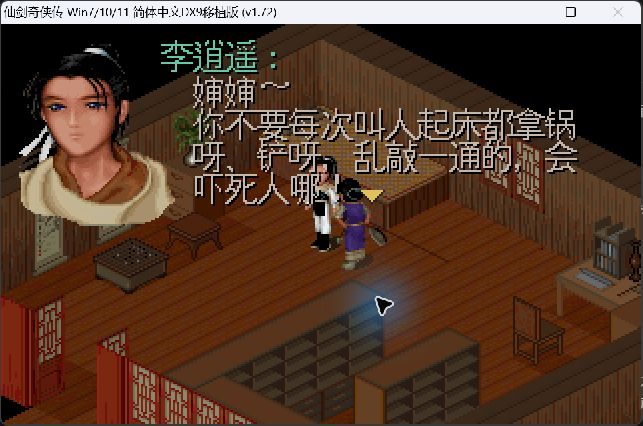 | 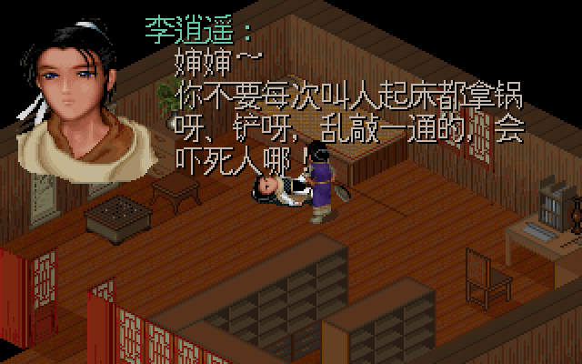 |
| 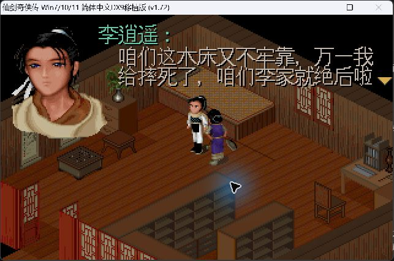 | 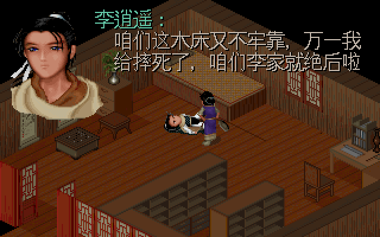 |
| 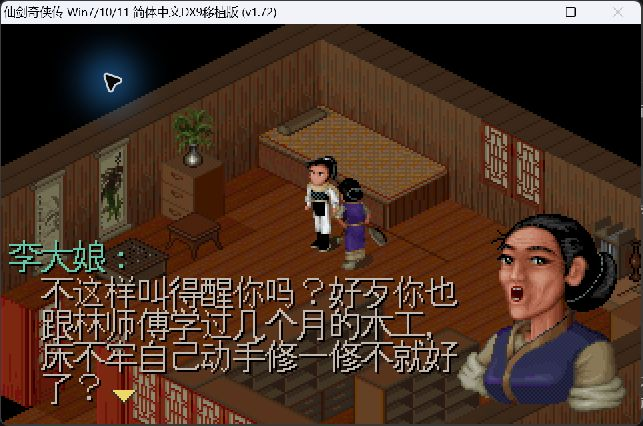 | 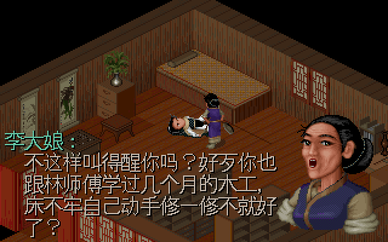 |
| 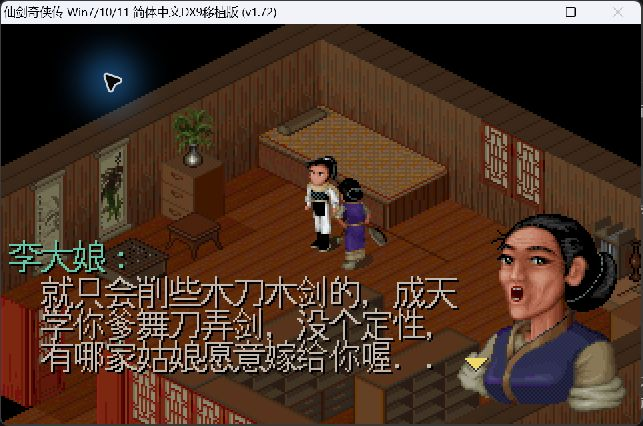 | 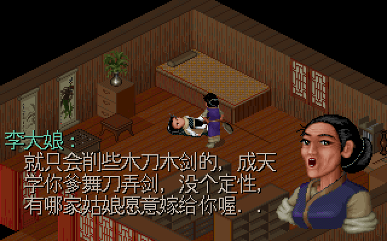 |

日文选择自动翻页后的末页，以及显式 CLEAR 后的第五页。两图均为源码输出，不是土星或 SDLPAL 实机截图。

| 1326 日文第二页 | 1333 日文第五页 |
| --- | --- |
| 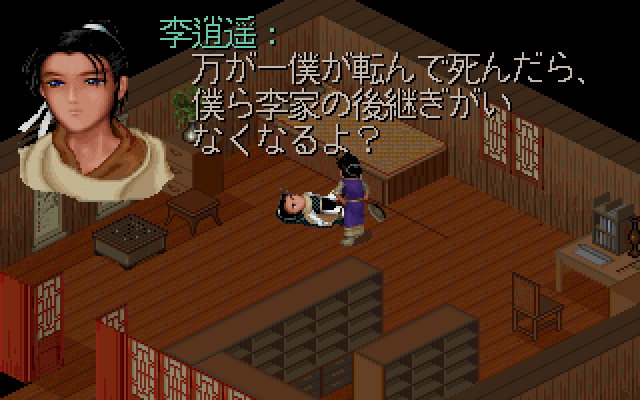 | 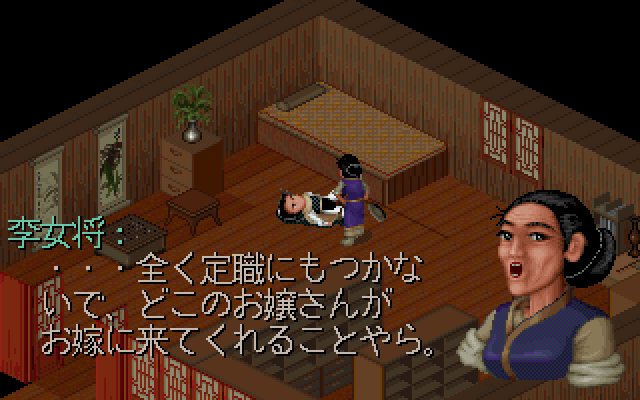 |

## 标点、颜色与转义符

另设清楚标注的人工夹具：9 行分为 4+4+1 页，第一行含全角 `，。！？`；黄色跨页持续，随后恢复默认色；验证红色、青色以及转义后的 `-'@"()\`。这段不写入游戏资源，也未在 PAL98 中执行。

| 第一页：右边界标点 | 第二页：跨页颜色与转义符 | 第三页 |
| --- | --- | --- |
| 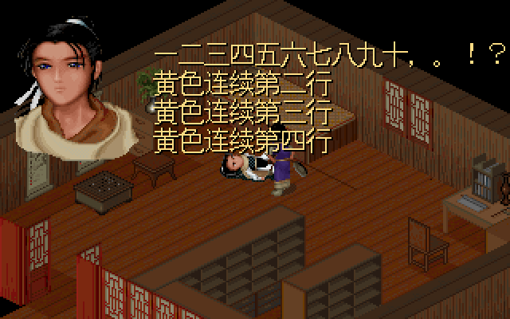 | 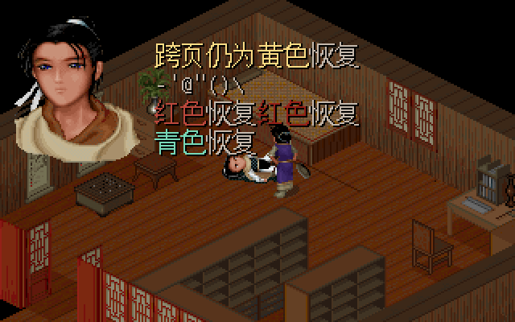 | 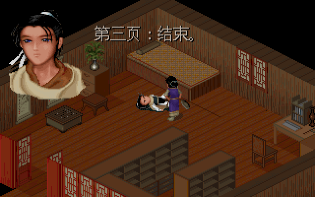 |

中文与日文模式各核对 **69 个字符位置、3,885 个预期正文墨点**，缺失、越界、颜色错误均为 0。预期墨点来自源码 JIS/Unifont 字形及字宽；半角控制字符共 80 个墨点也通过。此检查只约束预期正文墨点，不断言背景或所有额外像素都正确。

## 2 倍、3 倍与 2.5 倍

SDLPAL 在隐藏窗口的真实 Direct3D renderer 上建立目标纹理，调用生产 `VIDEO_Resize`、`VIDEO_UpdateScreen` / `VIDEO_RenderCopy` 后读回。没有用图片编辑器代替引擎缩放。绑定 SDL 会抑制隐藏窗口绘制，Test 入口仅通知其 SHOWN 事件观察器并断言 OS 窗口仍为 HIDDEN；所有像素来自目标纹理。

| 目标尺寸 | 检验 |
| --- | --- |
| 640×400，2 倍 | 19 张图均与 320×200 原图的整数最近邻结果逐像素一致 |
| 960×600，3 倍 | 同上，19 张全部一致 |
| 800×500，2.5 倍 | 19 张均保留每个原始像素的中心采样，共每图 64,000 像素；没有新增混合色 |

共 **57 张缩放图通过**，另有 19 张 320×200 基础页。2.5 倍的 GPU 取样边界与 Pillow 最近邻在半像素处可能不同，因此没有声称两者逐像素相同；非整数缩放的像素块宽度会交替为 2/3。

PAL98 + PALDLL 的系统菜单禁用交互式“大小”操作。用现有 DxWrapper `DdrawOverrideWidth/Height` 配置、重启副本后，取得三种实际截图尺寸。本机 AppliedDPI=144（150%），不能把配置值直接当作采集图的游戏区尺寸：

| DxWrapper 配置宽×高 | 采集窗口 | 实际游戏区 | 图 |
| --- | --- | --- | --- |
| 960×600 | 643×426 | 640×400 | [R2 的同段截图](images/same-source-font/pal98-same-font-aunt.jpg)；本轮分页截图也为此尺寸 |
| 1440×900 | 963×626 | 960×600 | 下方 3 倍图 |
| 1200×750 | 803×526 | 800×500 | 下方 2.5 倍图 |

配置 800×500 的诊断运行实际采到约 533×333 游戏区，未将它冒充 800×500 成果。配置快照和日志保留在 manifest 与 artifacts。DxWrapper 的尺寸选项含义见[官方配置文档](https://github.com/elishacloud/dxwrapper/wiki/Configuration)；这里的换算是本机实测，不推广为所有 DPI/后端的固定公式。

| PAL98 + PALDLL 3 倍实机 | SDLPAL 3 倍源码 |
| --- | --- |
| 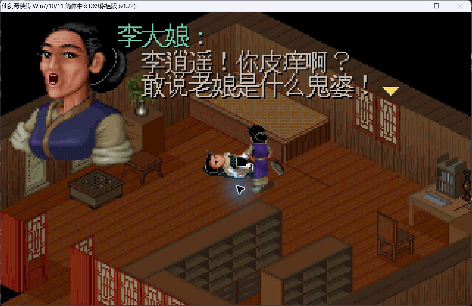 |  |

| PAL98 + PALDLL 2.5 倍实机 | SDLPAL 2.5 倍源码 |
| --- | --- |
| 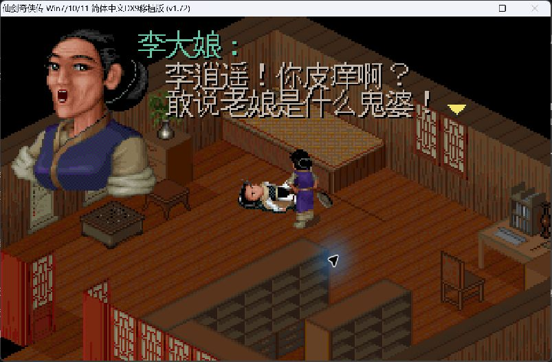 | 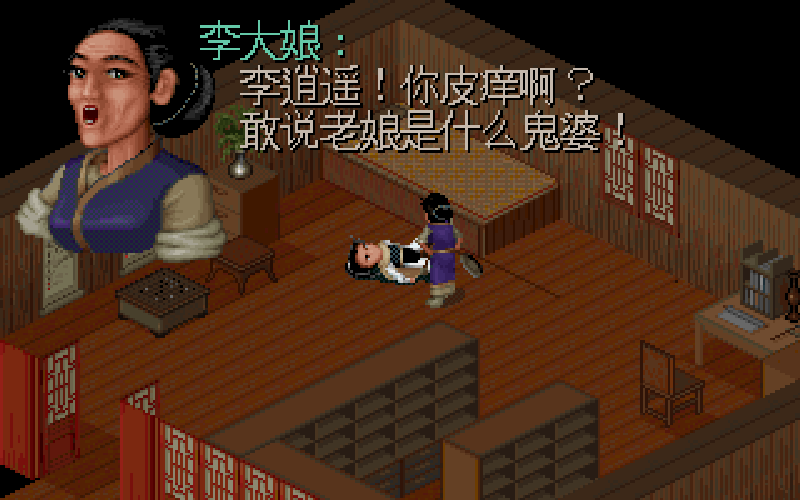 |

两端文字均完整可读。PAL98 截图包含窗口/DPI 处理和 JPEG 损失，SDLPAL 图是目标纹理的无损读回；动画帧和行距也不同。现有证据支持 SDLPAL 在这些尺寸保留字形像素，不能据此宣布所有显示条件下某一端画质更好。SDLPAL 的 OS 窗口缩放与人工输入另属实机层面。

## 验证与复现

从仓库根目录构建 Test；`$out` 目录先创建，资源目录末尾保留分隔符。路径请替换为本机副本：

```powershell
$env:CL='/utf-8 /DGTEST_HAS_TR1_TUPLE=0'
& 'C:\Program Files\Microsoft Visual Studio\18\Community\MSBuild\Current\Bin\MSBuild.exe' win32\sdlpal.sln /m:4 /t:Build /p:Configuration=Test /p:Platform=x64 /p:PlatformToolset=v145 /p:WindowsTargetPlatformVersion=10.0 "/p:OutDir=D:\evidence\build\"
Remove-Item Env:CL
$exe='D:\evidence\build\sdlpal.exe'
$resources='D:\evidence\native\'
$slf='D:\evidence\paljpn-win-adapted.slf'
& $exe --render-evidence $resources - 'D:\evidence\source-cn' cn-pages
& $exe --render-evidence $resources $slf 'D:\evidence\source-jp' jp-pages
& (Join-Path $env:USERPROFILE 'CodexTools\python\Scripts\python.exe') -B -X utf8 tools\verify_dialogue_rendering.py $resources 'D:\evidence\source-cn' 'D:\evidence\cn.json' --language cn
& (Join-Path $env:USERPROFILE 'CodexTools\python\Scripts\python.exe') -B -X utf8 tools\verify_dialogue_rendering.py $resources 'D:\evidence\source-jp' 'D:\evidence\jp.json' --language jp
& $exe --gtest_output=xml:D:\evidence\tests.xml
```

中文 / 日文真实分页等待分别 **4 / 7 次**，含人工控制符夹具的 2 次。校验器精确核对预期文件集合、尺寸、非空字形、墨点颜色与三档输出，拒绝缺页或无关页补数。导出字库函数新增可选字符集合，默认调用行为不变。

Test 构建成功，GTest **4/4** 通过；旧 `cn-jp-font-field` 的 12 张 BMP 与 R2 **逐字节相同**。本轮精选 PNG 均由相应 BMP 无损转码并核对 RGB 像素。PAL98 临时会话字体在比较副本退出后已卸载，没有安装到系统字体目录或修改注册表。

## 验收与追溯边界

本轮通过的是指定对白、源码控制符/分页、引擎目标纹理缩放和 PAL98 + PALDLL 三档窗口呈现。不能代替完整故事通关、战斗路线、所有对白、其他字库/DOS 或 SDLPAL OS 层窗口 resize/DPI 的测试。

独立分支 `richardli/feat/10-dialogue-pagination-scaling-r3`。实现与普通合并的完整 SHA、目标分支、远端祖先关系及清理结果记录在 #10 和 #1；不使用自动关闭关联。#5 的实际日文菜单验收另行归档，不混入本分支的实现记录。
