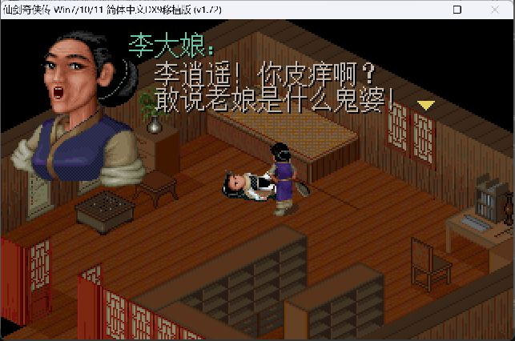
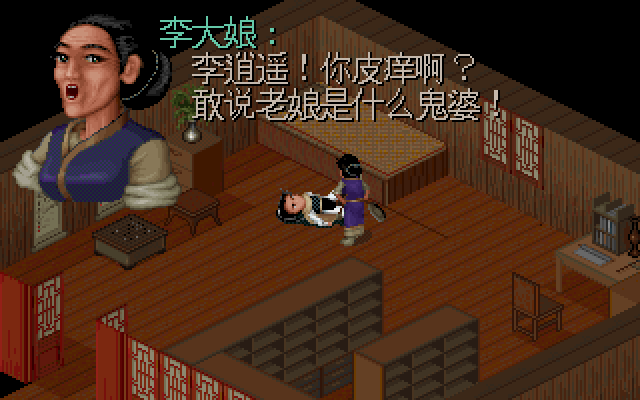
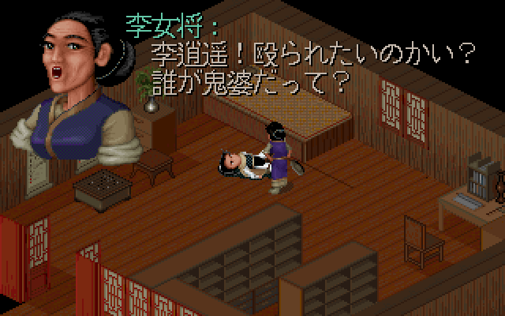
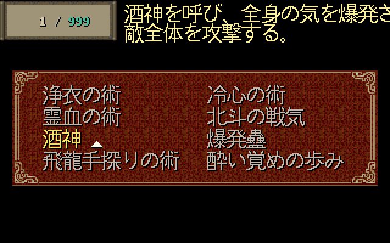
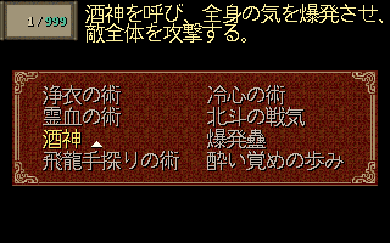
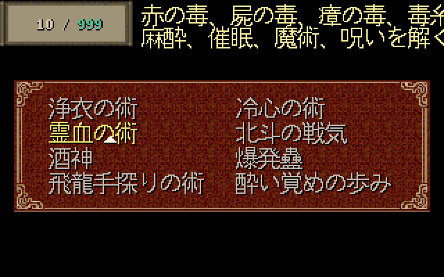
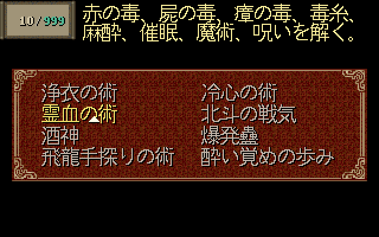

# Issue #10：PAL98 实机与 SDLPAL 源码渲染对照

日期：2026-10-20。关联 [#10](https://github.com/othercat/sdlpal-jp/issues/10)、[布局修复 #5](https://github.com/othercat/sdlpal-jp/issues/5)、[总管 #1](https://github.com/othercat/sdlpal-jp/issues/1)。

**SDLPAL 用实际引擎源码离屏出图，PAL98 + PALDLL_DX9 用实机截图。** 字体、字宽、换行位置、头像、地图、MP 框和菜单都有源码，不需要为了取得这些像素逐次操作 SDLPAL 窗口。窗口缩放、输入、动画及完整游戏流程仍需另行验收。

本轮结果：两引擎的中文李大娘对白均完整可读；SDLPAL 的两列菜单和 83–87 布局保留了原先被裁掉的 11 行法术说明，赤血蚕仍有 1 行裁切。当前证据不能为两引擎的整体画质排名，也不是完全同字形的跨引擎实验。

## 输入、版本与字体条件

资源来自用户指定的 `D:\PAL\完整包\PAL98_v1.72_20261014` **根目录**。原安装目录未修改。三个运行副本中的 18 个 MKF/MSG/DAT 文件与原目录逐一核对 SHA256，一致。没有混用原安装启用的 `pal98fix-classic-v5` Profile；其 `M.MSG`、`SSS.MKF` 与根目录不同。

- SDLPAL 绘制代码基于 #5 合并提交 [`d2e69f2dcc6025473f54cfa49d8e7520ac7bf160`](https://github.com/othercat/sdlpal-jp/commit/d2e69f2dcc6025473f54cfa49d8e7520ac7bf160)。本轮新增 Test 专用出图入口，未改变 Release 的绘制函数。
- PAL98：`PAL.EXE` 版本 1.00；`PAL.dll` 1.7.2.2，与本机 PALDLL_DX9 仓库 `Release/PAL.dll` 字节相同。不能据此认定它由该仓库当前开发 HEAD 构建。
- 日文 SLF：`f15a22cb2e999680119e08bae021cb61f366d6f45655ef4e33019472e9388c54`，沿用原审计生成物，没有为出图修改翻译或换行。
- [引擎图像、资源及字体指纹](evidence/issue-10-engine-rendering.json)；[PAL98 二进制、配置和截图指纹](evidence/issue-10-native-baseline.json)。

| 条件 | 实际字形与字号 | 文本 / 布局 | 输出 |
| --- | --- | --- | --- |
| PAL98 + PALDLL_DX9 | 六条已定义字体替换规则均 `Enabled=0`；没有取得实际 GDI 字体高度日志，不能填成已验证的 16px | 根资源中文，`GameTextMode=Simplified` | 实机 PNG 643×426 含边框，客户区约 640×400 |
| SDLPAL `cn` | 自动检测 GBK，`fontglyph_cn.h` 的 YH 中文字形覆盖基础 Unifont；本资源无 `wor16.asc`，运行报告 **16px** | 根资源中文；word length=10，即中文三列 | 320×200 逻辑画布 |
| SDLPAL `cn-jp-font` | 强制 Japanese：`fontglyph_jp.h` 的 JIS X0208 16×16 字形，未覆盖字符保留基础 Unifont | 同一中文及中文布局，单独观察字形差别 | 320×200 逻辑画布 |
| SDLPAL `jp` | SLF 指定 Japanese，高度 **16px** | 日文 SLF；word length=16，即 8 全角、两列；83–87 生效 | 320×200 逻辑画布 |
| SDLPAL `jp-legacy` | 与 `jp` 相同 | 仅将 83–87 恢复旧默认值；81/82、文字、字形不变 | 重现 #5 修复前结果 |

“日文默认字形”指项目现有 `FontFlavor=Japanese` 路径，即 GNU intlfonts 的 JIS X0208-1990 Kanji 16×16 数据，并非某个 Windows TTF 推荐。代码支持外部 BDF，未找到指定文泉驿或系统字体为本项目推荐配置的依据。

PALDLL_DX9 用 GDI `LOGFONT`/`CreateFontIndirectA` 替换字体，不能直接加载 SDLPAL 内置字形数组或 BDF。`FontSize=16` 不自动等于同一套 16×16 点阵。本轮没有启用本机不存在的“文泉驿点阵字体16px”后将字体回退当成成功。**完全同字形实验仍需可供 GDI 使用的同源字体及实际替换日志。**

## 同一句李大娘对白

Win 消息 **1317–1319**、脚本 **3550–3552**；日文分组 `1317..1319`、span=2，对应土星消息 **1761–1763**。通过 `PAL_GetMsgNum(1317, 2, order)` 读取，避免将土星编号当作 SLF 运行时索引。

场景由根资源重建：scene 2、map 12、viewport `(1152,176)`、角色 sprite 193/frame 0、头像 RGM chunk 55（85×99）、日间 palette 0。`PAL_MakeScene` 绘制地图与角色；`PAL_StartDialog(kDialogUpper, 0, 55, FALSE)` 和 `PAL_ShowDialogText` 绘制头像及对白。标题 `(80,8)`，正文 `(96,26)` / `(96,44)`，没有重新排版或补字。

PAL98 图是新游戏进入客栈时的实机捕获，保留边框。SDLPAL 图是状态重建，未重放整条路线；等待图标、动画帧和窗口装饰不参与字形判断。以下 SDLPAL PNG 仅将实际 320×200 像素以 **2 倍最近邻**放大到 640×400，无抗锯齿或图像修饰。

### PAL98 + PALDLL_DX9：中文实机



### SDLPAL：中文默认字形


### SDLPAL：同一中文改用 Japanese 字形



### SDLPAL：日文 SLF 与 Japanese 字形



两种 SDLPAL 字形的笔画和标点形态不同，但台词都没有横向丢字。原版与 SDLPAL 中文图也存在字形差异，不能由相近字号推断像素一致。日文图证明 SLF 与字体加载生效，不证明 PAL98 原生程序支持 SLF。头像仍来自 PC `RGM.MKF`，#9 的土星独立调色板头像未实现。

## 法术说明：真实菜单绘制路径

调用 `PAL_MagicSelectionMenuInit` / `PAL_MagicSelectionMenuUpdate`，加载 DATA 的 UI 精灵与 SSS 说明脚本，MP 框、数值、指针、两列名称、换行和正文均由引擎绘制。为突出说明，菜单背景固定为 palette 0 的黑色。测试角色仅在内存中持有 10 个待核对法术、MP=999，没有修改资源或存档。

### 酒神：旧布局与 83–87 生效后

旧布局裁掉右侧 63 个正文像素；新布局末尾「させ、」完整，MP 框缩窄且数值重定位。末尾空白字格越界不等于笔画裁切。

| 旧布局 | 新布局 |
| --- | --- |
|  |  |

### 灵血咒：两行同时恢复

两行原有 27+16=43 个越界正文像素，更新布局后为 0。

| 旧布局 | 新布局 |
| --- | --- |
|  |  |

### 赤血蚕：保留的反例

`PAL_ItemSelectMenuUpdate` 绘制道具图、两列名称、数量和说明。物品起点仍为 x=71，首行末字「者」仍缺右侧 **31 个正文像素**。修复前后整张物品图字节相同；83–87 没有解决或改变这个问题。原文换行调整需继续结合土星设计判断。


## 验证与复现

[C++ 出图入口](../tests/render_evidence.cpp) 只进入 Test 构建。它分配内存 Surface，用现有 `g_bRenderPaused` 跳过窗口提交，直接调用产品的字体、文本、脚本、地图和菜单绘制函数；不模拟按键、不创建窗口、不启动音频。每种模式单独运行进程，避免字体数组的覆盖污染下一次比较。

[采集脚本](../tools/collect_render_evidence.py) 保存原始 BMP，无损生成 PNG 并检查像素往返一致。越界探针将 Surface 扩到 384×200，仍调用真实 `PAL_RunAutoScript`，统计 x≥320 的正文颜色像素；不是另写一套字体排版算法。

| 实际引擎结果 | 中文默认 | 中文 + Japanese 字形 | 日文旧布局 | 日文新布局 |
| --- | ---: | ---: | ---: | ---: |
| 11 对象越界正文像素 | 0 | 0 | **437** | **31** |
| 其中 10 法术 / 11 行 | 0 | 0 | **406** | **0** |
| 赤血蚕 | 0 | 0 | **31** | **31** |

- 4 模式 × 12 图 = **48 张引擎输出**；全部 PNG 可还原到原 BMP 的逐像素 RGB，检查通过。本页精选 8 张引擎图及 1 张实机图入库，其余在 artifacts 保存。
- 11 对象的实际越界像素与独立静态审计逐项一致；物品图前后相同。图像复核确认酒神、灵血咒、MP 数值、两列名称与赤血蚕残留符合报告。
- Test x64 最终增量构建成功，0 警告 / 0 错误；既有 **4/4 测试通过**。完整重建有 40 条现存警告。首次出图校验遇到合法 `0x00A7` 说明标记，入口允许该引擎 no-op 后重新完成全部采集。

Windows 复现，需要自己持有游戏资源：

```powershell
$out = 'D:\Workspace\PALWork\artifacts\sdlpal-jp-issue-10\rendering-comparison-20261020\offscreen'
$resources = 'D:\Workspace\PALWork\artifacts\sdlpal-jp-issue-10\rendering-comparison-20261020\sdlpal-jp'
# 在本仓库根目录运行；先创建 $out。
$env:CL = '/utf-8 /DGTEST_HAS_TR1_TUPLE=0'
& 'C:\Program Files\Microsoft Visual Studio\18\Community\MSBuild\Current\Bin\MSBuild.exe' win32\sdlpal.sln /m:4 /t:Build /p:Configuration=Test /p:Platform=x64 /p:PlatformToolset=v145 /p:WindowsTargetPlatformVersion=10.0 "/p:OutDir=$out\build\"
Remove-Item Env:CL
& (Join-Path $env:USERPROFILE 'CodexTools\python\Scripts\python.exe') -B -X utf8 tools\collect_render_evidence.py "$out\build\sdlpal.exe" $resources "$resources\paljpn-win.slf" $out
& "$out\build\sdlpal.exe" "--gtest_output=xml:$out/test-results.xml"
```

环境：Windows 11 Pro 10.0.26200、VS 2026 / v145、SDL2 固定子模块 `6c89fad1f947e3173e822945adf534ca21ba52b5`；官方 CPython 3.11.9 的 `~/CodexTools/python`，使用 Pillow。直接入口为 `sdlpal.exe --render-evidence RESOURCE_DIR SLF_OR_DASH OUTPUT_DIR MODE`，输出目录须存在，要求 SDL2 Test 构建。

PAL98 副本保留原 `fontconfig.ini`，设置 `DefaultPatch=` 且未复制 palmod；`DisableSystemKeys=0`、`DisableQuitOutside=0`、`EnableSnakeWomanPeonyFairyHarmony=0` 仅在副本修改。DxWrapper 1.4.7900.25，`Dd7to9=1`、`D3d9to9Ex=1`、`DisableHighDPIScaling=1`、窗口模式。INI 目标 960×600 与捕获客户区约 640×400 不同，因此按实际尺寸记录。原版图未重采样或去掉边框。

## 本轮验收边界

执行者：Codex，2026-10-20。**源码出图和专项验证通过，#5、#10 保持开放。**

- #5：真实菜单路径验证 83–87 生效；赤血蚕未修复。普通对白分页、全部 296 对象的完整游戏回归及其他字体未完成。
- #10：完成原版中文实机基线、源码同资源对白和日文菜单证据。尚未取得 PAL98 使用同源 Japanese 字形的实际替换证据、原版同菜单说明截图和窗口缩放验收。
- 源码菜单比逐项人工截图更易复现，但不证明路线可达、等待输入或整场游戏交互正确。本页不将源码图标成实机截图，也不因窗口自动化失败否定源码验证。
- 完整提交、普通合并 SHA 与清理状态在 Issue 记录。日志、全部 48 图、原 BMP、运行副本、配置备份与输入指纹保存在 `D:\Workspace\PALWork\artifacts\sdlpal-jp-issue-10\rendering-comparison-20261020`，不依赖工作分支保留。
