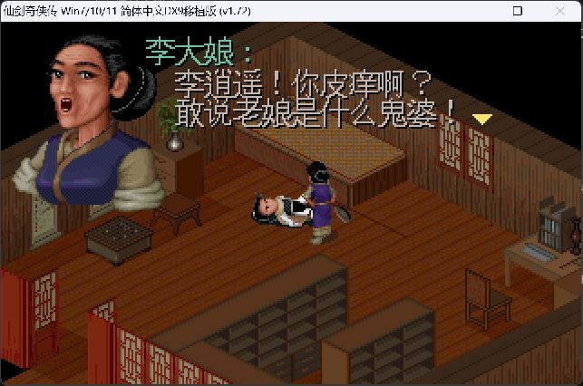
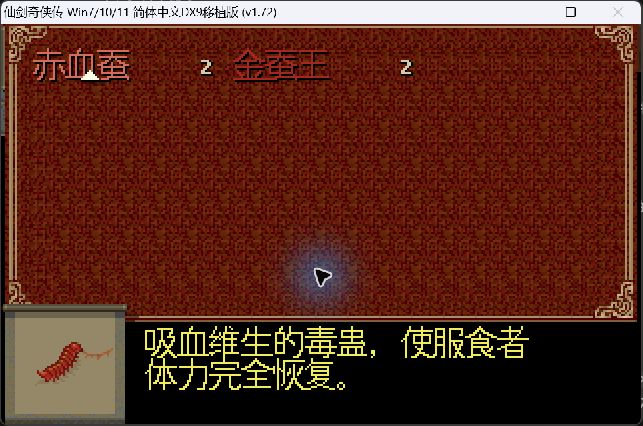
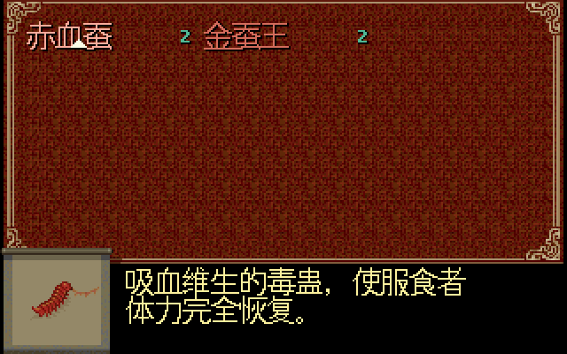
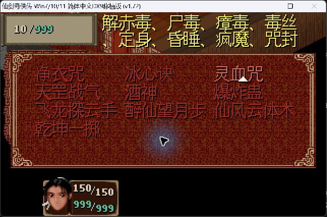
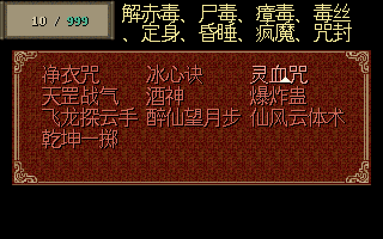
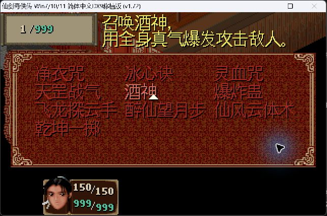
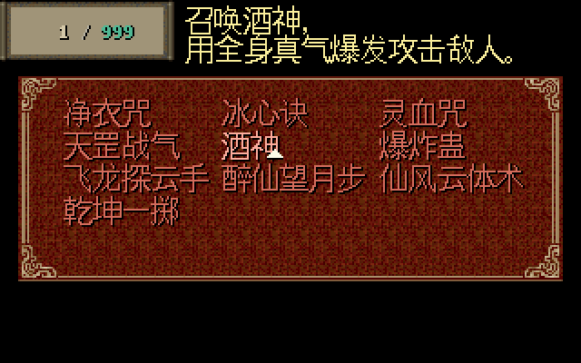

# Issue #10 R2：PAL98 与 SDLPAL 的同源 Japanese 16px 字体对照

2026-10-20，执行者 Codex。关联 [#10](https://github.com/othercat/sdlpal-jp/issues/10)、[总管 #1](https://github.com/othercat/sdlpal-jp/issues/1)。[R1 历史基线](pal98-font-rendering-comparison.md)保留。

**PALDLL_DX9 已通过现有字体配置使用 SDLPAL Japanese 字形和 16px 字号。** 同一套 PAL98 根资源下，完成李大娘对白、赤血蚕和 10 个法术说明的原版实机截图，以及对应的 SDLPAL 源码出图，共 24 张。测试样例两端均完整可读；没有修改 PALDLL Hook、原版 EXE 或游戏资源。

主对照使用两端相同的**中文文本 + Japanese 字形**，分离语言、字形和布局的影响。Japanese 指 `fontglyph_jp.h` 的 JIS 点阵，未覆盖字符使用引擎原有 Unifont 后备；并不表示原版 PAL.EXE 已能读取日文 SLF。日文专用两列布局和赤血蚕适配见 [#5 的证据](japanese-red-silkworm-layout.md)，不与本轮中文三列布局混算。

## 字体确实同源的证据

[导出工具](../tools/export_japanese_font.py)将每一行连续的实心点阵转为整数像素边界的 TTF 轮廓，保留字宽；字体名为 `SDLPAL JP 16px`。没有描摹截图、用相似系统字体替代，或加入平滑笔画。

| 检查 | 结果 |
| --- | --- |
| 字符集合 | ASCII、全部 6,879 个 JIS 字符，以及根资源 M.MSG / WORD.DAT 用到的字符 |
| 总数 | 7,846：JIS 6,879；Unifont 后备 961；引擎原本不绘制的 PUA 6 |
| TTF SHA256 | `9a7996e3860981ce3b19aa58b3d2ce9edccf1332340b21e90fb3bdf293cb5f76` |
| GDI 校验 | 全部 7,846 个字形索引存在；16px 单色位图及 advance 与源码逐字相同，差异 0 |
| 实际 GDI 字体 | `GetTextFaceW` 为 `SDLPAL JP 16px`；height/ascent=16，descent/internalLeading=0，半角宽 8、全角宽 16 |
| PALDLL 实际替换统计 | 退出时的 `font_stats.txt` 记录 SimSun、MingLiU、System 等已替换到 `SDLPAL JP 16px`，规则字号 16、字符集 0x86 |
| 原版截图抽查 | 对白「李」「敢」的 16×16 前景点阵均为 0 差异；物品「吸」、法术「解」各 1 个阈值分类差异，原始截图是有损 JPEG |

[完整 manifest](evidence/issue-10-same-source-font.json)包含 GDI 结果、实际字体替换统计、截图采样坐标和分类阈值。GDI 检验使用独立内存 DC；它不是原版截图，也不代表在 PAL.EXE 内调用过 `GetTextMetrics`。PALDLL 的统计另列 -17/-18 缓存标签，不能将缓存标签当作游戏正文实际字高；本轮由 GDI 位图校验、替换记录和实际画面的字格共同确认 16px。

字体适用条件是 `FontFlavor=Japanese`、`UseISOFont=0`，没有外部 `FontFile` 或 15px WOR16 覆盖。它是本次资源所需字符的子集，不是完整 Unifont 字库。6 个 PUA 保持引擎的空轮廓、零字宽行为，不能把它们计为新修复的缺字。

## 同资源与实际配置

资源来自 `D:\PAL\完整包\PAL98_v1.72_20261014` 根目录。**18 个 MKF/MSG/DAT 的 SHA256 与隔离运行副本逐项一致**；没有启用 `pal98fix-classic-v5`，也未混入其不同的 M.MSG / SSS.MKF。

| 项目 | 实测条件 |
| --- | --- |
| 系统 | Windows 11 Pro 10.0.26200 |
| 原版 | PAL.EXE 1.00；PAL.dll 1.7.2.2；DxWrapper 1.4.7900.25，二进制 SHA256 在 manifest |
| PALDLL 源码核对 | 本机 `PALDLL_DX9` 的 `dev @ a12719e961f11cbd382587e165d73a82deb5cb45`；本轮未改动该仓库，也未宣称现成 DLL 由此 HEAD 构建 |
| 原版文字 | `GameTextMode=Simplified`，`DefaultPatch=`；无 palmod Profile |
| 字体替换 | 下方完整规则；GDI `Quality=3`，即单色、无抗锯齿 |
| 窗口 | Dd7to9=1、D3d9to9Ex=1、窗口模式、DisableHighDPIScaling=1；实际捕获 643×426，游戏区 640×400，左上偏移 (1,24) |
| 输入辅助 | 测试副本启用既有 `EnableSyntheticCKeyMessageBridge=1`、`EnableSyntheticCKeyActionBridge=1`；使用 KP_2/KP_4/KP_6 导航，Escape/Return 操作 |
| SDLPAL | Test 构建的 `cn-jp-font-field` 模式；320×200 逻辑画布，16px Japanese 字形；非战斗菜单状态与原版一致 |

```ini
[FontReplacement]
RuleCount=1
[FontRule0]
OriginalFont=*
ReplacementFont=SDLPAL JP 16px
FontSize=16
FontWeight=400
CharSet=134
Quality=3
Enabled=1
MatchAllCharset=1
```

通配符仅用于隔离比较，便于确认所有游戏 GDI 字体请求都进入同一字库。原安装配置未改。副本沿用 R1 的 `DisableSystemKeys=0`、`DisableQuitOutside=0`、`EnableSnakeWomanPeonyFairyHarmony=0`。普通方向 Down 未改变菜单选择，数字键盘导航可用；本次不把输入兼容问题扩展为字体修复。

物品与法术用[离线测试存档工具](../tools/make_pal98_font_fixture.py)准备：基于已有可加载的 PAL98 Win 存档，只调整角色 0 的当前/最大 MP 为 999、10 个法术槽，以及赤血蚕/金蚕王各 2 个的背包。工具拒绝覆盖输出，并验证其他字段逐字节不变。此为明确标注的测试状态，不是自然游玩获得这些技能的证据；载入后没有保存，测试 RPG 字节未变。存档来源、输入/输出 SHA 和全部变更偏移在 manifest。

## 对白、物品和法术

左侧是 PAL98 原始窗口捕获，保留边框和 JPEG 编码；右侧是实际引擎源码生成的 BMP 转 PNG，仅作 2 倍最近邻放大。源图像素往返全部通过。源码菜单保留真实 UI 面板、文字和数字，场景背景清成黑色，未调用完整外层菜单的角色信息框；这些画面差异不用于评价哪套引擎的背景画质更好。

### 李大娘：Win 消息 1317–1319

scene 2 / map 12 / 头像 55；原版从新游戏自然进入该段对白，SDLPAL 用已有 `DrawAunt` 重建相同绘制状态。两端字形及文字一致，原版正文行距为 16 个逻辑像素，SDLPAL 为 18，后者行间更松。动画帧和等待图标不属于本次字形比较。

| PAL98 + PALDLL 实机 | SDLPAL 源码渲染 |
| --- | --- |
|  |  |

### 赤血蚕：物品 149

中文两行在两端均完整；保留资源原换行。原版说明起点约 `(72,151)`，SDLPAL 为 `(71,151)`。这不改变 #5 对**日文**赤血蚕原始长行的结论；本轮没有用中文短文本证明日文无需布局适配。

| PAL98 + PALDLL 实机 | SDLPAL 源码渲染 |
| --- | --- |
|  |  |

### 灵血咒：法术 308

两行说明、首行末尾「毒丝」及第二行「咒封」完整。原版说明起点约 `(100,2)`；SDLPAL 为 `(102,3)`，相差 2px / 1px。第二行行距两端均为 16px。原版的画面缩放与有损捕获会影响边缘颜色，不能把 JPEG 的零星差异当成字库笔画不同。

| PAL98 + PALDLL 实机 | SDLPAL 源码渲染 |
| --- | --- |
|  |  |

### 酒神：法术 370

「召唤酒神，用全身真气爆发攻击敌人。」按资源分为两行，两端完整。使用非战斗菜单测试模式后，SDLPAL 的禁用法术颜色也与原版的场外菜单条件一致；不修改产品绘制函数来配图。

| PAL98 + PALDLL 实机 | SDLPAL 源码渲染 |
| --- | --- |
|  |  |

其余法术同样已采集，未发现样例说明末字缺失：

| ID / 法术 | 原版实机 | SDLPAL 源码 |
| --- | --- | --- |
| 306 解毒咒 | [截图](images/same-source-font/pal98-same-font-magic306.jpg) | [图像](images/same-source-font/sdlpal-magic-306.png) |
| 307 冰心诀 | [截图](images/same-source-font/pal98-same-font-magic307.jpg) | [图像](images/same-source-font/sdlpal-magic-307.png) |
| 311 天罡战气 | [截图](images/same-source-font/pal98-same-font-magic311.jpg) | [图像](images/same-source-font/sdlpal-magic-311.png) |
| 374 爆炸蛊 | [截图](images/same-source-font/pal98-same-font-magic374.jpg) | [图像](images/same-source-font/sdlpal-magic-374.png) |
| 377 飞龙探云手 | [截图](images/same-source-font/pal98-same-font-magic377.jpg) | [图像](images/same-source-font/sdlpal-magic-377.png) |
| 390 醉仙望月步 | [截图](images/same-source-font/pal98-same-font-magic390.jpg) | [图像](images/same-source-font/sdlpal-magic-390.png) |
| 393 仙风云体术 | [截图](images/same-source-font/pal98-same-font-magic393.jpg) | [图像](images/same-source-font/sdlpal-magic-393.png) |
| 394 乾坤一掷 | [截图](images/same-source-font/pal98-same-font-magic394.jpg) | [图像](images/same-source-font/sdlpal-magic-394.png) |

这些样例支持“SDLPAL 使用同一字形可以达到相同的清晰程度，且对白行间更宽”的判断；不支持对所有字体、缩放倍率、场景或动画作整体排名。

## 验证与复现

- VS 2026 / v145 Test x64 构建成功，0 错误，3 条既有 SDL 警告；4/4 GTest 通过。
- 7,846 个 GDI 字形的覆盖、位图和字宽校验通过，独立复核 TTF cmap / 轮廓 / hmtx 与源码一致。
- 新模式 12/12 PNG 像素往返通过；11 对象的源码越界正文像素合计为 0。
- 旧 `cn-jp-font` 模式用新构建重跑，12/12 BMP 与修改前逐字节相同；新模式只改变菜单测试的场内/场外标志，Release 行为未改。
- 18/18 根资源哈希一致，测试存档载入后不变；24 张证据共 1,150,684 字节。
- PALDLL 正常退出生成的字体统计已归档。配置曾请求 `runtime.log`，但没有生成该文件，未将不存在的调试日志作为成功证据。
- 字体只加载到本次 Windows 会话；实际游戏退出后已成功卸载，没有写 Fonts 目录或注册表。

在仓库根目录运行，使用官方 CPython 3.11 的 `~/CodexTools/python`；需要 FontTools（本轮 4.67.0），PNG 转换使用项目已有 Pillow：

```powershell
$resources = 'D:\PAL\完整包\PAL98_v1.72_20261014'
$out = 'D:\Workspace\PALWork\artifacts\sdlpal-jp-issue-10\my-comparison'
New-Item -ItemType Directory -Path $out
& (Join-Path $env:USERPROFILE 'CodexTools\python\Scripts\python.exe') -B -X utf8 tools\export_japanese_font.py $resources "$out\sdlpal-jp-16px.ttf"
& (Join-Path $env:USERPROFILE 'CodexTools\python\Scripts\python.exe') -B -X utf8 tools\verify_japanese_font_gdi.py "$out\sdlpal-jp-16px.ttf" $resources "$out\gdi.json"
# 加载成功后，单独启动采用上述 fontconfig.ini 的 PAL98 隔离副本。
& (Join-Path $env:USERPROFILE 'CodexTools\python\Scripts\python.exe') -B -X utf8 tools\session_font.py load "$out\sdlpal-jp-16px.ttf"
# 结束所有使用该字体的测试游戏后，配对卸载一次。
& (Join-Path $env:USERPROFILE 'CodexTools\python\Scripts\python.exe') -B -X utf8 tools\session_font.py unload "$out\sdlpal-jp-16px.ttf"
```

加载返回 2 是添加的字体资源数；一次成功 load 配对一次 unload。未先加载字体就启动 PAL98，GDI 可能回退，因此必须重新核对实际字体，不能仅检查 INI 名字。[会话字体 API 说明](https://learn.microsoft.com/en-us/windows/win32/api/wingdi/nf-wingdi-addfontresourceexw)；[位图校验 API 说明](https://learn.microsoft.com/en-us/windows/win32/api/wingdi/nf-wingdi-getglyphoutlinew)。

Test 构建方法沿用 [R1](pal98-font-rendering-comparison.md#验证与复现)，源码出图命令为：

```powershell
# 输出目录预先创建；RESOURCE_COPY 应含相同的根资源，并以反斜线结束。
& "$out\build\sdlpal.exe" --render-evidence 'RESOURCE_COPY\' - "$out\source" cn-jp-font-field
& "$out\build\sdlpal.exe" "--gtest_output=xml:$out\tests.xml"
```

本轮生成的 TTF、原 BMP、全部原始截图、运行副本、完整配置备份、测试存档、采集脚本及日志保留于：
`D:\Workspace\PALWork\artifacts\sdlpal-jp-issue-10\same-font-r2-20261020`。TTF 可由已入库工具重建，未将游戏资源或存档作为项目素材发布。

## 来源、许可与剩余验收

JIS 部分沿用 [fontglyph_jp.h](../fontglyph_jp.h) 中 GNU intlfonts / Koichi Yasuoka 的 Public Domain 来源说明；Unifont 后备部分沿用 [fontglyph.h](../fontglyph.h) 的 SDLPAL / Lou Yihua 归属及 GPL-3.0-or-later 声明。混合字体不标成整体公有领域，也不自行添加字体嵌入例外。分发字体时须一并保留来源、生成工具和 [GPL 许可](../LICENSE)；本地产物旁已保存完整许可。

**本轮同源字体及三类呈现专项通过。#10 继续开放，等待窗口缩放、普通对白分页和完整游戏流程回归。** 原版物品/法术截图证明该测试状态在实际 PAL.EXE 中成功载入和显示；SDLPAL 源码图证明实际绘制路径的结果，未标作实机窗口验收。实现提交、普通合并 SHA、分支清理状态继续在 #10 和 #1 永久记录。
